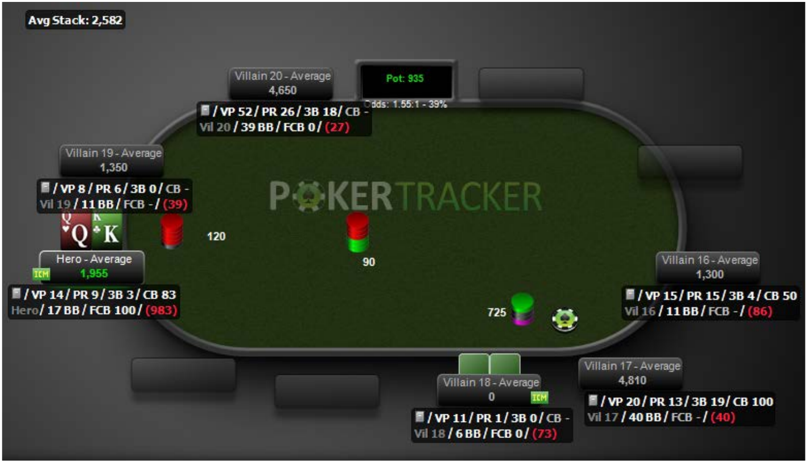
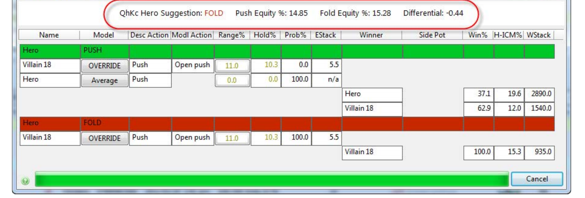

<!-- escape-math: v1 -->
# 分析技术

本章介绍如何借助 PokerTracker 4（PT4）这类牌局追踪与分析软件改进牌技。PokerTracker 自 2001 年起是在线扑克领域的主流分析追踪软件，从早期只支持限注德州扑克，扩展到 Omaha、无限注/底池限注德州扑克以及锦标赛。核心思想是：扑克是一系列离散**决策点**（decision point）的序列。软件的价值不在于替你做决定，而在于帮你找到那些“答案不清晰”的决策点，用数据建立对手模型，再把结论带回牌桌。本章源自 PokerTracker 母公司 Max Value Software 的 VIP 支持总监 Joel Freed 的客座讲座，全部示例基于 PT4。

## 决策点：分析的基本单位

**决策点**是一手牌中你可以采取行动的任何时刻——过牌（check）、下注（bet）、跟注（call）、加注（raise）或弃牌（fold）。打过一段时间牌之后，你会自然地记住相似的决策点：比如锦标赛中你是短筹码、前面全部弃牌轮到小盲位的你。下次再遇到同类局面时，你已经有了可以借鉴的历史。用软件分析这些决策点，是改进牌技最有效的途径之一。

什么样的决策点“有趣”？**当不同选项的期望值不清晰、彼此接近时**。你会看到电视上的选手长考数分钟，那正是有趣的决策点。新手阶段几乎每个决策点都“有趣”，直到你逐渐形成什么时候该跟、什么时候该弃的经验法则。不同水平的玩家会觉得不同的决策有趣。

### 一个泡沫期的决策点

考虑一场 50/30/20 奖金分配的单桌锦标赛（Single Table SnG）：买入 $10，第一名 $50、第二名 $30、第三名 $20。盲注 100/200，还剩四人。你在大盲位手持 A♣Q♣，筹码 1,430。截止位（cutoff）玩家全下 5,700，按钮位弃牌，小盲位跟注全下 2,980——两人已经全下。轮到你，底池共 4,810，需跟注 1,430。

先算**底池赔率**（pot odds）：跟注赔率约为 3.35:1，对应盈亏平衡胜率约 23%。如果这是现金局，只要对两手牌合计有 23% 的胜率就可以盈利跟注。但这是锦标赛，结论完全不同。

上图来自 PT4 的 ICM 测验（Tools → ICM → Quiz）。**独立筹码模型**（Independent Chip Model, ICM）把锦标赛筹码折算成奖池的真实货币权益：你的最后一颗筹码远比第一颗值钱，因为出局就一无所获。基于“平均水平玩家”模型：

- 跟注（全下）的奖池权益：**9.49%**；
- 弃牌的奖池权益：**18.67%**。

原因在于筹码 2,980 的玩家很可能被淘汰，届时你保底第三名。这是明确的弃牌——即便你手持 K♠K♥ 也一样。进一步把两名对手的范围（range）都设为 100%（即他们闭着眼睛用任意两张牌全下），弃牌权益仍有约 18.89%，跟注权益只有约 15.13%。尽管此时你能赢下约一半摊牌，依然是弃牌。锦标赛生存权的价值压倒了底池赔率。

## 哪些用法**不能**让你变强

软件里有很多东西可以看，但以下几种花时间的方式对改进决策毫无帮助。

- **盯着战绩图表**。一张从第 1 手打到第 26.5 万手、盈利约 €860,000 的资金曲线图很赏心悦目，但既然扑克是一系列决策点，请问：基于这张图你会改变哪个决策？答案是：一个都不会。它也许能帮你在波士顿买套房，但不能帮你打得更好。
- **分析“走过场”（walks）**。你在大盲位，所有人弃牌，你白捡小盲——这一手你根本没有行动机会，无法据此改进打法。
- **分析运气**。软件可以画出手牌运气分布：比如某位玩家手持口袋对子时翻牌击中暗三条（flopping a set）的频率高出均值一个标准差以上。这很棒，但过去的运气无法转化为未来的打法调整；同理，研究自己上周是否“更常被发到 AA”也毫无用处。
- **依赖不相关或样本不足的统计量**。

最后一点值得展开。PT4 有一千多个统计量，组合位置和筹码深度后数以千计，其中很多与当前局面无关，或样本太小。举例（真实现金局）：按钮位玩家手持 A♠T♥ 跟注对手 villain16 的翻前加注；翻牌 2♠4♠3♦，对手下注、他跟注；转牌 T♦，对手再下注、他再跟注。河牌 A♥，此时他拿到顶两对。对手下注 £1,550，底池 £1,975，跟注赔率 2.27:1，即领先概率不低于约 31% 即可跟注。

桌上 HUD（heads-up display，抬头显示）有 97 手该对手的数据（相当于现场约三小时、线上约一个半小时），VPIP 65、PFR 45，说明他又松又凶。河牌统计弹出窗口显示：他共有 8 次河牌下注机会、下注 3 次（38%）。但这个数字**完全无关**——因为“河牌下注”不关心他是以什么方式打到河牌的：一路跟注后对手过牌让他下注，也算；翻牌转牌都过牌、河牌下注，也算。而本局他是**持续下注**（continuation bet, cbet）：翻前最后加注，翻牌、转牌、河牌接连下注。统计窗口里“河牌 cbet”一栏的机会数是 **0/0**——一次样本都没有。用他的整体河牌下注频率推断本局牌力，是在错误的数据上做推理。正确的做法是结合牌面结构和他的翻前、翻牌数据推断什么牌会这样打到河牌。

## 正确的五步法

1. 用报告（report）和过滤器（filter）定位**非常具体**的某类决策点——找你拿不准答案的那些。
2. 对该局面中的玩家建立**心智模型**（mental model）：你认为他在这里会怎么打。即使决策点同类，对手类型、牌面结构（听牌成型、牌面对子等）也各不相同，需要具体判断，就像现场牌桌上揣测对手在想什么一样。
3. 用一切相关信息修正模型：相关统计量、笔记、乃至“他两手前输了个大底池正在上头（steaming）”、“他刚喝完第五杯啤酒说话含糊”这类现场信息。
4. 评估各决策选项的优劣：跟注能否获胜？弃牌后筹码还剩多少？对锦标赛其他人的排名有何影响？（锦标赛的翻前决策尤其受此类考量影响。）
5. 回到第 1 步，循环往复。每分析一类有趣的决策，你下次就能做得更好。

## 报告系统

PT4 中“报告”泛指任何数据展示方式，集中在 **View Stats** 页面（锦标赛选 T 标签），左侧边栏选择具体报告，分 Results、Statistics、My Reports、Graphs 四类。

- **Overview 报告**默认按锦标赛描述分组（By Description），可切换为按单场锦标赛（By Tournament）；Basic/Advanced 只区别统计列多少。**双击某行**可下钻：从 392 场锦标赛的双击进入单场列表，再双击单场进入逐手牌列表（默认最近 100 手，可调）。点击列头排序。
- **右键菜单**可增删统计列（Configure Report）、重放（replay）手牌、导出视频、添加笔记与标签；Ctrl/Shift+点击可多选，“Replay All Hands in Report” 可整场重放。
- **Summary 报告**支持多种分组，最常用的是按起手牌（Starting Hands Hold'em）与按位置（Position）。起手牌报告每行一种牌型：例如 AA 出现 131 次、VPIP 为 100%（如果不是 100%，请反思决策过程，AA 是德州扑克最强起手牌）。选中某行，下方列出对应手牌，可重放、可双击。位置报告每行一个位置，用来验证“我的大盲位是不是总被人欺负”之类的感觉——记忆常会骗人，数据不会。
- **Holdem Hand Range Visualizer（起手牌范围可视化）**以 13×13 起手牌矩阵展示范围。范围（range）是扑克核心概念：把所有底牌视为定义域，你的打法策略就是把定义域中的牌映射进范围的函数。选择统计量（如翻前三-bet，即有人加注后你再反加）后，矩阵有两种视图。**Range** 视图显示该动作中各起手牌出现的实际占比（如口袋对 T 占 2.244%，AK 占 4.28%）——即对手眼中你的范围长什么样。**Value** 视图显示拿到每种牌且有机会时你实际三-bet 的频率。

上图中，该玩家对 AKs/ATs/A9s 等同花 A 高牌每次都三-bet（100%），但各牌型实际占比不同，说明他被发到这些牌的次数不同。若你认为“KJo 不该反加”，而这里显示你 75% 的时候反加了，你立刻得到一个可执行的改进点。任何以百分比表达的统计量都可在此查看。

- **Facing Preflop Action（面对翻前行动）报告**按“轮到你首次行动前发生了什么”分组：无人入池（unopened pot，全部弃牌到你）、有一人跛入（limper，仅跟注大盲）等，每行显示手数、盈利率、VPIP、PFR。例如某（单挑）玩家无人入池时 10,434 手、VPIP 约 70%、PFR 约 60%；有一跛入者时 1,945 手、VPIP 骤降——因为单挑大盲位过牌不算主动投钱，且 VPIP 只统计翻前。锦标赛后期面对全下时的应对范围与偷盲（blind steal）范围差别巨大，这份报告正是用来校准这些场景的。

### 自定义报告（My Reports）

可自建三类报告：**Player Report**（以你打过的手牌为样本的聚合统计，如 VPIP）；**Hand Report**（每手牌一行，适合“所有面对河牌持续下注的手牌”这类清单）；**All Players Report**（数据库中每个玩家一行）。Player Report 支持许多独有分组，其中**翻前筹码深度（preflop stack size，以大盲计）**对锦标赛玩家价值极高：可以看到不同筹码深度下率先加注（RFI）频率如何变化。例如筹码不足 2 个大盲的 59 个样本中 RFI 为 47%。大盲数乘以 2/3 可粗略换算为 M 值。报告还可与过滤器绑定保存，下次直接从下拉框加载。

## 过滤器系统

边栏的 **More Filters** 是所有数据子集的入口，分五个区：

- **Game Details（赛事层面）**：日期、货币、速度（普通/turbo/hyper）、买入、描述、桌型人数、盲注级别等。
- **Hand Details（整手牌层面）**：翻前最大加注、是否出现三-bet、是否有跛入、底池大小、筹码深度、牌桌人数（泡沫期手牌可按人数过滤）、各玩家位置（谁率先加注、我坐哪）、手牌标签、输赢金额、是否打到摊牌等。
- **Hand Values（牌力）**：底牌、成牌强度、听牌强度。底牌选择器可直接点击矩阵选牌，也可用滑杆选“前 N% 的牌”——排序模型默认 **Sklansky–Karlson**（为解答一个具体数学问题而提出的手牌强度排序，课程后续会讲），也可换成“hand vs three randoms”（按对三个随机底牌的胜率排序，显著偏向高牌，KJo/QJo 会排在小口袋对之前），甚至自定义模型。Group Select 提供“任意 A”、“任意对子”、“取反”等快捷选择。成牌强度可指定在哪条街做成（如只在河牌成顺）、用了几张底牌、是否**坚果**（nut，不可能被更大的同类牌击败——如 A♠K♥ 在 Q♥J♦T♣ 牌面是坚果顺，而 9♠8♠ 在同牌面是非坚果顺）、是否**后门**（backdoor，翻牌无听牌、转河连发两张才成牌）。听牌强度可过滤翻/转牌的卡顺（4 张补牌，outs）或双头顺（8 张补牌）、补牌是否通向坚果顺、后门听牌等。
- **Board Texture（牌面结构）**：牌面是否含 A、转牌是否成对、翻牌是否同花色（monotone）、牌面连接性（T♠9♦8♣ 为强连接，T♠9♦7♣ 次之）等。
- **Actions & Opportunities（行动与机会）**：主动玩家的行动（下注及尺度、加注、面对的加注及尺度、跟注、弃牌）与机会（有机会三-bet、有机会面对全下等），可精确到“我率先加注 3 个大盲”或“对手开局加注 2–3 个大盲到我”，翻、转、河各街同理。

多个过滤器可用 **AND / OR**（OR 为相容或）分组，用 **NOT** 取反。例如“我做过 2–3 大盲率先加注”与“我面对 2–3 大盲开局加注”取 AND 将永远无数据，取 OR 则是两者的并集。复杂过滤器费时搭建，应**另存为快速过滤器（Quick Filter）**：命名保存后出现在边栏下拉框中，一键加载到任何报告。Edit Quick Filters 可重命名、删除、叠加多个快速过滤器，并支持导入导出以便团队共享。

## 统计量：定义与解读

绝大多数统计量回答同一个问题：**某人在有机会做某动作时，实际做了的频率**：

$$
\text{统计量} = \frac{\text{做出该动作的次数}}{\text{有机会做出该动作的次数}} \times 100\\%.
$$

典型例子：

- **VPIP**（voluntarily put money in pot）：翻前主动投钱入池的手牌占比。它刻画玩家卷入底池的程度，且收敛很快（几乎每手牌都有一次观察机会）。VPIP 40 的玩家打法风格大体相似，可据此快速归类对手。
- **Raise First In（RFI）**：前面全部弃牌时，首次行动即加注的频率。RFI 40% 意味着极高的偷取倾向。与 VPIP 联读更有信息量：VPIP 70、RFI 2 的玩家“只跟不加”——愿意投钱但不愿抬高价码。
- 高度特化的统计量，如 **Fold to Raise After Flop CBet in 3Bet+ Pot**：翻前你做了三-bet 以上的最后加注，翻牌持续下注被加注后你弃牌的频率。这类统计在现金局积累数千手后有用；锦标赛筹码太浅，几乎不会出现这种局面。
- 任何统计量的定义都可在 **Configure → Statistics** 窗口查到：可按锦标赛/现金、玩家/手牌筛选，支持搜索，并附详细文字描述与精确公式。例如“call preflop squeeze”——**挤压**（squeeze）指有人开局加注、另一人跟注后，第三人三-bet 两者，展现出极强牌力（《Harrington on Hold'em》推荐的打法）。你面对挤压并跟注即计入该统计。

### 查对手的数据

- **Results → Player Summary**：数据库中每个对手一行，含参赛场数、VPIP、PFR、三-bet 频率及三-bet 成功率（三-bet 后全员弃牌的比例——成功率高说明他可以肆无忌惮地三-bet 抢盲）。点击列头排序，找出最常交手的对手。
- **Hero vs Villain 报告**：只列你与某一对手之间输赢的手牌，按底池大小分档，选中即得二人全部交手记录。
- **Player 下拉框切换视角**：把任意对手载入后，PT4 全部报告、统计、过滤器都改以他的视角呈现。唯一限制：只有打到摊牌的手牌才能看到他的底牌。

## 实战分析示例：Fifty50 大盲位 K♣Q♥ 面对全下

把所有工具串起来。**Fifty50** 锦标赛：10 人参赛、前 5 名进入钱圈，入圈即返还买入（$10），另一半奖池按剩余筹码比例分配。我们要分析的局面：六人桌（恰在泡沫期，再淘汰一人比赛结束）、我在大盲位、手持 K♣Q♥ 不同花、面对翻前全下。

过滤路径：Game Details 选 Fifty50 → Hand Details 设置发牌人数 6–6 → Actions & Opportunities 翻前 Posted Big Blind → Hand Values 勾选 KQo → Actions & Opportunities 翻前 Opportunities 勾选 Faced All In。数据库中仅命中两手——感觉上“经常遇到”的局面，实际样本往往比想象少。回放第二手：

如上图：盲注 60/120、前注 15，前面全部弃牌，小盲位 Villain 18 全下 725。底池 935，我们需跟注 605，赔率 1.55:1（约 39%）。若跟注并淘汰他，比赛立即结束、我们锁定钱圈；若弃牌，他收下 210 筹码涨到 935，仍是短筹码。

\*\*第一步：建立基线模型。\*\* 在动用统计量之前，先问“一个完全陌生的玩家此时会用哪些牌全下”——基线不同，后续修正的含义完全不同（“比 100% 范围紧”和“比 10% 范围紧”是两回事）。职业选手的做法正是先建基线，再按个体特征调整。

\*\*第二步：用数据修正模型。\*\*

如上图，73 手样本中 Villain 18 的 VPIP 为 11%（约每 9 手玩 1 手）、PFR 为 1%——他在此之前总共只加注过\*\*一次\*\*。深入看小盲位与跟注数据：小盲位 VPIP 13%（8 手玩 1 手），从未在小盲位加注；各位置都倾向跟注（25 手跟注 4 次，cold call 2 次）；面对跛入者时 7 次只跟注 1 次，不攻击示弱者；两次面对偷盲加注均弃牌。样本不大，但画像已相当清晰。

\*\*第三步：推断他的全下范围。\*\* 两个互相拉扯的因素：锦标赛生命悬于一线（被跟注落败即空手出局）使他偏紧；但他是短筹码，\*\*M 值\*\*（筹码量与一圈盲注前注成本之比）仅约 2.7——纯弃牌撑不过三圈，必须尽快行动，这又使他偏松。逐类牌问自己：他会用小口袋对（如 2♠2♥）赌上锦标赛生命吗？会用弱 A（如 A♦4♣）吗？会用 KQ（与我们同牌）、KT 或 QJ 吗？若会，我们可能\*\*压制\*\*（dominating）他，即共享一张高牌且另一张更大，约有 70/30 的优势。

把百分比翻译成具体范围需要借助工具：PT4 的 Equity Calculator 提供 Hand Range Selector 滑杆，按所选模型把“前 N% 的牌”展开成矩阵，也可计算牌对牌、牌对范围、范围对范围的胜率。以其 VPIP 11% 为起点（假设“他玩过的牌现在都会玩”），Sklansky–Karlson 模型下前 11% 的范围为 44+、A8s+、KQs、ATo+：

即不含 22/33、不含任何弱 A（连 A9 都只是中等 A）、不含弱同花 A——相当强的范围。

\*\*第四步：ICM 裁决。\*\* PT4 回放器内置 ICM 计算器，点击绿色 ICM 框即可看到当前局面的奖池权益分析。默认 Average 模型（基于大量数据分析构建）认为，M≈2.7、前面全弃时，小盲位“平均玩家”会用约 \*\*33.9%\*\* 的范围全下（弱到 Q8s、K2s、K6o、任意对子、任意 A）。在此默认范围下：全下权益 15.83%，弃牌权益 15.28%——\*\*跟注\*\*。但两者仅差 0.55 个百分点（$10 锦标赛里约 $0.60 的期望差）。差距虽小，扑克的优势正是由一个个边际决策累积而成。

但我们已经推断这位玩家远紧于平均。把 Include 滑杆从 33.9% 拖到 11%：

结论翻转为\*\*弃牌\*\*。继续滑动还能找到\*\*盈亏平衡范围\*\*：若我们把底牌亮开、让他打完美扑克，他的最优全下范围约为 24%——任意 A、任意对子、K9s+、QTs+、KTo+。认为他推得比这窄，弃牌；推得比这宽，跟注。至此我们为“Fifty50 泡沫期大盲位面对短筹码全下”建立了一个可复用的决策基准。

\*\*结局与模型修正。\*\* 实际比赛中 Hero 用 K♣Q♥ 跟注了（人总在第一次遇到局面时犯错）。翻牌 9♠K♦2♦ 击中顶对，转牌 7♥ 安全，河牌 4♦。牌面出现三张方块：此时若对手手持两张方块即成同花，A♦K 也赢我们，QQ/KK/AA 亦然。对手亮出 A♥5♦：不是 AK，也只有一张方块、没有同花——Hero 的一对 K 赢下 1,540 的底池。但注意 A5o \*\*不在\*\*我们给他设定的 11% 范围内——模型被证伪了。而这正是流程的一部分：下次分析“超紧玩家的超短筹码全下”时，把范围放宽几个百分点，模型就进化了一次。

## 要点小结

- 扑克是一系列离散决策点；“有趣”的决策点是各选项期望值接近、你不确定答案的那些——分析它们才能进步。
- 锦标赛中 ICM 把筹码折算成奖池货币权益，生存权价值可使 A♣Q♣（甚至 KK）在泡沫期面对全下成为明确弃牌，底池赔率让位于 ICM。
- 看资金曲线、分析走过场、分析运气、引用不相关或样本不足的统计量，都无法改进决策；统计量必须与局面匹配（如整体河牌下注频率 ≠ 河牌持续下注频率）。
- 分析五步法：过滤器定位决策点 → 建立对手心智模型 → 用统计与信息修正 → 评估选项 → 循环。
- 统计量的统一形式为“次数/机会×100%”；VPIP 与 RFI 联读可快速勾勒对手类型；定义以 Configure → Statistics 为准。
- 复杂过滤器应存为快速过滤器复用；范围可视化区分 Range（实际构成）与 Value（各牌频率）两个视角。
- 实战流程示范：基线模型 → 数据修正（73 手、VPIP 11、PFR 1）→ 范围推断（11%）→ ICM 裁决（默认 33.9% 范围是跟注，修正后 11% 范围是弃牌，盈亏平衡约 24%）→ 结果被证伪后修正模型。
