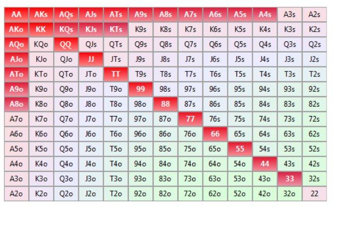
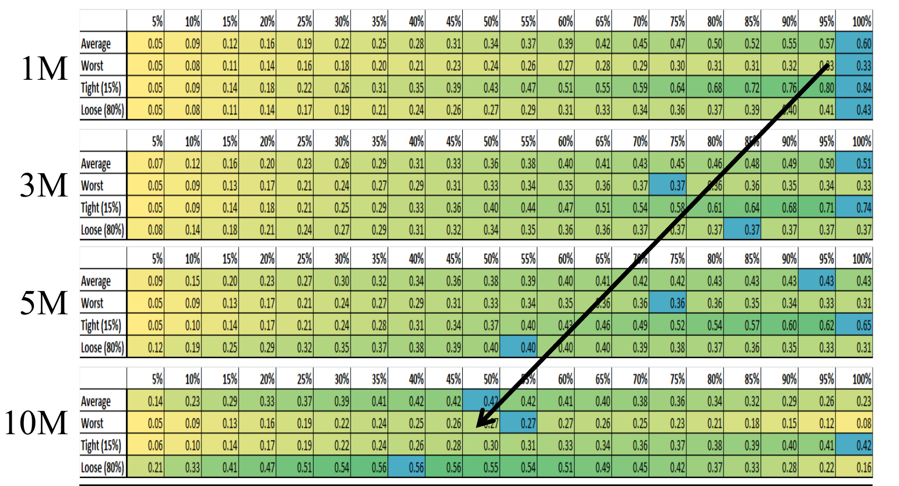
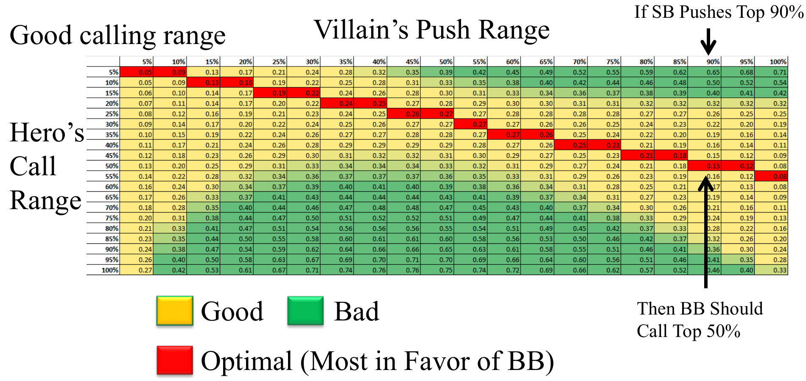

# L4 翻牌前分析

翻牌前（pre-flop）是锦标赛中最值得精确求解的决策点：变量少、可以算得很干净，而大多数现场玩家在这里错得离谱。本讲从一手看似该弃牌的烂牌出发，建立范围（range）的语言，再系统推导单挑和多人局面下 M ≤ 10 时的全下/弃牌（push/fold）法则。

## 动机：为什么用一整讲讲翻牌前

- 在锦标赛中，你的大部分价值来自翻牌前接近最优的打法；
- 大多数现场玩家的翻牌前决策偏差极大——他们害怕被一手差牌淘汰，或害怕亮出差牌，而翻牌前的打法本身就很反直觉；
- 翻牌前容易求解：变量少、假设少，可以逼近纳什均衡（Nash equilibrium）；翻牌后则变量太多，只能靠模式匹配。

## 场景 A：9♠6♥ 该不该全下

无限注德州扑克锦标赛，盲注 125/250，前注（ante）25。大盲位（BB）玩家 trifluvian 剩 1100（M = 2.59），我们在按钮位/小盲位（BTN/SB）有 3400（M = 8）。注意单挑规则的小变化：按钮位同时是小盲，翻牌前第一个行动、之后每轮最后行动。底池已有 425，我们手持 9♠6♥，怎么办？

翻牌前的全下本质上是半诈唬（semi-bluff）：即便被跟注，我们的胜率几乎不会低于 30%。使用半诈唬 EV 公式：

$$EV = Pot \times Fold\% + (1-Fold\%) \times (Win\% \times WinAmt - Lose\% \times LoseAmt)$$

假设对手的跟注范围为 22+、A2+、JT+（占全部起手牌的 27.60%，这是相当宽的跟注范围）。用 PokerTracker 的胜率计算器计算 96o 对该范围的胜率：我们不必知道对手具体拿什么牌，只需知道"他若跟注，就等概率持有范围内的任意一手"，于是 96o 对范围 {22+, A2+, JT+} 的胜率为 **34.26%**——被跟注时我们是约 35-65 的劣势方。

输赢金额（注意 BB 已投入的盲注和前注不计入）：

$$WinAmt = 4500 - (3400 - (125+25)) = 1250$$
$$LoseAmt = 1100 - (125+25) = 950$$

代入：弃牌的 EV 为 0，而全下的 EV 为

$$EV_{push} = (1-27.6\%) \times 425 + 27.6\% \times [34.26\% \times 1250 - 65.74\% \times 950] = 307.7 - 54.2 = \mathbf{253.5}$$

在这个看似边缘的局面里，全下平均能赚 253.5 个筹码——而赢下整个锦标赛也只需要 1000 筹码。反过来说，弃牌等于白送对手约 250 筹码。

### 一般化：结论不依赖于跟注范围的假设

上面的计算假设了对手的跟注范围。把跟注比例 $F\%$ 作为变量（胜率 $W\%$ 随 $F\%$ 变化：对手跟得越紧，被跟注时我们越被压制）：

$$EV_{push} = (1-F\%) \times 425 + F\% \times [W\% \times 1250 - (1-W\%) \times 950]$$

如上图，总权益（Total Equity）= 弃牌权益（Fold Equity，随对手跟注率线性下降）+ 摊牌权益（SD Equity，几乎全程为负，仅当对手跟注极宽时才略高于零）。关键观察：**整条曲线上 EV 都是正的**——无论对手用什么跟注策略，这里都应该全下。对手 100% 弃牌时 EV 趋于底池 425；对手跟注增多时 EV 下降但仍为正，全程平均约 175 筹码。

弃牌的代价有多糟？弃掉这手牌约损失 175 筹码的 EV，这比拿 3♣4♦ 去跟注 A♠K♠ 的全下还要糟：

$$1250 \times 35.42\% - 950 \times 64.58\% = -171$$

### 反直觉性与本章目标

推/弃决策很不直观：弃牌权益与摊牌权益随各变量同时变化、方向诡异，无法靠直觉判断。影响决策的变量有：我们的牌、我们的位置、我们的筹码量、对手的跟注范围。我们的目标是得出对"所有跟注范围"或"任意两张牌"都成立的速用规则，最终能画出"绿色区域全下、黄色区域弃牌"式的决策图。

## 范围的定义

**范围（range）是一手牌的集合。** 同花性用牌旁的 o（offsuit，不同花）或 s（suited，同花）表示。

范围的记法用系列中最低（或最高）的牌表示：

- AA KK QQ 写作 **QQ+**；
- AA KK AK AQ KQ 写作 **KK+, AQ+, KQ+**；
- 较少见地，用 "-" 表示系列中最好的牌：55 44 33 22 54 53 52 43 42 可写作 55-, 54-, 43-。

范围有两个用途：

- **分析对手**：估计对手持牌分布后计算我们的胜率，例如拿着 AT，对 ATC（any two cards，任意两张牌）有 63% 的胜率；
- **决定我们的打法**：制定基于范围的规则，例如"用 AT+、88+ 全下，其余弃牌"。

### Sklansky-Karlson 排名

最常用的起手牌百分位排名是 Sklansky-Karlson 排名，依据的是两人对局中翻牌前领先的可能性。排名前 10 的手牌依次是：AA, KK, AKs, QQ, AKo, JJ, AQs, TT, AQo, 99。

David Sklansky 是著名扑克理论家，三条 WSOP 金手链、一个 WPT 冠军得主，就读于沃顿商学院，在 TwoPlusTwo 出版社出版了 13 本著作。他提出的**扑克基本定理（Fundamental Theorem of Poker）**是：

> 每当你的打法不同于"看得到对手所有牌时的打法"，对手就获益；每当你的打法与之一致，对手就受损。

Sklansky-Karlson 排名来自 Sklansky 2003 年 10 月 4 日发表的"重要无限注数学问题"：盲注 1/2，你在小盲位拿到 A8o，只剩两个选择——弃牌，或者**亮开手牌全下**（对手看到你的 A8o 后再决定）。当筹码不超过多少 x 时，亮牌全下仍是 +EV？Sklansky 给出的答案约为 x ~ 70。

推导：假设大盲仅在胜率 ≥ 50% 时跟注（忽略底池赔率的细微影响——它只轻微改变 x，不影响手牌排序）。则大盲的跟注范围是 A8+、22+（占 13.12%），A8o 对该范围的胜率为 33%。令 EV 为零求临界点：

$$EV = 87\% \times 3 + 13\% \times [33\% \times x - 67\% \times (x-1)] = 0 \Rightarrow x \approx 62$$

即筹码不超过 62 时，亮牌全下 A8o 是 +EV 的。每手牌的 x 值取决于两个因素：**你略优于多少手牌**（决定弃牌权益）和**落后时的获胜概率**（决定被跟注后的摊牌权益）。Victor Chubukov（Karlson）在同年 10 月 24 日对全部手牌求解：AA 的 x = ∞（任意多筹码亮牌全下都不亏），KK 的 x = 1290（可用 $0 = 0.9955 \times 3 + 0.0045 \times (0.1805x - 0.8195(x-1))$ 验证，在 x ≈ 1040 处约为零）；一路算到 32o 的 x ≈ 1.8。另一种排序方式是按"对三个随机手牌的胜率"排名，可能更适用于多人底池，但本课程主要假设只有一个跟注者，故采用 Sklansky-Karlson 排名。

百分位与范围的对应：前 1% 是 AA；前 5% 是 TT+、AQs+、AQo+；前 30% 是 22+、A2s+、K4s+、Q9s+、JTs、A2o+、K8o+、QJo。

值得背诵的简化范围：

| 百分位 | 范围 | 记忆法 |
|---|---|---|
| 5% | TT+, AQ+ | 优质牌 |
| 10% | 55+, AT+ | AT 起步 |
| 20% | 22+, A2+, KQ | A2 或口袋对 |
| 30% | 22+, A2+, Broadway | 任意两张大牌（10 及以上） |
| 50% | 口袋对 + 点数相加为 16 的牌 | 网格对角线 |
| 100% | 任意两张牌 | 整个网格 |

### +EV 范围与最优范围

对一个决策而言，**+EV 范围**指该决策平均而言有利可图的范围；**最优范围（optimal range）**指以筹码计最赚钱的手牌集合。例子：对抗 AQ，用 55+、AT+ 跟注有 53% 的胜率，是盈利的，但不是最优——因为其中的 AT 和 AJ 输给 AQ。最优范围是 22+、AQ+，胜率达 60%。若一个范围是最优的，则该范围内每一手牌单独都是 +EV 的。这正是我们用"解出范围"来证明"范围内任意手牌都适用该规则"的原因。

## 基本假设

- 我们的有效筹码 M < 10（M 为筹码量除以一个完整盲注圈的成本）；
- 对手的跟注范围是某个"前 x%"的手牌，且所有人对手牌强弱排序基本一致；
- 不考虑 ICM（独立筹码模型），只最大化筹码期望值（cEV）；
- M < 10 时基本只有全下或弃牌两种选择。**为什么不加注？** 若加注 3BB（约 2M），对手再加注到 6M 时你的底池赔率（pot odds）是 8/20 = 40%，你还能以很小的代价弃掉 99-、A5-、K9- 这类边缘牌；但如果加注后剩余不足 4M，底池赔率变为 4/12 = 30%，基本永远该跟注——弃牌权益没了。所以 M < 10 时最大化弃牌权益最重要，直接全下。

## 单挑（Heads Up）

**目标**：推导盲注对盲注、M ≤ 10 时最优的推/跟范围。方法论分五步：

1. 建立范围对范围的胜率表；
2. 推导估计范围胜率的两因子模型；
3. 建立半诈唬的 EV 模型；
4. 对每个 M 求纳什均衡（若存在）；
5. 对不稳定的均衡，找出合理的范围。

### 第一步：范围对范围胜率

在 PokerTracker 中固定我们的范围，对对手的每个跟注范围计算胜率。例如我们推前 50%：对手跟 50% 时胜率 50%（对称），对手跟 100% 时我们约有 60%，对手只跟 AA 时只有约 17%。把每条"我们推 X% vs 对手跟 Y%"的曲线拟合成函数：Y ≥ 10% 时呈对数关系（$r^2$ 达 0.99、0.98）；但对手范围收紧到 5% 时 $r^2$ 降到 0.95，3% 时 0.89，1% 时完全失效——因为前 1% 只有 AA、KK、AK 三手牌，对手是否跟 AK 会让胜率断崖式跳变。反过来看（固定对手范围、变动我们的推注范围）规律相同：若对手跟前 50%，我们推前 30% 时有 55% 胜率。整表中的典型数值：我们推前 50% vs 对手跟前 20% → 赢 40%；推 100% vs 跟 30% → 赢 39%；推 5% vs 跟任何牌 → 赢 73%。

### 第二步：两因子对数模型

对整表做对数变量的多元回归，得到：

$$HeroWin\% = 50\% + 0.085 \times \ln(VillainRange) - 0.085 \times \ln(HeroRange) + \varepsilon$$

$R^2 = 0.98$（81 个观测，标准误 0.01）。截距 50% 与两系数绝对值相同（对称性）很耐人寻味，直觉上也合理：对手跟注范围越宽，他持有的弱牌越多，我们胜率越高；我们推注范围越宽，我们自身弱牌越多，胜率越低。误差集中在小于 5% 的极紧范围，其余地方可接受——而 M < 10 时没人只用 5% 的范围行动，可以忽略。

### 第三步：半诈唬 EV 模型（以 M 为单位）

令大小盲之和为 1（即所有 EV 以 M 计），则：

$$EV = FoldEquity + ShowdownValue$$
$$FoldEquity = 1 \times (1 - VillainCall\%)$$
$$ShowdownValue = VillainCall\% \times [SDWinAmt \times HeroWin\% - SDLoseAmt \times HeroLose\%]$$
$$SDWinAmt = Stack + \tfrac{2}{3}, \quad SDLoseAmt = Stack$$

（+2/3 来自赢下一个大盲；筹码记作支付盲注前还是后会带来 ±1/3 的细微差别，影响不大。）把第二步的胜率模型代入，就得到只含三个变量——对手跟注率、我们推注率、筹码量——的大方程：

$$EV = (1 - VillainCall\%) + VillainCall\% \times \left[\left(Stack + \tfrac{2}{3}\right) \times HeroWin\% - Stack \times HeroLose\%\right]$$

### 第四步：纳什均衡

对 M = 20 的 EV 网格，小盲（SB）想最大化 EV、大盲（BB）想最小化 EV，此时 SB 平均每手亏 0.49M。把每个 M 的 EV 网格画出来（绿色利于 SB，黄色中性，红色利于 BB）：

- **M = 1**：SB 推 100%、BB 跟 100% 是纳什均衡——双方都动弹不得，这很符合直觉；
- **M = 2**：推 100%/跟 100% 仍是均衡（偏移的代价只有约 0.01M）；
- **M = 3**：出现**不稳定的纳什均衡**——若 SB 推 80%，BB 该跟 100%；若 BB 跟 100%，SB 该推 65%……如石头剪刀布般循环。

所以网上查到的"翻牌前纳什均衡表"大多不可靠：稳定均衡只在 M ≤ 2 成立，而那时本来就该推得极宽。对 M > 2 需要另找规律。

### SB 推注的经验法则

对每个 M 和每个候选推注范围，在四种情景下分别取最大 EV 的列：平均情形（对对手跟注范围无信息）、最坏情形（对手最优响应）、紧手对手（假设 15% 跟注范围，如 33+、A4+、KT+）、松手对手（假设 80% 跟注范围，如 22+、T2+、93+ 等）。

- 若读对手为紧手，**推 100% 永远最优**——他 85% 的时候直接弃牌，弃牌权益碾压一切；
- 其他情景下，M = 1 时推 100% 最优，随 M 增大缓慢漂移，M = 10 时约为推 50%；
- 最大的错误是推注频率低于 50% 的手牌。

单挑推注的速查表（对手不紧时）：

| 筹码 | 推注范围 |
|---|---|
| 1M | 前 100% |
| 5M | 前 75% |
| 10M | 前 50% |

### BB 跟注的经验法则

M < 10 时 SB 因弃牌权益总有优势，BB 的目标是用尽可能少的假设找到一条实用的跟注规则：对每一个 M，在"对手推注范围 × 我们跟注范围"的 EV 网格上标出对 BB 最有利的区域，发现**最优跟注范围是 SB 推注范围的一个固定比例**。

| 筹码 (M) | 跟注倍数 | 最优 BB 跟注率 = SB 推注率 × 倍数 |
|---|---|---|
| 1 | 10× | 他推 5% 你跟 50%；推 ≥ 20% 你全跟 |
| 2 | 2× | 他推 ≥ 50% 你全跟；推 20% 你跟 40% |
| 4 | 1× | 推多少跟多少 |
| 6 | 2/3× | |
| 9 | 1/2× | 他推 90% 你跟 50% |

单挑时（包括满员桌弃牌到小盲后形成的"事实单挑"），只要默记 M = 1–2 时几乎全跟、M = 4 时等比例跟、M = 6–9 时跟对手推注率的一半到三分之二，就能根据读到的对手推注频率持续压制他。

## 其他位置

### 面对全下的跟注

多人桌的复杂之处是身后还有未行动的玩家，需要保守假设（宁可错杀小的正期望，也不错跟小的负期望）：

- 摊牌赢额 = 筹码量（不因 SB/BB 位置打折）；
- 第二个跟注者的范围是 TT+、AQ+（前 5%）；
- 若被两家跟注，我们的胜率按 0% 计（几乎必然被压制）。

因此最低胜率要求 = 50% + 5% × 身后剩余玩家数，并由此推出我们的跟注范围应为对手推注范围的一个倍数（HRM）：

| 剩余玩家 | 最低胜率 | 范围倍数 HRM |
|---|---|---|
| 5 | 75% | 5% |
| 4 | 70% | 10% |
| 3 | 65% | 20% |
| 2 | 60% | 30% |
| 1 | 55% | 55% |
| 0 | 50% | 100% |

示例：对手从 CO 位全下前 50%，我们在 BTN 位（身后剩 2 人），需要 60% 胜率；应跟 50% × 30% = 前 15%，用两因子模型验证：$Win\% = 50\% + 0.085\ln(50\%) - 0.085\ln(15\%) = 60.2\%$ ✓

各位置的跟注经验法则（保守估计，因此压线跟注往往非常 +EV；且高度依赖对对手推注范围的阅读）：

| 位置 | 我们的跟注范围 |
|---|---|
| MP | 5% × 对手范围 |
| LP | 10% × 对手范围 |
| CO | 30% × 对手范围 |
| SB | 50% × 对手范围 |

实战中在 CO 位面对全下，只需自问"他的推注范围有我手牌的 3 倍宽吗"：拿 AQ（前 5%），他会推 A5（前 15%）吗？拿 AT（前 10%），他会推 KJ（前 30%）吗？拿 KQ（前 20%），他会推 85（前 60%）吗？

### 主动全下

精确解析解很复杂，目标是在保守假设下做决策表：

- 摊牌赢额 = 筹码量；
- 第一个跟注者范围 55+、AT+（前 10%）；
- 第二个跟注者范围 TT+、AQ+（前 5%）；
- 被两家跟注时胜率按 20% 计；
- 第三家跟注概率按 0% 计（永远不会被三家跟）。

回答两个问题：何时可以盈利地推 Broadway（前 30%）？何时可以盈利地推任意两张牌（前 100%）？结论（保守、非最优但足够好）：

- **AT+、55+（前 10%）**：任何位置、筹码直到 10M 都可盈利全下；
- **Broadway（前 30%）**：1M 时任何位置、6M 时后位（late position）、10M 时 CO 位；
- **任意两张牌（前 100%）**：1M 时后位、4M 时按钮位、10M 时小盲位。

简化决策表：

| 筹码 | 推 ATC 的位置 | 推 Broadway 的位置 | 推 AT+, 55+ |
|---|---|---|---|
| 1M | 后位 | 任何位置 | 任何位置 |
| 5M | 按钮位 | 后位 | 任何位置 |
| 10M | 小盲位 | CO 位 | 任何位置 |

即：M < 10 时永远可以推前 10%；M < 1 时从任何位置推得极宽；M < 5 时后位推 Broadway。

## 要点小结

- 翻牌前全下是半诈唬：EV = 弃牌权益 + 摊牌权益；短筹码单挑时该值几乎恒为正，弃掉"烂牌"可能比用 3♣4♦ 跟 A♠K♠ 全下还亏。
- 范围是一组手牌；用 Sklansky-Karlson 排名把范围映射到百分位，背下 5% / 10% / 20% / 30% / 50% 五档简化范围。最优范围内的每一手牌都 +EV。
- M < 10 时假设对手跟注"前 x%"的手牌、忽略 ICM、只做推/弃两选一；加注会损失弃牌权益，不如直接全下。
- 范围对范围胜率可用两因子对数模型估计：$Win\% = 50\% + 0.085\ln(V\%) - 0.085\ln(H\%)$，$R^2 = 0.98$，仅在 < 5% 的极紧范围失效。
- 单挑推注：对手紧则推 100%；否则 M = 1 推 100%，漂移到 M = 10 推 50%；推注频率低于 50% 是最大的错误。
- 单挑跟注：BB 最优跟注率 = SB 推注率 × 倍数（M=1 为 10×、M=2 为 2×、M=4 为 1×、M=6 为 2/3×、M=9 为 1/2×）。
- 多人桌跟注：最低胜率 = 50% + 5% × 剩余玩家数，跟注范围 = 对手推注范围 × 位置倍数（MP 5%、LP 10%、CO 30%、SB 50%）——核心一问："他的推注范围比我的牌宽 3 倍吗？"
- 多人桌全下：前 10%（AT+、55+）任何位置推到 10M；Broadway 在 1M 任意位置 / 6M 后位 / 10M CO 位；任意两张牌在 1M 后位 / 4M 按钮位 / 10M 小盲位。
