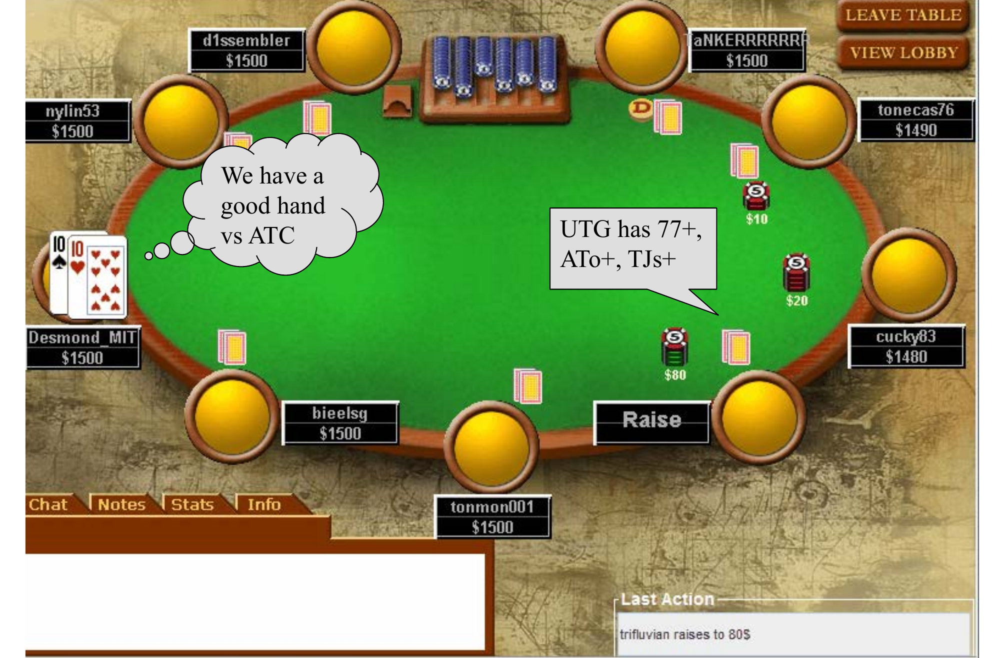
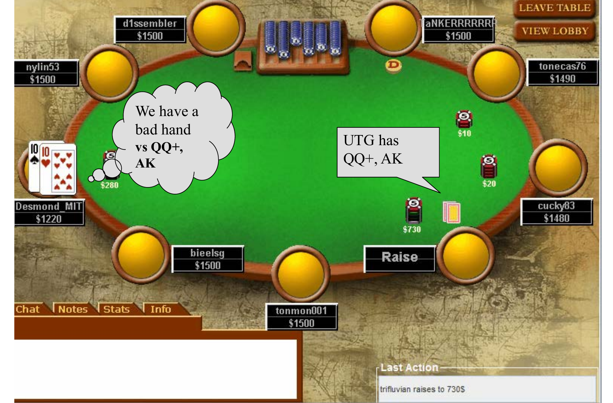
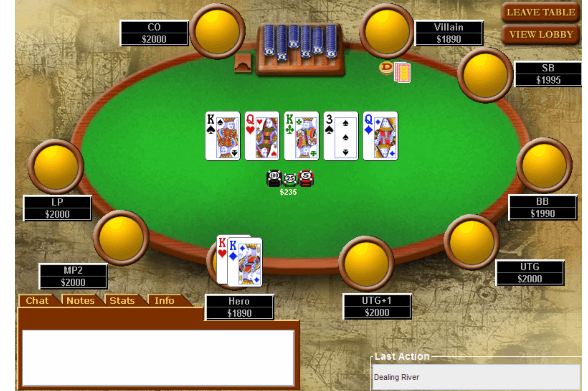

# L5 锦标赛打法

本章把扑克当作一项投资来讨论：假设你已经是一名盈利玩家，如何在锦标赛（tournament）这种与现金局（cash game）截然不同的结构中兑现你的优势，并管理好你的资金。

## 现金局与锦标赛

锦标赛是你用买入费换取比赛筹码、只有比对手活得更久才能拿到奖金的结构——最终拿到所有筹码的人赢得一份固定的奖池份额，而不是等价于筹码的现金。现金局中每个筹码都有确定的货币价值，你可以随时进出。两者的对比如下：

| 现金局 | 锦标赛 |
| --- | --- |
| 筹码 = 赢利（winnings） | 名次 = 赢利 |
| 筹码期望（chip EV, cEV）= 金钱期望（$EV） | cEV ≈ $EV（方向一致但不严格相等） |
| 随时来去 | 被锁定在锦标赛结构里 |
| 无限次买入 | 一次固定买入 |
| 盲注固定 | 盲注级别不断上涨 |
| 可以选桌（table selection） | 只能选玩家池（player pool selection） |
| 流动性更高 | 附带成本（overhead）更高 |
| 方差更低 | 方差更高 |
| 文献丰富 | 文献很少 |

几点值得展开。cEV 与 $EV 在锦标赛中大体同向，但某些场合正 cEV 的决策可能是负 $EV 的（见后文 ICM）。现金局里你被淘汰可以立刻重新买入，"就像没发生过"；锦标赛第一手出局则没有重来机会。现金局你可以直接观察同桌八九个人再决定入座；锦标赛只能选定一个"参赛人群"——你可能报名一场 90 条鱼 10 个职业的比赛，却被分到全是职业的桌子。现金局流动性强、随时能兑现时薪，是最好的职业选择；但中高级别现金局很难赢——输家会很快察觉并退出，而锦标赛里一些大牌职业可能已经是输家了，只是还不知道，因为大赛事的"长期"可能要好几年才能显现。

**为什么打锦标赛**：更难精通、文献少所以优势空间更大；更受公众关注；成绩是永久的（track record）；能以高 stakes 对抗习惯低 stakes 的对手；投资回报率（ROI）通常更高。

**为什么不打锦标赛**：更难精通；打得差也不易察觉，长期结果来得极慢；方差更大；单场耗时很长；需要高 stakes 才有时薪可言；有发牌员小费、差旅住宿等附带成本；需要更多规划与研究。

## 锦标赛生命周期

锦标赛最重要的概念是**节奏（tempo）**。生命周期分三段：早期阶段（early game）、泡沫期与刚入圈阶段（bubble and early cashes）、后期/决赛桌（late game / final table）。早期会淘汰约 90% 的选手，约占比赛时间的一半。

### 早期阶段

早期打法与现金局非常相似：此时 cEV ≈ $EV——当你有 1000 筹码、夺冠需要 100000 时，50 筹码的得失对奖金期望几乎没有影响。你的打法完全由筹码量决定；早期还有额外价值：建立对对手的阅读（reads）和自己的牌桌形象（image）。

按 M（筹码量与一圈盲注及前注成本之比，即 Harrington 的 M）划分筹码区：

| 筹码区 | 名称 |
| --- | --- |
| $M < 2$ | 死亡区（Dead Zone） |
| $2 < M < 8$ | 偷盲期（Steal Period） |
| $8 < M < 12$ | 偷盲/反偷期（Steal/Re-steal Period） |
| $12 < M < 30$ | 价值下注区（Value Betting Zone） |
| $M > 30$ | 暗三条挖矿区（Set Mining Zone） |

**关于节奏**：锦标赛与现金局最大的区别是攻击性（aggression）的拿捏。Doyle Brunson 说过"永远别在锦标赛里超速"——不要在筹码很深时过度激进。想夺冠你迟早得赢下几次 coin flip（胜率接近五五开的对决），这不可避免；你的目标是在不摊牌的情况下慢慢积累筹码、避免主动进入五五开，让真正的对决来临时你有更多筹码。这些微小差别在整场比赛中被不断复利，把你夺冠的概率从 1% 提升到 3%–4%——优势就是这样兑现的。

### M < 2：死亡区

落入此区只应该是因为你刚输掉一手牌、而输之前筹码只比对手略多。在这里你几乎没有弃牌赢率（fold equity，对手弃牌带给你的那部分期望）——大盲有赔率跟注你的任何全下，甚至会不看牌就跟。你的全部目标是攒够筹码重获弃牌赢率。**任何情况下都不要跌破 M = 1**：哪怕随后翻倍，你仍在死亡区，等于至少落后一次必须赢下的对决。宁可拿任意两张牌全下，也不要跌破 M = 1。

### 2 < M < 8：偷盲期

此时你唯一的动作是全下或弃牌（push or fold）。每偷到一次盲注，你的筹码量就增加约 10%–40%——除非你真有 AA，这比靠好牌在摊牌赢得的边际优势更有价值。具体做法：

- 找出不保卫盲注的玩家专偷他们——你在早期就该读人，这些"软柿子"是你最好的朋友；
- 对外装成会保卫盲注的人（比如口头宣称会反击），但别真这么做——如果大家都弃牌轮到你大盲，你白赚近 1 个 M；
- 尽量避免摊牌：除非认为自己是约 70% 的热门，否则不要跟注全下。

这背后是 Sklansky 的**缺口理论（Gap Theory）**：跟注全下需要的牌力远强于主动全下。因为主动下注时你拥有弃牌赢率带来的全部权益，跟注时则没有——很多场合你可以用任意两张牌全下，却只有好牌才能跟注。本阶段的目标是保持 $M \geq 2$，并通过翻倍或连续偷盲（连偷三手大约能从 8M 升到 11M）进入下一个区。

### 8 < M < 12：偷盲/反偷期

到了这里，面对加注你可以选择弃牌，这在更深的死亡区做不到。原因：标准偷盲加注是 3BB（约 2M）；对手再加注全下时你还要补约 6M，底池赔率要求 $\frac{6}{6+11} \approx \frac{6}{17} = 35\%$ 的胜率——不足以支持用任意两张牌（ATC, any two cards）跟注。对手的再加注不再是"必须跟"，你重新获得了弃牌的选择权。偷盲（steal）是主动抢盲注；反偷（re-steal）是识别出某人在偷盲后对他再加注反击，也包括自己不在盲注位时对偷盲者加注。

### 12 < M < 30：价值下注区

在这个区你真的会看到翻牌（课件该节标题写作 $15 < M < 30$）。你的起手牌价值开始取决于它击中翻牌的能力，打法接近现金局。准则：

- 翻牌前不要平跟（flat call）入局，自己加注进来，单挑时在翻牌持续下注（c-bet）；
- 在互不关联（uncorrelated）的牌面上，拿暗三条（set）打光筹码是可以接受的；
- 不要用小的两对、顶对顶踢（TPTK）打光，也不要在明显有同花/顺子可能的牌面上用暗三条打光。

### M > 30：暗三条挖矿区

**暗三条挖矿（set mining）**指翻牌前用口袋对子便宜地平跟，希望翻牌击中隐蔽的暗三条。总则：

- 耐心等待怪兽牌，做成后猛烈地价值下注；
- 在一手被加注又再加注的牌里，数一数有多少手牌能赢你——如果你的牌不是绝对最大的可能牌型，不要为 50M 打光；
- 便宜地看翻牌，用底池赔率（pot odds）评估追坚果牌（nut）的听牌，隐含赔率（implied odds）要保守估计；
- 如果你管不住自己的手，在攒到 30M 之前连 JJ 及以下的对子都直接弃掉。

## 翻牌后打法（Flop, Turn, River Play）

以下建议适用于中等筹码（$M > 10$）。基本思路是给出每个阶段各类牌力的价值，并推荐激进下注：翻牌前标准加注为 3BB，每个已平跟者再加 1BB；翻牌后各条街下注约 2/3 底池，以遏制听牌。$M < 10$ 属于翻牌前打法（后续讲座），$M > 30$ 则建议非常保守。

### 思维层级（Levels of Thinking）

- **L0** — 不读牌/对牌力无所谓；
- **L1** — "我有什么牌？"（读自己的牌，hand reading）；
- **L2** — "他有什么牌？"（读对手，opponent reading）；
- **L3** — "他认为我有什么牌？"（表象/扮演，representation）；
- **L4** — "他认为他在扮演什么牌？"；
- **L5** — 以此类推……

**你的目标是恰好比对手高一个层级**，而不是越高越好。

课件用一手在线牌局演示了这个推理过程（下注单位为美元）：Hero（Desmond_MIT）手持 T♠T♥。第一层思考是"我们对任意两张牌（ATC）都有一手好牌"；加入读人后，率先加注的 UTG 被放在 77+、ATo+、TJs+ 的范围上。

随后 MP1 做出再加注，其范围被读为 TT+、AQo+、AJs+；UTG 面对再加注又做出第四次加注——此时他的范围被压缩到 QQ+、AK，TT 从"好牌"变成了"坏牌"。

这就是 Phil Gordon 在《小绿书》（*Phil Gordon's Little Green Book*）里的名言：**"第四次加注意味着 AA"（The Fourth Raise Means Aces）**。

**层级错配（mismatched levels）**是常见的输钱方式：当对手根本不在读你（不到 L2）时，你在 L3 思考"我在扮演什么牌"就是浪费——对阵 L1 玩家，Phil Ivey 也没有优势，因为所有"扮演"都对牛弹琴。示例：盲注 25/50，Villain（后位）与 Hero（按钮位）各有 $2000。

- 翻牌前（底池 $75）：Hero 持 K♣J♣，Villain 平跟 $50，Hero 加注到 $250，Villain 跟注；
- 翻牌 7♣T♣3♣（底池 $575，两人）：Villain 下注 $200，Hero 加注到 $600，Villain 全下 $2000。

同一个动作，在弱手和强手眼中意味着完全不同的范围：

| 弱手的范围 | 强手的范围 |
| --- | --- |
| JJ+ | A♣X♣（坚果同花听牌） |
| AT | 也许 TT |
| TT、77、33 | |
| T7、T3、73 | |
| 任意两张 ♣ | |

你最早的"阅读"之一就是判断一个人是好玩家还是差玩家。同一个人在不同阶段可能在 ±1 个层级间跳动——例如有人擅长翻牌前读人，到了翻牌却只盯自己的牌（介于 L1 与 L2）；有人觉得小同花很大，却不认为小对子大（介于 L0 与 L1）。合理的默认假设是：**新玩家在 L1，普通锦标赛玩家在 L2，现金局玩家在 L3**。

彼此熟悉的玩家之间会出现竞相"升层"以压制对方的军备竞赛——这在现金局更常见，但锦标赛也有：2011 年 WSOP 主赛事 Shaun Deeb 的 AA 对 Max Heinzelmann 的 A6 就是 L5 思维的实例。挪威名将 Annette Obrestad（18 岁成为最年轻的 WSOP 金手链得主，15 岁起以 Annette_15 的网名打线上）曾在不看底牌的情况下赢下一整场比赛，是"只读对手、不读自己牌"的极端示范。

**强弱跑步机（Strong vs Weak Treadmill）**概括了这种层级循环：

| 层级 | 实际牌力 | 扮演的牌力 |
| --- | --- | --- |
| L1（读牌） | 强 | 强 |
| L3（扮演） | 强 | 弱 |
| L5 | 强 | 强 |
| L7 | 强 | 弱 |

为什么要学思维层级？本章后续的翻牌后建议都假设对手是能进行基本读人的普通玩家：这套策略对纯新手并非最优，对职业玩家大概会输，但至少足以击败低 stakes 牌局。

### 翻牌前打法

起手牌按"翻牌击中能赢的牌型"的可能性排序；位置（position）实质性地影响牌力——很多牌在后位能赢、在前位会输。这里的层级大致对应 Sklansky-Karlson 排名，具体范围来自 Harrington 的《Harrington on Hold'em》。

按这套打法，你入池的牌很少，但入局时通常领先；翻牌后决策简单，因为你要么完全击中要么完全错过；你赢下的是中等底池而非巨池。任何要玩的牌都由你自己加注到 3BB + 每个跟注者 1BB（约占全部起手牌的 15%），并希望到翻牌时形成单挑（heads-up）。

**开池范围（opening range）**：

| 位置 | 范围 |
| --- | --- |
| 盲注位与 UTG/UTG+1 | TT+、AQs+、AKo+ |
| MP1、MP2、MP3 | 88+、AJ+、KQ+ |
| 后位（LP）、关煞位（CO）、按钮位（BTN） | 77+、同花 Ax（Axs）、高张同花连张 |

前位范围极紧（约前 5%），因为你信息最少、之后每一条街都处于最差位置；中位约放宽到 15%。

**面对加注时的范围**：整体上调一档——

| 位置 | 范围 |
| --- | --- |
| 前位或中位 | TT+、AQs+、AKo+ |
| 后位（LP）、CO、BTN | 88+、AJ+、KQ+ |

### 翻牌打法

翻牌前你是进攻方，翻牌就应该用 2/3 底池持续下注（c-bet）。盈亏平衡所需的成功率只有

$$\frac{2/3}{1 + 2/3} = \frac{2}{5} = 40\%,$$

即约 40% 的次数奏效就有利可图；下注尺度保持不变以避免被剥削（exploitation）。任何不如"顶对好踢脚（TPGK, top pair good kicker）"的成牌都视为听牌——可以半诈唬（semi-bluff），也可以在底池赔率合适时跟注。

翻牌圈牌力分级：

| 层级 | 牌型 |
| --- | --- |
| Tier 1 | K 高同花、最大顺子（无对子牌面）；最大的两副暗三条、葫芦 |
| Tier 2 | A 高同花、最大顺子（有对子牌面）；T 高同花、第二大顺子（无对子牌面）；最小暗三条、任意两对 |
| Tier 3 | 超对（overpair）、顶对好踢脚 |
| 听牌 | 顶对差踢脚、中对/底对、不成超对的口袋对子、四张同花听牌、顺子听牌 |

牌面有对子意味着葫芦成为可能，同花、顺子在有对子的牌面上要降级处理。Tier 1 值得打光（30M 也可以）；Tier 2 大约值两个下注——例如 T 高同花不该弃，但下注被加注后就只能跟注不再加注；Tier 3 被加注后按听牌处理。

### 转牌/河牌打法

到转牌时底池通常已有约 10M，往往只剩"全下或弃牌"的决定，不需要再费心多榨一个下注。此时要用手牌范围（hand range）评估自己的牌力：哪些牌既符合他到目前为止的行动、又能赢你。

### 读牌范围（Reading Hand Ranges）

翻牌结束后，你应该对对手的范围有合理的估计；之后的每个决策都让你排除其中一部分牌，从而更清楚自己的处境。一个"讲不通的故事"可能是诈唬，但完全空气诈唬（complete bluff）的概率通常可以忽略。

课件用两手在线牌局演示了逐步排除的过程。第一手 Hero 在按钮位持 K♣T♠：翻牌前 Hero 加注、UTG 的 Villain 跟注——Hero 被读为 22+、JT+，Villain 被读为 88-JJ、78+、AQ-；翻牌 2♦5♠9♥，Villain 过牌后加注，范围收窄为 Hero 99-JJ、79、T9，Villain 88-JJ、KJ+、AQ-。第二手 Hero 持 A♥K♥，翻牌 2♥5♥T♥，Hero 下注后 Villain 跟注：Villain 的范围修正为 T5、55、TT、AT、小同花，88-JJ、KJ+、AQ- 被划掉。

**Zeebo 定理（Zeebo's Theorem）**："没有任何玩家能够在任何下注轮弃掉葫芦，无论下注多大。"因此当对手可能有葫芦时，不要用更小的牌诈唬；反过来，你拿葫芦时应当假定对手不会弃牌地收取价值。

## 心理概念

Mike Caro 是最早的扑克理论家之一，著有《Caro's Book of Poker Tells》，倡导四色牌组（4-color decks），还开发了早期的扑克 AI"Orac"。其体系的基本概念是：目标是做出 +EV 的决策，单场、单手的胜负不重要。其余核心心理概念包括：

**形象（Image）**：

- 筹码堆的组织和整洁程度会暗示打法风格；
- 广告效应（advertisement）——对手会记住你亮过的牌；
- 盲注小时偏松凶（LAG, loose-aggressive），盲注高时偏紧凶（TAG, tight-aggressive）。

**操纵（Manipulation）**：不同对手天性地"想跟注"或"想弃牌"，要因人而异；不要害怕把整桌的节奏带松。

**长期观念**：

- 已经投入的不是你的（沉没成本不计）；
- 长期来看牌不会"回本"——运气没有记忆；
- **痛苦阈值（Threshold of Misery）**：玩家输得最多的时候，往往是刚输掉超出计划的金额之后；
- 不要试图证明你是最强的——这不是篮球。

**恐惧与上头（tilt）**的典型表现：被迫亮出烂牌；输钱；赢的时候打短局、输的时候打长局。

**稳定心态的技术**：

- 把资金按市值记账（mark your bankroll to market）；
- 记住扑克最重要的秘密："时刻打出你最好的水平"；
- 不要想着连胜连败，要想着盈亏平衡期（breakeven periods）；
- 对手牌保持短时记忆——线上打牌更容易做到。

## 泡沫期打法

泡沫期（bubble）大致在距钱圈还有约 10% 人数的时候（若 10% 的选手进钱圈，从剩余约 20% 起气氛就开始变化）。此时普通业余玩家明显打得太紧——例如 WSOP 剩 250 人、前 240 名有奖金时，他们宁可放弃微小的夺冠期望也不冒出局风险。可以说你在泡沫期的表现基本决定了你能走多远：这是业余玩家犯最大错误的时段，善于利用的好玩家在此阶段筹码翻倍的机会远超 50%。边缘决策要使用 ICM（见下节）。

泡沫期的元游戏（metagame）有两种形态：传统上非常被动；近年大家都学会"泡沫期要凶"之后，普通玩家又变得过度激进。观察同桌弱玩家在做糟糕的跟注还是糟糕的弃牌，你很快就能判断身处哪种元游戏。能欺负人就欺负人；别人欺负你时，也不必事事顶回去。

## 独立筹码模型（ICM）

**独立筹码模型（Independent Chip Model, ICM）**用于把锦标赛中的 cEV 换算成 $EV。它基于你最终落在各个奖金名次的概率：

$$\$EV_i = \sum_j P(\text{第 } j \text{ 名}) \times \text{奖金}_j,$$

其中名次概率由所有玩家的筹码量递归导出，目前只能算法求解。直觉上：

- 赢家通吃（winner-takes-all）时，cEV 接近 $EV；
- 奖金分布平坦（flat）时，cEV 与 $EV 相差很大；
- 筹码大幅变动时，$EV 的变化不对称——输比赢更疼（存在曲率：赢来的筹码贬值，输掉的筹码很贵）。再考虑金钱本身的效用，大注冒险的门槛就更高了。

**示例**：$20 买入的 100 人赛只剩 4 人，各持 2500 筹码，奖金为第 1 名 $1000、第 2 名 $600、第 3 名 $400、第 4 名 $0。假设四人水平相同，每人的权益（equity）都是总奖池 $2000 的 25%，即 $500。

现在 Adam 与 David 全下对决并淘汰了 David：

| 玩家 | 筹码 | 权益（ICM） | 奖金 |
| --- | --- | --- | --- |
| Adam | 5000 | $766 | $1000 |
| Bob | 2500 | $616 | $600 |
| Charlie | 2500 | $616 | $400 |
| David | 0 | $0 | $0 |

你可能以为 Adam 直接继承 David 的 $500 变成 $1000，但 ICM 下 Adam 只多拿了 $266，Bob 和 Charlie 什么都没做就各多拿 $116。原因在于边际奖金结构：第 2 名比第 3 名多 $200，第 1 名比第 2 名多 $400。David 出局后 Bob 和 Charlie 已锁定至少 $400，余下要分配的只是 $200 与 $400 两档边际奖金。最终赢家并不会拿走与全部筹码相称的 $2000 权益——他实际上向先于自己出局的玩家"让出"了权益，第一名因此是单位筹码权益最低的位置。若改为赢家通吃（第 1 名 $2000），则 Adam $1000、Bob $500、Charlie $500、David $0，cEV 与 $EV 完全重合。

**WSOP 卫星赛示例**：卫星赛（satellite）是前若干名赢得大赛门票的比赛，特别容易让人犯巨大的错误。设 10 人剩余，前 9 名各得 $10000 门票，第 10 名 $0；每人 2500 筹码，故每人权益为 $9000。盲注 200/400，小盲位的 Irene 加注到 2500（即全下），大盲位的 Jessica 拿到 K♦K♥。她的 M 约为 3，对手在该位置正确地用任意两张牌全下，KK 对 ATC 的胜率为 82%。

- 筹码期望：$cEV = 0.82 \times 5000 + 0.18 \times 0 = 4100$，$\Delta cEV = +1600$——大赚；
- 金钱期望：$\$EV = 0.82 \times \$10000 + 0.18 \times 0 = \$8200$，$\Delta \$EV = \$8200 - \$9000 = -\$800$——反而亏钱。

所以这里应该弃掉 KK；事实上即使拿到 AA，只要不是超过约 90% 的热门（比如确定对手的口袋对子被你压制），也应该弃牌——假装看一眼牌然后弃掉。实战中 Jessica 几乎 100% 会跟注，这是全桌其他人喜闻乐见的错误。若所有人都理性，每个人的跟注范围都是 0%，于是轮到行动就该直接用任意两张牌全下，直到盲注强行把某人套入为止。这就是卫星赛是 ICM 威力最大、最值得寻找的比赛类型的原因。

## 后期阶段

- 不要被 stakes 吓倒——把决赛桌当成一场单桌锦标赛（single-table tournament）。本质上它就是一场 10 人 SNG，只是奖金稍平，而且所有人都像在"越级打牌"：按 $100 买入、1000 人赛做的资金规划，打到最后 10 人时等效于一场 $10000 的赛事；
- 继续根据所处筹码区偷盲/反偷；
- 时刻意识到 ICM——清楚每个名次的边际奖金，此时不是拿全部筹码赌 coin flip 的时候（例如不要为 2% 的边际优势用 AK 跟注全下）；
- 剥削那些资金不足（under-bankrolled）的玩家。

## 资金管理（Bankroll Management）

**什么是资金（bankroll）**？一般指"你专门用于扑克投资的钱"；更精确地说，是"一旦输掉就被你认为不可挽回、并迫使你停止打牌"的那笔钱——不是因为你羞愧，而是剩余资金能支撑的 stakes 太低，靠打牌再也挣不回来了。例如你本可投入 $20000，输掉 $19900 后你不会去一分两分的牌桌上把它磨回来，而是会找份正常工作重建资金。资金概念只对盈利玩家有意义：负期望玩家无论如何早晚破产，他该做的是学会赢，或降到自己真正能赢的级别。几个实例：

- 新手："一大笔钱"——新玩家输掉 $10000 大概就永远告别扑克了；
- 业余玩家：可自由支配、未投入长期投资的现金（输掉不至于无家可归的那部分）；
- 职业玩家：可动用现金加上全部借款能力——Phil Hellmuth 即使输光身家也能再融到钱继续打；成绩记录足够好的人即使身无分文，也能靠被赞助拥有几十万的"资金"。

**经验法则**：以下数字基于 2% 的破产风险（risk of ruin），按平均买入计算，且假设你不随盈亏升降 stakes——实际上你应该升降 stakes：输了降注会让破产率渐近趋零（亏向"时薪不值得"而非破产），赢了升注则让 2% 被新的 2% 取代、风险被复利放大。法则同时假设你是稳定盈利玩家、方差处于正常水平：

| 游戏类型 | 建议资金 |
| --- | --- |
| 现金局——无限注（NL） | 20 个最大买入 |
| 现金局——限注（Limit） | 300 个大注（big bets） |
| 单桌锦标赛（STT） | 30 个买入 |
| 多桌锦标赛（MTT） | 50–100 个买入 |

这些数字基于平均买入：如果全桌都翻倍了，你实际上在打一场大两倍的游戏。因此现金局翻倍后是否留桌取决于牌桌——对手明显偏弱就留下，对手偏强就该换桌；你也不会希望桌上风险超出自己通常的风险指标。若你的赢率显著高于平均，所需买入数可以下调。若你打牌时总为输钱揪心，多半不是心理素质问题，而是你的资金根本不达标。

**理论基础：凯利判据（Kelly Criterion）**。若你的效用函数是对数型的，最大化长期效用增长率要求按优势比例下注。例如在一赔一的偏硬币赌局中你有 60% 胜率，最优下注比例是 $f^* = 0.6 - 0.4 = 0.2$，即资金的 20%。这是二十一点（BlackJack）算牌时下注尺度的理论基础——牌面对你有利时下大注；投资管理中把更多资金分配给高 alpha 标的也是同一思想。

**以 WSOP 为例**：WSOP 主赛事是最大的赛事之一，6000+ 人参赛，买入 $10000，按上述法则合适的资金要求超过 $1000000——与同等规模的其他投资相比，打一百次 WSOP 主赛事的风险调整后收益（risk-adjusted returns）很糟糕。但反过来说，WSOP 是所有 $10000 赛事中牌桌最软的，且深名次还有奖金之外的曝光价值（Chris Moneymaker 夺冠后从赞助中赚到的钱远超奖金本身）。

**风险管理工具**：

- **赞助（staking）**：WSOP 级别的盈利好手可能有 +$5000 的 $EV（+50% ROI），但方差巨大，有相应风险偏好的投资者可以吃下方差、换取部分盈利。常见分成是投资者拿 50% 上行收益并承担 100% 亏损——玩家先偿还买入费再分剩余的一半，长期赞助还带"补亏（makeup）"条款。这是一种股权投资：输了不用还钱。
- **出售份额与互换百分比（selling shares / trading percentages）**：职业玩家之间几乎普遍会在大赛中互换一小部分成绩；也会把单场比赛拆成 10 份、按 10% 加价（markup）卖给个人投资者（如把 10 场比赛切成每份 $1500 筹集 $15000），让小投资者也能分散到多位玩家身上，在保留期望的同时显著降低方差。

**其他考虑**：

- **对手方风险（counterparty risk）**：被赞助者不打比赛、赢了不分成，或线下俱乐部被查、线上平台跑路，都是真实摩擦。若你估计牌局每晚有 1/10 的概率被查封，就该把预期毛赢利下调 10%；
- **生活方式**；
- **当前扑克环境**：2003 年 WSOP 借口袋摄像头（hole card cams）推广，Moneymaker 与次年同样经卫星赛夺冠的 Greg Raymer 引爆了线上扑克的五年黄金期；随后玩家整体变强，"黑色星期五"事件（Full Tilt 被证实为庞氏骗局、各线上平台退出美国）又使市场明显收缩——当年一桌六个业余配一个职业，如今 $10000 赛事大约五五开；
- **选局（game selection）**：软局仍然存在（WSOP 边赛、低 stakes 局），如果选局得当、资金管理到位，扑克可以成为你其他事业之外很好的分散化收益来源。

## 要点小结

- 锦标赛中名次决定奖金，cEV 只近似等于 $EV；盲注上涨和一次性买入使锦标赛方差更大、更考验节奏。
- 最重要的概念是节奏：不摊牌地慢慢积累筹码，避免主动进入五五开，把必须赢的 coin flip 留到筹码更深时。
- 按 M 划分打法：$M<2$ 死亡区（绝不跌破 1）；$2<M<8$ 只推或弃、以偷盲为生（缺口理论：跟注需要比下注强得多的牌）；$8<M<12$ 可反偷也可对再加注弃牌；$12<M<30$ 价值下注区；$M>30$ 便宜挖矿、只用怪兽牌打光。
- 思维层级只需比对手高一层：默认新手 L1、普通锦标赛玩家 L2、现金局玩家 L3；对不读你的对手玩层级就是错配。"第四次加注意味着 AA"。
- 中筹码翻牌后打法：自己加注（3BB+每跟注者 1BB）入局，翻牌 2/3 底池持续下注（40% 成功率即保本），按 Tier 1–3 与听牌分级处理牌力。
- 泡沫期是普通玩家犯最大错误、也是你奠定名次深度的阶段；传统元游戏太紧，新元游戏太凶，先判断牌桌再决定剥削方向。
- ICM：输比赢更疼。极端情形（如卫星赛）下 cEV 大赚的跟注可以是 $EV 大亏——10 人争 9 张门票时连 KK、AA 都该弃给全下。
- 资金管理基于 2% 破产风险：NL 现金局 20 个买入、限注 300 大注、STT 30 个、MTT 50–100 个买入；理论基础是凯利判据；高方差赛事可用赞助和出售份额分散风险。
