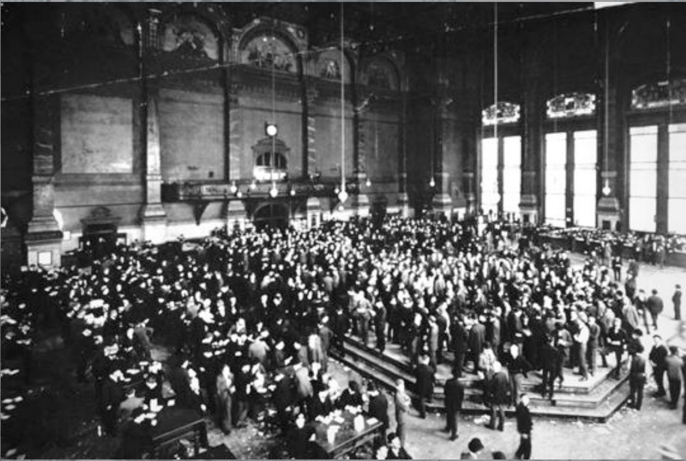

# L6 扑克经济学

本章为客座讲座，讲者是 AQR 资本管理公司（AQR Capital Management）的 Aaron Brown，主题为"扑克与金融"：扑克这个游戏为何诞生、它在经济上做了什么、以及一代牌手如何把牌桌上的思维带进现代金融。

## 一片不该致富的土地

故事始于 19 世纪上半叶当时被称为"美国西北部"的地区——大致是密苏里河、密西西比河与俄亥俄河流域围出的土地。那里地广人稀、极度贫困：几乎没有道路和城镇，遍布沼泽、山地与河流，陆路交通极其困难；从 1800 年到约 1880 年战乱不断——既有被称为印第安战争的大规模作战，也有几十人乃至几人的袭扰仇杀，堪称当时世界上最贫穷的地区之一。住在这里的有被从东海岸驱赶来的印第安人、抵抗迁徙的本地部落、被英国人赶来的讲法语的加拿大叛乱者、威士忌叛乱（Whiskey Rebellion）后被排挤的造反者、逃亡奴隶和躲债的人。当时流行一个说法：不想还债就在门上写"GTT"（Gone To Texas，去德克萨斯了），然后跑到这一带。总之，这是一片充斥着失败者、暴力、几乎没有任何经济资源的土地。

然而有人曾列出"有史以来最富有的 100 个美国人"，并把估算财富与当时经济总量相比较：其中 19 人在 1850 年时身处这片地区，财富大体在 1850–1880 年间积累。而且不只是洛克菲勒、梅隆、卡内基这样的"强盗大亨"，还有麦考密克、威斯汀豪斯、普尔曼这样的大发明家，以及斯威夫特、普利策、赫斯特、阿莫尔、马歇尔·菲尔德等各行业的创新者——全都是今天仍家喻户晓的名字；讲者据此断言，整个 20 世纪世界上任何其他地方都数不出同等级别的商业创新者群体。

这片土地有什么？不是劳动力——那里人烟稀少，劳动者大部分时间得用来勉强糊口，劳动力极其昂贵。讲者给出的答案是：**他们有扑克**。

## 一个被"设计"出来的游戏

关于扑克最早的外部文字记录出现在 1820 年代末到 1830 年代初。这些记载"没说什么"比"说了什么"更有意思：没有一篇解释扑克的规则，甚至没人把它称作一种"游戏"，唯一讲清楚的是**它涉及大额金钱的转移**；没有人说它是某种外地游戏的变种，也没有人说是法国人、印第安人或波斯人带来的。它就在那里，是这个地区独有的东西，而且所有人都已心知肚明：当地人玩一种叫扑克的严肃游戏，赌注极大，别的地方没人玩。

当时远比扑克流行的是世界各地各阶层都玩的纯运气赌博——骰子、法罗牌（faro）、轮盘类游戏；贵族们玩的则是惠斯特（whist）、象棋这类重技巧、不一定涉赌的游戏。扑克两者都不是。那么它与此前的任何游戏有何不同？

**A 大过 K。** 今天看来微不足道，在当时却是革命性的——在世界上大多数国家，说 A 压过 K（国王）足以招来杀身之祸。早期扑克中 A 永远算大，没有高低两用。可见设计者不是君主主义者。

**牌型按稀有度排序。** 越稀有的牌型越大；早期扑克还没有顺子和同花，这条原则执行得更彻底。但有一个后来的变化很能说明问题。今天比较同类牌型（同为两对、同为散牌）时从最大的牌开始往下比；1830 年代之前恰好相反——**先比最小的牌**。在下表列出的 1,302,540 种不成对、不成顺、不成花的五张散牌中，以 A 为最大牌的散牌有 502,860 种，最常见却排名最高——这颠倒了"越稀有越强"的原则；按最小牌排名才真正忠实于它。

| 牌 | 作为最大牌的散牌数 | 作为最小牌的散牌数 |
|----|-------------------:|-------------------:|
| A  | 502,860 | — |
| K  | 335,580 | — |
| Q  | 213,180 | — |
| J  | 127,500 | — |
| 10 | 70,380  | — |
| 9  | 34,680  | 4,080 |
| 8  | 14,280  | 14,280 |
| 7  | 4,080   | 34,680 |
| 6  | — | 70,380 |
| 5  | — | 127,500 |
| 4  | — | 213,180 |
| 3  | — | 335,580 |
| 2  | — | 502,860 |
| 合计 | 1,302,540 | 1,302,540 |

这一差别让 A 大幅贬值，很像小牌扑克（lowball）：最好的牌帮不上忙，决定牌力的是最差的那张——手持 A、K、Q、J 再加一张 2，就是一手"2 小"，输给几乎所有人。数字可以说明差距：双方都是散牌时，现代规则下持 A 一方有约 $83\%$ 的胜率；按最小牌排名，持 A 只值约 $56\%$，因为 A、K、Q、J 间差别微乎其微。

讲者强调的重点不是策略细节，而是：**这个游戏是被设计出来的**——有人明确提出一条理性原则，并做了在当时相当精巧的数学计算来确定牌型排名。它不是经漫长传统演化来的，也不是某位宫廷人物写下的规则；它是有人为了某个目的而设计的。

## 直扑克的下注设计

早期扑克（当时叫直扑克，straight poker）的牌局过程简单到近乎平凡：发一张牌，一轮下注；发第二张，一轮下注；发第三张，一轮下注；最后两张牌——当时就叫转牌（turn）和河牌（river），与今天德州扑克的叫法一样——一起发出，且**最后一张牌之后没有下注**。

下注机制同样经过精心设计：没有底注（ante），也没有今天意义上的盲注（blind）。发牌者左手边的人称为"age"（年长者位）。age 在看到第一张牌之前押注，金额任意，**可以是零**。只有第一轮规则与现代扑克不同：**不允许跟注（call）age 的下注**——要么弃牌，要么加注，且最低加注额是押注的两倍（age 押 1 美元，你至少押到 2 美元）；之后各轮与现代扑克相同。这使 age 比今天的小盲注更有利：小盲可以被跟注，age 的注只能被加倍或弃掉。

当时的牌手坚持认为**扑克不是赌博**，区别在于：没有人被迫下注——你看过牌之后，自愿押一笔你认为有正期望（用今天的说法）的注。经验上当 age 押注被认为是占便宜——数学上可以证明这不可能成立，但心理和经验上确实如此：别人被迫要么翻倍要么弃牌；其余人只在认为自己能赢时才下注。

## 每轮结清：逐日盯市

扑克下注还有一个此前任何游戏都没有的特征：**每一轮下注结束时，所有仍留在局中的人下注额完全相等**。牌局在每轮后被"逐日盯市"（mark-to-market）——你最终赌的是摊牌（showdown）时谁的牌最大，但游戏必须等到每个未弃牌者押注拉平才能继续。

## 规则的松动与演化

严格规则没能维持多久。到 1840–1850 年代，人们开始反抗清规戒律：加入底注、顺子和同花、最后一张牌之后的下注，发展出抽牌扑克（draw poker）和部分牌面朝上的 stud 扑克（stud poker）等玩法。John Blackbridge 在《The Complete Poker Player》（1875）中批评底注：

> 底注把扑克变成了一种彩票，而且附加了一个彩票系统所没有的条件——所有玩家都必须买彩票。

约一百年后，R. F. Foster 在《Practical Poker》（1904）中解释了这场演化：

> 科学型牌手把不那么谨慎的对手逼向底注和限注，麻烦是自找的。大多数人都想玩，不管手里有没有花牌；一手接一手地坐着等花牌并不好玩，哪怕这样做在钱面上有十一分之二的胜率优势……旧时代的保守牌手没有花牌绝不下场，不断一个筹码不投地扔牌，结果自由派牌手找不到对手来下注。

于是，一个保守、古老、建立在严格科学原则上的游戏，最终演化成现代扑克：好玩得多，明确允许赌博，服务于相当不同的目的。

## 扑克筹码与信用创造

牌与下注都还不是扑克最革命的部分。历史上几乎所有赌博——赌博可追溯至史前，几乎每种文化都有——都以货物或现金进行；用到信用时，信用由某个受信任的中央对手方（如赌局组织者）提供。扑克从不为现金或货物而玩，玩的是当时所谓的"扑克支票"（poker checks）。直到 1980 年代，人们还清楚区分两个常被混淆的东西：**支票（checks）有内在价值**，拉斯维加斯曾用赌场支票代替现金进行一切交易；**筹码（chips）只是记号**——在牌桌上买来、离桌时理应兑回，甚至不该从轮盘桌带到花旗骰桌。后来由于国税局介入、赌场与有组织犯罪切割，有内在价值的合法筹码消失了：今天你拿一枚 5000 美元的筹码去兑现，赌场会要求你证明它是在赌场购买或赢来的，否则拒付。

回到 19 世纪初。扑克支票是玩家自制的记号：常用黏土做小圆片，按上拇指印等可辨认的个人标记。关键在于**这些记号对应到个人**——你在用自己创造的钱打牌：你输了，别人手里就有了对你的索取权；你赢了，你手里就有了别人的记号。一局结束后人们做"环形清算"（ring clearing）：用手里别人的支票换回自己的支票，赢家剩下一堆别人的支票，意味着许多人欠他钱。**没有中央对手方，收账是赢家自己的责任**——你不喜欢某人的支票也没办法，只能另找别人交换。这就创造出一种货币；这种信用创造（credit creation）是早期扑克最本质的要素。

可以对照同时代的另一种金融制度——软货币银行，又称野猫银行（wildcat bank）：某人宣布"我开了一家银行"并开始放贷，然后要么印制银行券（有些极其粗糙，甚至用记号、树枝、旧符木充当），要么只记一套账；想花钱的人得先把钱存进银行。运转得好，它会催生大量经济活动：贷款收回、存款兑现；运转不好，一切归零。给它加上一个特征就成了多数人心目中的银行——**真实货币（黄金）形式的资本金**。讲者特意指出这一二分：在他看来，经典银行就是软货币银行，资本金只是增加可信度的附加特征——一则表明办银行的人利益攸关（skin in the game），银行垮了他也受损，这是信心信号；二则理论上可在银行倒闭时赔付部分损失（实践中从来赔不到，银行家总能在别人之前把资本金抽走）。而许多银行立法和大众认知恰好相反，把"100% 资本充足"当作常态、把部分准备金当作附加动作。纵观人类文化，几乎各地都有这类自我信用创造的形式——susu、唐提会（tontine）等皆是，扑克就是其中之一：你创造自己的货币，打一局牌，赢了就获得大量他人的信用去开展经济活动；输了，别人为了把钱收回来就得雇你干活。老西部的许多生意就是这样被创造出来的。正如老牌大亨 Big Julie Weintraub 所说："发明扑克的人很聪明，但发明筹码的人是天才。"（The guy who invented poker was bright, but the guy who invented the chip was a genius.）

## 期货交易所：同一土壤长出的第二个发明

时间推进到 1840 年代：芝加哥期货交易所（Chicago Board of Trade）出现了。

期货交易所与扑克出现在**完全相同的地理区域**，晚了约 20 年。同样地：没有人宣称发明了它；它在该区域内部遍地开花、在区域之外无影无踪；它与过去一切金融制度都不同——这片文化土壤里有某种东西，让这件从未有人做过的事显得自然而然。与扑克的相似一目了然：**逐日盯市**——你赌的是三个月后小麦的价格，但每天结清，使双方押注始终一致；**清算**——早期交易所用的正是与扑克一样的环形清算，后来才演进为更复杂的清算所（clearinghouse）。

期货交易所是干什么的？教科书的标准答案是"农民用它锁定价格"。把这个故事当真过一遍：假设你是 1840 年的农民，沿烂路走两星期才能到芝加哥。自古以来农民卖粮都卖给收购商——其代理就在你买补给的地方，每月还来农场看长势；你可以跟他锁价，他按约定价格买下全部收成，数量不限，价格现在定或以后定都行，你送货或他上门收粮（价格低一点）皆可。再对比"创新的"期货市场：你得走两星期去芝加哥，承诺交付某个你并不生产、也不确定能否按时凑齐的固定数量、固定品级的小麦；你不知道能收多少，却必须事先指定数量；你要交初始保证金，而你的现金全压在庄稼里（农民只有收获后才有现金）；你还得天天待在芝加哥做逐日盯市结算——那谁来种你的小麦？这毫无道理。凡在教科书里写"农民用期货套期保值"的人都没有认真想过半秒钟：交易所的创设者中没有农民；农民对交易所心存疑惧，屡屡试图将其关停；即便使用期货市场，农民也几乎总是买入方而非卖出方。

真正的典型交易由加工商完成（当年创设这些交易所的人全是扑克牌手，这不是玩笑）。我是磨坊主，把小麦磨成面粉。我无法用期货对冲"小麦风险"，因为我没有天然的小麦价格敞口：若欧洲爆发大战、他处歉收，小麦需求骤增、价格大涨，我的生意反而兴隆——各地小麦涌来，研磨产能短缺，我可以提价，这个意义上我是"做多小麦"的；若本地歉收、小麦因稀缺而大涨，没人需要我的磨坊，产能过剩，我一分钱也收不上来。我真正关心的是机器运转、燃料、人工、监管和来料品质；想和供应商、买家锁价，随时可以签合同，不需要交易所。

期货市场的真正用法是：我先向谷物筒仓商（grain silo，从各地收麦再卖给加工商的中间商）订好未来三个月的分批交付——指定时间、数量、品种，送到我的磨坊；然后到期货交易所**卖出等量的远期小麦**。这样我就消除了价格风险：小麦涨跌与我无关——我今天买入小麦、三个月后卖出，**我借入了小麦**。我本可以借钱买麦，但那要承担两层风险：货币的风险（别忘了，这是一个金银稀缺、银行体系薄弱、银行券不太可信的地区，承担货币风险本身就是大风险）和小麦价格的风险。最简单的办法就是直接借小麦。而且正如任何经营性贷款，我永远不打算归还：就像买机器的贷款到期就续借，我会把这些期货合约**永远展期（roll）下去**，绝不交割——我永久性地借入了一部分生产原料，用它代替购买。其一，期货交易所由此创造了巨量信用；其二，它还给无人想到过的服务标出了价格：谁知道怎么把面粉变回小麦？怎么把八月的小麦挪回五月？175 年来，芝加哥期货交易所一直在为这两种"服务"报价。想建一座桥、把原本运往圣路易斯的小麦改道引入芝加哥？你可以做多芝加哥小麦、做空圣路易斯小麦，把这项运输服务卖出去。日历价差、品级价差、清理价差……都是买卖农业加工链条中各种服务的方式。这是一种效率高得多的组织方式：内生的信用、好得多的信息流，正是它引爆了随后波及全世界的商业爆炸与创新。奇怪的是，期货长期只用于农产品——尽管远比农产品贵重的东西多得是——直到 1970 年代人们把同样的想法搬到金融领域，一切才真正起飞。

还要澄清一个常见误传：期货并非由"到货合同"（to arrive contract）演化而来。到货合同在有文字记载之前就存在——古巴比伦最早的泥板文书里就很常见：它承诺"小麦一到市场，我就按每蒲式耳 0.5 美元卖给你一万蒲式耳"。它是**价格保证，不是交付保证**：不承诺何时到货，甚至不保证到货。美国最大的到货合同市场在布法罗（Buffalo）——你可曾听说过布法罗到货交易所里赢得和输掉的财富、斗殴和逼仓？没有。到货合同由安静的佣金文员打理，期货交易所里则是好勇斗狠、大起大落、随后干出惊人事业的创新者，两者毫无传承关系。

一个旁证：Buffalo、Chicago、Cincinnati、Omaha、Texas，哪些是扑克游戏的名字？Omaha 是，Texas 是，Chicago 是，Cincinnati 也是（如今玩得少了）——唯独没有叫 Buffalo 的扑克游戏。事实上，**所有以地名命名的扑克游戏，其地名都位于"输光钱跳河后会顺流漂到新奥尔良"的河流域内**。直到今天，扑克仍强烈地是一种地域性态度：一种极具爆炸力的、创新的经济态度，除发源地外从未真正扩散。互联网扑克可能改变这一点，但留下一个悬而未决的问题：扑克的灵魂还活着吗？这种经济创新与自由、这种自我信用创造，会随网络扑克传遍世界，还是扑克一旦被搬上电脑、变得虚拟，就被抽掉了灵魂？

## 从牌桌到华尔街

讲者生于 1950 年代，在西雅图长大。旁人看来那是田园诗般的童年（父亲是教授，家境不富也不窘），他却厌恶那个时代：他真心相信世界会在他上大学前毁于核战争；他喜欢的数学和科学几乎全靠国防项目资助；大半个世界被极权统治，还没有任何国家从共产主义走向自由与繁荣；经济一团糟——西雅图比全国更早滑入"70 年代滞胀"，家里一位世界顶尖的超音速机翼材料专家（MIT 出身）因没人再造超音速飞机而被解雇，只好开出租车。社会氛围也怪异：只要一个男人修剪草坪、把工资拿回家，他就是好人，别的事（酗酒、家暴、吸毒）无人谈论；一旦失业，一家人会悄悄搬走，从此无人提起。他得到的讯息是：能挣钱则万事大吉，挣不到钱则不可言说的可怕。

他是个害羞内向的孩子，却痴迷报纸后面的数字，研究规律，赌马、赌球，并发现自己能赢。当时整个美国西部的酒馆后屋或地下室都有扑克局，他走进去、赢钱、收钱、走出来——这是巨大的解放：**你不必找工作，不必上大学；世界上任何地方你都能找到牌局赢到钱；当你以好牌手出名后，即使输光了，也有人借钱给你、给你入股（stake）**。牌桌上也不是电影里的模样：有警察、水手、店员——各色普通人，而如果你是高手，这些人最终会欠你钱。

他后来想明白了自己在这个网络中的功能。好牌手对牌局有两个用处：其一，**保护牌局**——若有外来高手想横扫牌局，本地有高手坐镇（当年的"会打牌"远不止牌技：要能识破作弊、判断谁有被捕风险、谁可能动粗）；其二，**把牌局接入更大的网络**。牌局的核心是信用创造：医生、律师、警察、技工在局里交换服务，形成庞大的地下经济——一个生意惨淡的律师，因为欠了牌局里的钱，照样能替人写信、办些法律业务。有人完全脱离正常生活、没有工资，全靠地下经济维生；牌局是重要的组织工具——水手能带来古巴雪茄，高级餐厅的洗手间侍者能负责销货。扑克之所以关键，是因为你要和这些人长期相处、知根知底，装不出来：卧底警察可以混进来两天，但不可能年复一年地天天打牌。

带着这张网络，他来到波士顿上哈佛，惊讶地发现这张网**无缝地横跨了整个国家**。谈到"上大学积累人脉"，他拿三个室友（公司律师、电视制片人、法学教授）与哈佛的扑克局对比：牌局里有后来当上总统的小布什、比尔·盖茨、史蒂夫·鲍尔默、作家斯科特·特罗（Scott Turow）等名人、政客与富人。**扑克人脉不是朋友关系，而是一种生意关系**，他一生的职业轨迹都由扑克网络塑造。他记忆中当时哈佛牌局里牌最好的两人是特罗（有职业级直觉，只是打得不够多）和数学家劳埃德·特雷费森（Lloyd Trefethen，后来执教牛津，还教过他不少理论）；小布什打牌主要为好玩和人脉，牌局组织得很棒。

在波士顿的高额局里，一位在斯坦福附近经营扑克室的巡回职业牌手对他说：你的数学牌感很像加州加迪纳（Gardena）那帮人——"我在全国各城市的顶级局都能赢，但在加迪纳赢不到钱，你该去那里检验自己。"加迪纳是当时世界扑克水平最高的地方（电影《California Split》（1974）里有当年加迪纳扑克室的实景），也是前述网络经济的加强版。那是 1970 年代末：边际税率极高，监管繁苛，税法复杂而腐败；共同财产制让不少人在离婚中被洗劫一空；许多人背着税收留置权（tax lien）。这群人受教育程度远高于西雅图乃至波士顿的牌友，聪明、破产而且**财务上有毒**——钱存银行会被划走，口袋里的现金会被合法拿走，但扑克筹码不会；借给牌友的扑克债，谁也强制执行不了。于是地下经济极度活跃：讲者到的第一天，一位汽车旅馆经理（原业主破产后被银行雇来看店）就表示，牌手塞给他远低于房租的好处费即可住店，住三四个月后被"赶出去"，账目上只写"房客从未付租"，然后换到下一家循环往复。修车、打官司、做手术，牌室里都有人接活，全在桌面下，钱可就地拆借。现代扑克理论的奠基者——David Sklansky、Mason Malmuth、Mike Caro 这些最早写扑克理论书的人——都出自这里。拉斯维加斯当时憎恨扑克（理由很简单：楼里有人输钱，而钱没进赌场口袋），要么不开扑克室，要么把它塞在楼梯底下挨着老虎机，随性开开关关；当年的世界扑克大赛（WSOP）纯属赌场宣传噱头——直到 1990 年代末、2000 年代初，互联网、电视与扑克热潮把新人带进来，赌场才真正接纳扑克。

还有一则对照能说明加迪纳的水准：三位 WSOP 冠军——多伊尔·布朗森（Doyle Brunson）、塞勒·罗伯茨（Sailor Roberts，那批人里唯一真正顶尖的牌手）和另一人——当年开车在得州各乡镇的本地局打牌。按说三个世界冠军应横扫乡镇局，但塞勒亲口告诉讲者：**他们打牌只做到保本**；真正赚钱的是替人收高中橄榄球的赌注——他们是收账的"钱袋人"（bag men），扑克只是敲门砖。反过来，加迪纳一个能在高额局保本的普通俱乐部牌手，牌理水平也远超那些得州巡回赌棍：后者很会靠扑克谋生，但让他们解释为何这样打，说的全是运气论，毫无战略逻辑；而加迪纳的人若被扔进得州酒馆，五分钟就会被人用台球棍敲晕扔出去——谋生技能和牌理是两种截然不同的东西。

## 打败轮盘赌：关于"随机"的一课

讲者以扑克为生，但兴趣更广。他在波士顿四年最深的感受是：学术与政策界的定量分析粗劣得惊人——数据糟糕、分析愚蠢，而且**这些人谁也不肯为自己的结论押上一分钱**；同一个人买车时做的常识性分析，远比他建议政府接管钢铁工业时认真。他和同道中人信奉定量方法，自信能靠下注赢钱证明自己——和赌徒混在一起，任何观点都有人可以要求你"拿点钱押上"，空话因此大减。检验方法的天然场所，就是人们赌博的地方。

他们都读过 Ed Thorp 的《Beat the Dealer》。索普（Ed Thorp）是数学教授，发明了二十一点算牌，几乎征服了所有赌场游戏，还发明或完善了今天人们使用的几乎所有量化对冲基金策略，本人也是多年里最成功的对冲基金经理之一。讲者重点讲轮盘赌——它彻底改变了他对许多事情的思考方式，对有学术统计背景的人是极重要的一课。

如何打败轮盘赌？当时有两派意见：一派说记录开奖结果找偏差（比如 13 出现偏多）；另一派说轮子造得太好，不可能有偏差。索普的洞见在于：**两种情况下你都能赢**。轮子有偏差，押 13 就行；轮子完美到每个号码频率完全相等，那它一定被加工得极其精密——于是可以用牛顿力学算出球会落在哪里。他与信息论之父、MIT 的克劳德·香农（Claude Shannon）合作造出了装置。原理是：轮子向一个方向转，球沿外圈碗沿反向滚。球沿碗沿滚动这一段完全服从牛顿力学、可以预测——借助当时合法（如今非法）的电子辅助设备，很容易算准球离开碗沿那一刻哪个号码正在其正下方；从那一刻到球静止之间的弹跳则近乎混沌、无法逐点预测。但关键洞察是：**可预测段可以精确计算，而混沌段在轮盘上绝不是均匀分布的**——若球落下时 17 在其正下方，可以算出最终落点的分布，离均匀分布差得很远，足以做出有利可图的下注（实际操作还要层层细化，此处只讲大意）。

这与 Nassim Taleb 所说的"游戏谬误"（ludic fallacy）直接相关：经典统计理论建立在骰子这类人为制造随机的装置上，而真实世界远没有那么随机——**即便刻意制造随机，在赌场里也做不到**。原因：装置造得极其精密，它就是可预测的；造得松散粗糙，它就有非均匀的模式；"既精密又不可预测"的装置超出人类能力。股票、政治、战争等现实中的"随机"，人们建模时都太草率。每当有人说"这是随机的"，正确的反应是：切开它，找出可以精确计算的小块可预测区间，再找出其间非均匀的模式。这样做在外人看来会很怪：你痴迷于别人认为无关紧要的角落数据与数据质量，又对人人认为至关重要的东西大手一挥、做出"鲁莽粗糙"的假设。但这恰恰就是赢的方式——**你以为重要的东西不重要，你以为不重要的东西才重要**。

## 三条通往金融的路

当年攻克赌场游戏（二十一点、轮盘、百家乐、花旗骰）的人与做体育博彩的人走的是两条路。赌场游戏是频率派的功夫：你挣的是赌场的钱，一旦被识破，轻则警告驱离，重则被埋进沙漠，所以必须骗过赌场、藏在雷达之下；适合反社会的独行者，不需要社交技能（电影里 MIT 算牌队那种夸张表演并非主流，多数人只是安静地进场、安静地打）。

体育博彩是贝叶斯派的功夫：**预测人们会怎么下注，远比预测比赛结果容易**。1970 年代，一个简单观察就够赚钱了——洛杉矶湖人是当时最具人气的球队，洛杉矶又是投注大市；湖人主场作战时涌入的投注会把让分推到过于有利的地步，于是反买湖人主场，不需要天才、数学博士或电脑。这类模式建立在对人的理解上：不合群的人去了赌场游戏，喜欢人的人去了体育博彩。成功后的待遇也不同：赌场赶你走，博彩公司却**雇用你**——发工资（方式是允许你下更大的注）、让你入伙，最终经营自己的盘口。这两拨人都在课堂之外练就了远超当时统计学界与计量经济学的技术，因为他们必须正确——每天都在下注，世界上最聪明的人每时每刻都在想办法打败这套系统。

扑克介于两者之间：有牌技成分（算牌、读洗牌），也有对人的判断——不用像体育博彩那样预测成千上万人，但要能读懂牌桌上的人、被邀请进局、从输家手里收到钱、避开抓捕、作弊和暴力。1970–80 年代初，这批人中的许多带着磨好的技艺进入金融业，各归其位：

- **赌场游戏派**去了隐秘的小型对冲基金：用自己的钱、少数富有的投资人，一有机会就退还外部资金、独善其身，在狭窄领域里做极精深的东西。
- **体育博彩派**进了大银行：他们懂人、懂生意，是天生的银行高管。那个年代去华尔街求职要把数学从简历上删掉——华尔街不想用懂数学的人，就像 NFL 不想要数学博士；有人怕聪明人危险，有人认定学数学的必是书呆子。但一旦进门，连赢五六年体育博彩积累的关于市场、生意和带队伍的知识，是许多人一辈子也学不会的。
- **扑克派**（讲者一类）能拿到工作，但不要高位：他们想在雷达之下经营小部门——量化交易、配对交易（pairs trading）、结构化产品。他们擅长网络化生存，但不擅长西装革履讨老板欢心，也不擅长募资，所以依附大机构：机构出交易资本、出既有交易关系，他们保留（部分）赚到的钱。

正是这批人彻底改造了华尔街。讲者用一个类比说明 1980 年代初至今金融变化之深：数码相机与胶片相机看起来差不多——都用电池、有闪光灯、有镜头、有快门，拍同样的东西——但内部技术完全不同，造相机要雇完全不同的人、用完全不同的工艺。金融的技术基础就是这样被整个重做了一遍，而这代量化从业者的知识"基因"，更多来自体育博彩、赌场游戏和扑克，而非 1970–80 年代的经济学理论。

这种隔阂至今仍在。华尔街的本质是销售：能募来钱、聚来资产的人永远拿大头，量化从业者只能在边缘赚些"小钱"。早年量化人士到来时，华尔街的态度是"无所谓——哪怕你是占星师、画线派，只要能带来交易、付我们佣金，我们就假装尊重你"；后来发现这些人居然真在赚钱，态度变成又戒备又轻视。直到今天，AQR 这样的量化基金去做信用评估时，对手方仍默认"没人搞得懂你们的黑箱"，总派最资浅的信用人员对接——尽管策略完全可以摊开来八句话讲清。最大的障碍是**置信度文化**：非量化的人按你表现出的自信程度衡量可信度，说"我确定，我有 87 条理由"的人大家听得懂（心里也只按 51% 采信）；而量化的人诚实地说"这笔交易我大概六成把握"，对方反而不明所以。量化的人明白 51% 配上足够多的下注就是一台收银机，非量化的人难以接受这个概念——所以他们才会不戴"眼镜"就去玩轮盘。

## 延伸阅读

讲者推荐的书目（按书名字母序，另有两本现场补充）：

- Edward O. Thorp, *Beat the Market*——"读索普的一切著作，很多在网上免费可得。"
- James McManus, *Cowboys Full*——唯一一部像样的扑克通史（作者另著有打进 WSOP 主赛事决赛桌的 *Positively 5th Street*）。
- Jeffrey Williams, *The Economic Function of Futures Markets*——此前约一百年关于期货市场的著述全是废话，这本 1990 年前后的薄书逻辑自洽、有经验证据，第一次真正把期货市场讲明白，却几乎无人引用。
- Perry Mehrling, *Fischer Black and the Revolutionary Idea of Finance*——理性与数学如何经由费希尔·布莱克这样的"怪人"进入金融（平装本前言为讲者所写；作者另著有讲现代金融的 *The New Lombard Street*）。
- Daniel H. Usner, Jr., *Indians, Settlers, & Slaves in a Frontier Exchange Economy*——扑克到来之前下密西西比河谷（至 1791 年左右）的"前史"：那个前现代经济体已蕴含比同时期伦敦、纽约更多的现代经济设计。
- Sebastian Mallaby, *More Money Than God*——早期对冲基金群像；不谈策略细节，但故事翔实。
- Aaron Brown, *The Poker Face of Wall Street*——讲者本人所写，覆盖扑克与金融的联系。
- Aaron Brown, *Red-Blooded Risk*——讲者本人所写，细述体育博彩、扑克与赌场游戏的思想如何进入主流金融。
- David Hayano, *Poker Faces*——作者是加迪纳牌手、社会学博士（自称"自我民族志学者"），写尽 1970 年代加迪纳的扑克经济；那是旧式扑克经济的最后一抹余晖。
- Philip Tetlock, *Expert Political Judgment*——关于"专家"的预测有多糟糕：若你擅长用真金白银检验判断，就必须远离专家，去一个用现金冷酷告诉你对错的地方。

## 要点小结

- 19 世纪中叶美国"西北部"（密苏里—密西西比—俄亥俄河流域）是一片贫困、暴力的边疆，却在 1850–1880 年间造就了"史上最富 100 名美国人"中的 19 人；讲者认为关键因素是扑克。
- 扑克不是演化来的民间游戏，而是被**设计**的：A 永远压过 K（在当时是革命性的）、牌型按稀有度排序（早期甚至按最小牌排名以严格贯彻——持 A 散牌的胜率会从约 83% 降到约 56%）。
- 直扑克的下注机制刻意排除强迫下注：age 自由定价、第一轮只能加注或弃牌；当时牌手据此坚持"扑克不是赌博"。每轮结束时所有在场者下注额相等——牌局被逐轮"逐日盯市"。
- 扑克支票是玩家自制、对应个人的信用凭证，配合环形清算，构成没有中央对手方的货币创造；它与野猫银行、susu、唐提会同属人类自我信用创造的传统，是老西部商业组织的发动机。
- 期货交易所在同一地区晚 20 年出现，机制与扑克同构（逐日盯市、环形清算）；其真正功能不是农民套保，而是让加工商"借入小麦"（买现货、卖远期、永续展期），并为加工链条中的运输、时间、品级等服务定价，催生巨量信用与创新。
- 扑克的地下网络同时是信用网络与职业网络：好牌手保护牌局、连接网络；讲者经由西雅图酒馆、哈佛牌局与加迪纳扑克室，进入横跨全国的人脉体系。
- 索普与香农的轮盘赌研究表明：装置要么精密而可预测、要么粗糙而有非均匀模式，"完美的随机"造不出来——应寻找可精确计算的区间与其间非均匀的模式，而非笼统假设随机。
- 赌场游戏（频率派、反社交）、体育博彩（贝叶斯派、社交）、扑克（两者兼备）三条路径分别塑造了对冲基金、大银行与量化交易台的人才；现代金融的技术基础由这批赌徒出身的量化者重建。
