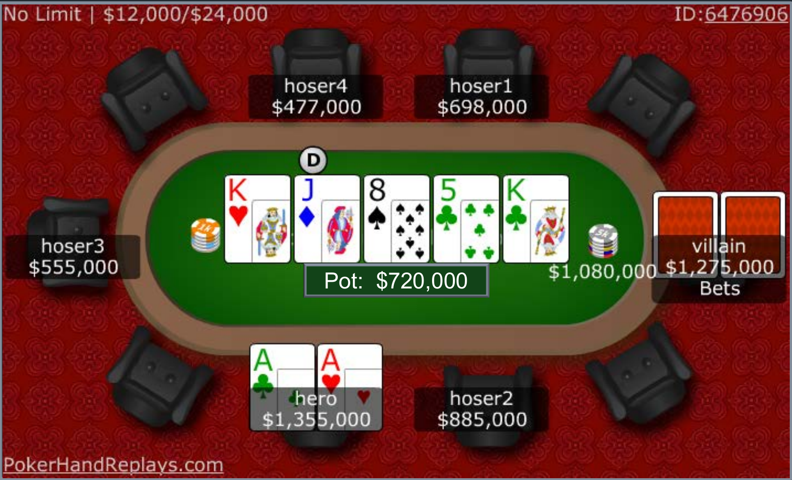
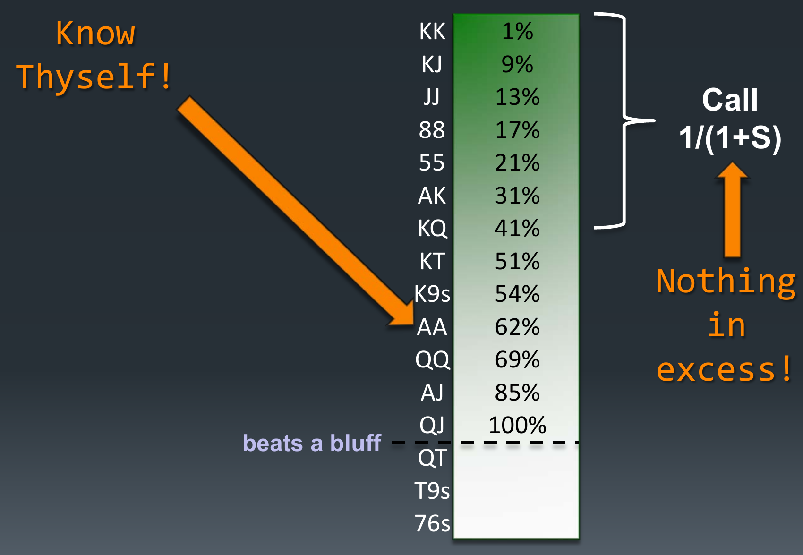
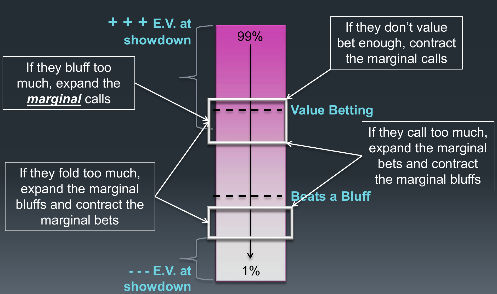
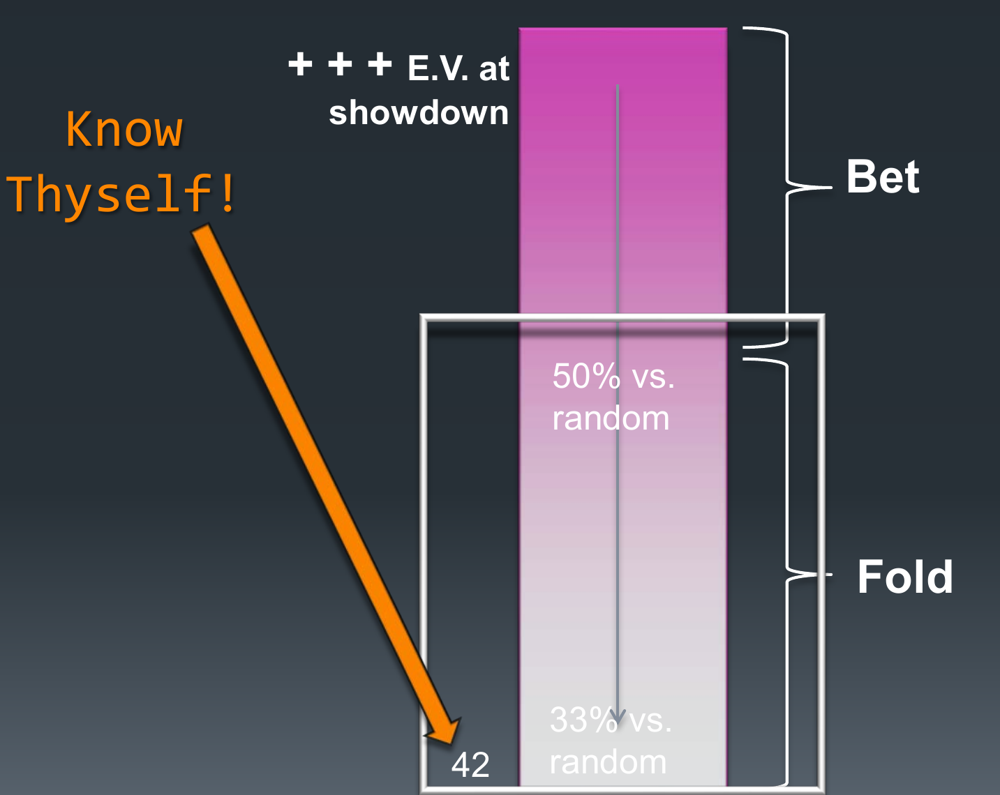

# 决策制定

本章为 Matt Hawrilenko（WSOP 金手链得主、曾被视为世界最强的限注德州玩家之一）的客座讲座。上一讲 Bill Chen 介绍了用计算机求解扑克的 Cepheus；本讲换一个角度：人类牌手如何在牌桌上实际运用博弈论。方法是先求解两个极简单的玩具游戏（toy games），再把其中的原理映射到一手真实的高额锦标赛场牌局，最后提炼出可以长期指导训练的原则。

## 读牌派与博弈论派

面对"打好扑克"这个巨大的博弈空间，人们通常有两种进路。**读牌派（read-based approach）** 试图弄清对手有什么牌、可能有什么牌，再据此行动——这是绝大多数人的打法。**博弈论派（game theoretic approach）** 则关心自己的整体策略是否平衡、是否会被剥削。

为什么博弈论值得学？一个类比：练柔术时，对付白带选手几乎什么招都管用；但随着对手升到蓝带、紫带、黑带，那些招数不仅失效，还会惹祸上身。扑克也一样：在家庭局里"紧凶、只用好牌下注、几乎不诈唬"可能很赚钱，因为对手会高估自己的牌力；但把同一套策略带到 Bellagio 的中额桌，就会被生吞活剥。正确的态度是从第一天起就按黑带的标准训练——学那些对最强对手也成立的打法。

理论派可以往下解游戏、解动力系统；实践派关心博弈论告诉我该怎么思考某个局面。这两者并非二选一：玩具游戏正是连接理论与实践的桥梁。

## 一手真实的牌局

先看本讲贯穿始终的实战手牌。几年前的一场 WSOP 锦标赛，已进入钱圈，六人桌，盲注 \$12,000/\$24,000，前注 \$3,000。讲述者（hero）在按钮位（button）前两位用 A♣A♥ 加注，一位明显比自己更强的对手跟注。

- **翻牌** K♥J♦8♠：对手过牌，hero 下注，对手跟注（底池 \$160,000）。
- **转牌** 5♣：对手过牌，hero 下注约 2/3 底池，对手跟注（底池 \$310,000）。
- **河牌** K♣：对手主动下注约 \$1,080,000，进入一个 \$720,000 的底池。

hero 此刻完全读不懂：1.5 倍底池的下注意味着什么？他为什么不下全下？是在引诱跟注，还是想在自己弃牌时省下 \$300,000？大多数人在这种时刻的本能反应是收集更多"信息"去缩小对手的范围——他以前亮出过大诈唬吗？要不要盯着他找马脚（tell）？

## "对方也会变魔术"

关于马脚，先泼一盆冷水。扑克桌上的马脚或许对弱手有点用，但那是噪声海洋里的微弱信号，不足以作为职业本钱。有人拿 FBI 审讯官做过系列实验：让审讯官和随机路人一起观看面谈录像，判断被试者是否说谎。结果两组人的正确率都接近随机（约 53%），唯一差别是审讯官们对自己的判断自信得多——普通人只有五成把握，他们却九成确信自己是对的。

这背后是**自我评估偏差（self-assessment bias）**。一项对 GE 工程师的经典调查让每人评估自己在全体工程师中的百分位：平均值落在第 80 百分位，约百名受访者中只有两人认为自己低于平均水平。电影《赌王之王》（Rounders）开篇引用过一句话，说的是同一件事在扑克里的版本："没几个玩家记得自己赢过的大底池，但每个玩家都能惊人准确地回忆起职业生涯中那些惨烈的爆冷（bad beat）。"记忆偏差喂养了自我评估偏差。

讲述者自己付出过学费。WSOP 一场大赛的钱圈泡沫（money bubble）上——下一名出局者空手而归，其余人保证有钱——他左手边的玩家是第一次打 WSOP，兴奋到提前 40 分钟离桌生怕被淘汰。泡沫真正到来时，讲述者在小盲位拿到 42o（4 和 2 不同花色，整个分布里几乎最差的牌），前面全部弃牌，他自认有"铁一般的阅读"，直接全下。对手说"我就知道你会这样"，然后**不看牌跟注**，翻开 92o——用一手烂牌压制了他，并以多出一两枚的筹码把他淘汰在泡沫上。这个阅读错到什么程度？对手不仅要不在乎泡沫出局，还要不在乎到连牌都不看——因为只要看了 92o 就必须弃牌。

教训不只是"谦虚点"。**任何时刻你试图揣测对手的策略，她都可以反过来揣测你。**你在估算她的分布并作出回应，她在估算你认为她的分布是什么、并据此塑造自己的行动——双方都在"变魔术"。没有知识储备的人被逼到陌生局面时，本能反应就是变魔术；而强手恰恰会把你带到他们反复走过的陌生小路上。

因此本讲的第一条规则是：**忘掉她的牌（forget her hand）；更进一步，忘掉她的范围（forget her range）。** Jerrod Ankenman（《The Mathematics of Poker》作者之一）有句话点明了目标："如果我真的按最优方式打牌，我可以把我在每个局面下的完整策略写在一张纸上交给你，而你仍然赢不了我。"

问题是完整策略记不住——单挑限注德州是最小的真钱扑克游戏，也有约一千万亿（quintillion，$10^{18}$）个博弈状态。求解程序是黑箱，要让人脑理解策略背后的结构，需要玩具游戏。

## 玩具游戏一：抛硬币透视游戏

**透视游戏（clairvoyance game）** 指一方或双方拥有完全局面信息的游戏：如果你总能知道对手的牌、且对手知道你知道，你会怎么打？**抛硬币透视游戏（Coin Flip Clairvoyance）** 的规则如下：

1. 双方各下前注 \$1（底池 \$2）。
2. 抛硬币：正面你赢，反面对手赢。但只有你能看到结果。
3. 你可以选择下注 \$1 或过牌；对手只能过牌/跟注或弃牌。

局面一：正面，显然下注。局面二：反面，怎么办？核心是两个问题：对手应该多频繁地跟注？你应该多频繁地诈唬？

**跟注频率。** 跟注方要让对手对"诈唬"和"放弃"无差异，即令两者的期望相等：

$$E(\text{诈唬}) = E(\text{放弃}) \;\Longrightarrow\; P(1-C) = 1 \cdot C \;\Longrightarrow\; C = \frac{P}{P+1},$$

其中 $P$ 为底池大小，$C$ 为跟注频率，$1$ 为诈唬下注额。左端是诈唬赢下的（底池乘以对手弃牌率），右端是诈唬被抓输掉的。本例 $P=2$，所以对手应以 $2/3$ 的频率跟注。注意底池越大，跟注频率越高——$C$ 渐近于 $1$：钱已经在池里了，必须更多地防止被诈唬偷走。

**诈唬频率。** 诈唬方要让对手对"跟注"和"弃牌"无差异。用诈唬与价值下注之比 $b$（而非百分比）写更简洁：

$$E(\text{跟注}) = E(\text{弃牌}) \;\Longrightarrow\; b\,(P+1) - 1 = 0 \;\Longrightarrow\; b = \frac{1}{P+1}.$$

即对手跟注时以 $b$ 的概率赢下 $P+1$、以 $1$ 的概率输掉跟注额。本例 $b=1/3$：每两次价值下注搭配一次诈唬。底池越大，诈唬比例反而越低——因为价值已经在池里，且对手跟注得更多，不需要太多诈唬就能兑现价值。

**推广到任意下注尺度。** 设底池为 $1$，$S$ 为下注占底池的比例，则：

$$\text{跟注频率} = \frac{1}{1+S}, \qquad \text{诈唬价值比（bluff-to-value ratio）} = \frac{S}{1+S}.$$

对手下注越大，你需要跟注的频率越低；对手诈唬越多，她必须搭配的价值下注也越多——诈唬区域扩大时，价值下注区域必须随之扩大。

**"如果只玩一次呢？"** 常见疑问：面对再也不会遇到的对手，何必平衡？答案是：这仍然是重复博弈。设想你将和一千个不同对手各玩一次抛硬币游戏，并决定"反正他们学不到我的历史，我 100% 诈唬"。每个对手其实是从所有可能策略的分布中的一次随机抽样：有人会过度弃牌被你吃掉，也有人会过度跟注把你吃掉。哪怕是对阵陌生人的第一手牌，你面对的也是这个策略分布——它就是重复博弈。

**两点观察。** 第一，关键不是价值下注或诈唬本身，而是两者的组合：如果你"有正面就下注、反面就过牌"，对手会对你的每次下注弃牌，你的好牌分文不值。第二，我们最大化的是**整手牌集合**的价值，而非当前这一手牌的价值。

## 玩具游戏二：A-K-Q 游戏

**A-K-Q 游戏（Ace-King-Queen Game）** 是最经典的不完全信息玩具游戏：

1. 双方各下前注 \$1，各发一张牌（从 A、K、Q 中抽取，你拿 A 对手就只有 K 或 Q）。
2. 玩家 1 可以过牌或下注。
3. 玩家 2 只能过牌/跟注或弃牌。

逐个情形分析：

- **你拿 A**：下注（对手跟注你赢，弃牌你也赢）。
- **对手下注，你拿 A**：跟注。
- **对手下注，你拿 Q**：弃牌。

这三种情形涉及**占优与劣策略（dominant / dominated strategy）**：所谓劣策略，是指其价值严格不高于另一选择的策略。用 Q 跟注不可能赢，只会输钱，严格劣于弃牌。

- **你拿 K，过牌还是下注？** 这也是劣策略！对手拿 A 必跟、拿 Q 必弃，你用 K 下注赢不到任何额外的钱、只会输给 A，因此被过牌严格占优。
- **你拿 Q**：要以一定频率下注（诈唬）。
- **对手下注，你拿 K**：混合策略——以一定频率跟注（抓诈，bluff catch）。

跟注频率是多少？套用上一节的公式，应以 $\frac{1}{1+S}$ 的频率用"能赢诈唬的牌"继续。本例 $S=0.5$（下注 \$1 进入 \$2 底池），跟注频率为 $2/3$。能赢诈唬的牌是 A 和 K（Q 连诈唬都赢不了）。A 占这类牌的一半，全部跟注才到 $1/2$，还需再补 $1/6$：即**用全部 A 跟注，再用 $1/3$ 的 K 跟注**（$1/2 + 1/3 \times 1/2 = 2/3$）。

注意这与底池赔率思维的区别：拿 K 面对下注时，赔率思维问的是"我至少有 $1/3$ 的时候领先吗"——这需要揣测对手的牌；博弈论思维问的是"我要怎么做才能让对手对诈唬与否无差异"——只需要管理自己的整个范围。

**新增一条观察**：把牌映射为三类很有用——价值牌（value hands）、抓诈牌（bluff catchers）、诈唬牌（bluffs）。**你对一手牌的策略决定了你对其他牌的策略。**既然 A 必定跟注，就必须搭配一部分 K 跟注；既然 A 必定下注，就该用最差的那部分牌（Q）诈唬——那部分牌从对手弃牌中获益最大。更微妙的是：如果你玩某手牌的方式与我不同，你对其余牌的最优玩法也与我不同。比如你只下注一半的 A 却仍下注 $1/3$ 的 K，比例就失衡了，失衡在这个游戏里就是输钱。

德尔斐阿波罗神庙的三句铭文恰好概括到这里为止的内容：**认识你自己（know thyself）**——知道自己的牌、知道自己的分布；**凡事勿过度（nothing in excess）**——保持平衡；第三句"立誓则祸近"牵强附会，就记"恶作剧（mischief）"二字，留到剥削打法部分。讲述者强调：在"知道自己处于自身分布的哪个位置、并把分布塑造平衡"这项技能帮你赢出一套房子之前，不要操心扑克的任何其他东西——相比之下一切都是点缀。

## 思考同一手牌的三个层次

回到开头那手牌。面对河牌 \$1,080,000 的下注，人们有三个层次的思考方式：

1. **我的牌 vs. 你的牌**：我有 AA，他是什么？KQ？KT？QT？Q9？——把对手钉死在一手牌上既困难也没多大用处。
2. **我的牌 vs. 你的分布**：我的 AA 对抗"你根据已发生行动可能持有的所有牌"表现如何？这里的**分布（distribution）** 指给定全部已发生行动后，一名玩家可能持有的手牌的频率分布。
3. **我的分布 vs. 你的分布**：塑造自己的行动，使其最大程度地利用对手的行动。重点不再是"我这手 AA 怎么办"，而是"我所有会以同样方式打到这里的牌分别怎么办——我恰好拿着 AA"。这是与博弈论最互补的层次。

用底池赔率想"我是否至少有 $1/3$ 的时候领先"，又是在变魔术。博弈论的问题是：我需要多频繁地跟注，才能让对手对诈唬无差异？

## 把 A-K-Q 游戏映射到真实扑克

下图是全讲最关键的一张图：把 A-K-Q 游戏的结构映射到真实扑克的完整范围上。

把你在当前局面下可能持有的所有牌按摊牌期望（E.V. at showdown）从高到低排成一根条带：顶端是第 99 百分位的牌（在这个牌面上是四条 K 之类的坚果），底端是第 1 百分位的牌（42o 之类）。结构是：

- **跟注/加注区域**：用最顶端 $\frac{1}{1+S}$ 的牌继续（真实扑克允许加注，所以是"跟注或加注"）。目标是让对手的诈唬期望为零。
- **诈唬价值比**：最底端 $\frac{S}{1+S}$ 的牌用来诈唬——摊牌价值最低的牌从对手弃牌中获益最大。
- **中间地带**是"能赢诈唬"的抓诈牌。

价值下注区域与诈唬区域联动：你的价值下注范围越宽，需要搭配的诈唬就越多。顶尖无限注玩家那些看似疯狂的薄价值下注和抓诈，原理正在于此——他们价值下注多，所以诈唬也多；对手因此必须跟注更多。初学者最常见的失衡就是诈唬区域与价值区域脱节。

## 阅读自己的手牌（Reading Your Own Hand）

**阅读自己的手牌（RYOH）** 是扑克中最重要的技能：你对分布中一部分牌的处理，决定了对其余部分的处理。具体做法是在每条街（street）对自己的分布做两次更新：

1. **牌面排除（card removal）**：根据新发出的公共牌修正组合数——翻出一张 8，你持有 88 的组合就从 6 种降到 3 种。
2. **行动更新（account for your action）**：根据自己的动作删掉不会采取该动作的牌。

下面用开头那手牌完整走一遍。讲述者在按钮位前两位加注，其翻牌前分布（preflop distribution）约为：

| 类别 | 手牌 | 组合数 | 类别 | 手牌 | 组合数 |
|---|---|---|---|---|---|
| 对子 | 22–AA | 各 6（共 78） | 无间隔 | AK、KQ、QJ、JT | 各 16 |
| 同花连张 | T9s–65s | 各 4（共 20） | 间隔一张 | 86s、97s、T8s、J9s 各 4；QT 16 | 共 32 |
| | | | 间隔两张 | KJ、AQ、KT、AJ | 各 16 |
| | | | 间隔三张 | K9s 4；AT 16；A2s–A9s 32 | 共 52 |

合计 **310 个组合**（combinations, combos）。

- **翻牌 K♥J♦8♠，牌面排除更新**：含 K/J/8 的手牌组合数下降（88、JJ、KK 各 6→3，AK 16→12，KJ 16→9，86s、T8s、J9s 各 4→3，A2s–A9s 32→31 等），总数 310→**263**。
- **翻牌行动更新**（对手过牌，hero 下注 \$75,000）：删掉不会下注的牌——66、77、99、TT、86s、97s、T8s、98s、87s、AQ、AT、A2s–A9s 归零，总数→**160**。具体哪些牌该过牌可以争论，重点是分布在收窄。
- **转牌 5♣，牌面排除更新**：55 6→3，65s 4→3，总数→**156**。
- **转牌行动更新**（对手过牌，hero 下注 \$205,000，对手跟注）：删掉 22、33、44、JT、J9s、65s 等，总数→**120**。

这里做一次平衡检查：转牌圈价值下注约 96 个组合，剩下 24 个组合是诈唬。按公式，诈唬应为价值下注的 $\frac{S}{1+S}$，即约 $96 \times \frac{0.4}{1.4} \approx 27$ 个组合。实际有 24 个——相当不错。不必纠结每条街上个别牌的取舍，重点是经常这样自查："我在这条街上是否大致平衡？"

- **河牌 K♣，牌面排除更新**：KK 3→1，AK 12→8，KQ 12→8，KJ 9→6，KT 12→8，K9s 3→2，总数→**102**。

## 河牌决策

对手下注 \$1,080,000 进入 \$720,000 底池，$S = 1.5$，故应以

$$\frac{1}{1+S} = \frac{1}{2.5} = 40\%$$

的频率用"能赢诈唬的牌"跟注。把 102 个组合按牌力从高到低排列并累计频率（QJ 大致是仍能赢诈唬的最差牌），得到下图：

| 手牌 | 累计百分位 | 手牌 | 累计百分位 |
|---|---|---|---|
| KK | 1% | KT | 51% |
| KJ | 9% | K9s | 54% |
| JJ | 13% | AA | 62% |
| 88 | 17% | QQ | 69% |
| 55 | 21% | AJ | 85% |
| AK | 31% | QJ | 100% |
| KQ | 41% | QT、T9s、76s | （赢不了诈唬） |

答案令人意外：这条街感觉像艰难抉择，但 AA 落在分布的第 62 百分位，远在 40% 的跟注线之外——**弃牌**。甚至连 KT（51%）也要弃。跟注范围大约是 KQ 及以上。

注意一个推论：如果对手以为"他会弃掉 AA 这样的好牌"，于是 90% 的时候在这里诈唬，这算不算剥削了我们？不算。我们的分布在这里极强——能赢诈唬的牌里约一半带着三条 K。他诈唬撞上铜墙铁壁时输掉的，远比偶尔偷走底池赢到的多。分布强大时，对手无法靠多诈唬剥削你。

**直觉检验（gut check）**：我们真的想要一个"必须弃掉三条"的分布吗？这个牌面没有同花、没有顺子可能，弃三条感觉不对劲——要么只是感觉错了，要么说明前面某条街打错了。一条实用的经验法则（rule of thumb）：**如果一手牌你本会拿它做价值下注，你就该把分布塑造成不必弃掉它的样子。**

怎么修正？从更早的街把更多牌加进来：翻牌前多玩一些、翻牌转牌价值下注更宽，河牌的分布就更宽。例如把 JT、J9s 一路玩到底（它们排进"能赢诈唬"区的 97%、100%），跟注线就会下沉到覆盖大多数 K；再激进一些（把 J9o、J8o、J7s 也纳入），AA 被推到第 41 百分位左右，刚好挤进跟注区域——同一手 AA 在同一个河牌上，因为到达这里的路径不同，正确打法从弃牌变成跟注。反过来说，**如果你发现自己的河牌分布里有大量中等强度牌，你就必须用更多中等强度牌跟注，否则就会被剥削。**

顺带一提加注的情况：纯诈唬应该用分布最底部的牌（摊牌价值最低、从弃牌中获益最大）；但**诈唬加注（bluff raise）应该选用"你本来打算弃掉的牌里最强的那些"**——反正要弃，用其中最强的牌诈唬加注不占劣势，用更弱的牌反而是劣策略。

**RYOH 的实践要点：**

- 在每一条街上检查平衡，但别过度思考——盯着明显的失衡（glaring errors）修。这类检查主要应在牌桌之外做。
- 不要只盯着 K♥J♦8♠5♣K♣ 这一块牌面练，否则会把策略过拟合到特定牌面上。
- **不要无谓地二分你的分布（bifurcate your distribution）**：如果翻牌前用不同的加注尺度区分不同牌型，你的 310 个组合一开始就裂成两半，博弈树急剧缩水、范围也极易被读出。不是绝对不能做，但要理由充分且极其小心。讲述者本人只按牌面结构（听牌多少）调整下注尺度，从不按手牌类型调整——潜在收益太小，潜在损失太大。
- 记录自己容易失衡的典型局面；等你准备转向剥削打法时，在对手身上寻找同样的倾向——你会失衡的地方，别人多半也会。

**模型的假设要心中有数。** 把 A-K-Q 游戏映射到真实牌局，隐含假设了双方分布大致对称（你我的 A、K、Q 分布相当）。扑克中并非总是如此：满员桌你在枪口位（under the gun）加注、大盲跟注，你的分布远强于对手，并不对称，打法也应不同。不过随着手牌推进、双方行动不断收窄范围，分布会趋向对称。总体而言这个映射相当稳健，但要留意例外。

最后说明本讲刻意没讲的一件事：**如何挑选价值下注的牌**。公式给出了跟注与诈唬的比例，却没有回答"该下注哪些牌"——这需要用别的玩具游戏去研究（可参见《The Mathematics of Poker》）。选择 RYOH 作为核心方法正因为它足够灵活：无论你目前用哪些牌做价值下注、偏紧还是偏松，它都能整合进你的游戏。而且随着你玩的牌越来越多，新增的第 $n$ 手牌对期望的影响远小于新增的第 5 手——人人都会玩 TT，把 9♠6♥ 加进范围只是向零期望的门槛牌（threshold hands）靠近一步。

## 剥削打法：在边际上动手

平衡是地基，剥削（exploitive play）是在地基上根据对手倾向做的调整。博弈论式的剥削不是"我就知道他在诈唬，不看牌跟注"，而是**移动边际（exploit at the margins）**——只调整那些期望接近零的边际牌，绝不动核心区域：

- 对手诈唬太多 → **扩张边际跟注**；
- 对手价值下注不足 → **收缩边际跟注**（但不做大弃牌）；
- 对手弃牌太多 → **扩张边际诈唬、收缩边际价值下注**；
- 对手跟注太多 → **扩张边际价值下注、收缩边际诈唬**。

阅读的可信度决定边际移动幅度：小阅读小动，大阅读大动。但即便移动，移动的也是整段边际（"这个人似乎爱诈唬，我把分布整体微调一点"），而不是只针对当前手里这一张牌。

反面教材就是泡沫上那手 42o。那是一个"顶部全下、底部弃牌"的局面，合理的剥削是把边际从 86s 挪到 85s、再到 K2o 这样一点点外扩；而讲述者直接跳到了整个分布的最底部——42o 对随机牌只有 33% 胜率——于是被恰到好处地惩罚了。**无论你对自己的阅读多有信心，你多半都高估了它。**

**进阶剥削：别忘了底池也是变量。** 诈唬价值比 $\frac{S}{1+S}$ 里的 $S$ 提醒你：剥削可以不发生在对手犯错的当时当地。比如对手河牌弃牌过多，你若每次河牌都猛打，他很快就会收到反馈。另一种做法是在前几条街把底池做大一点——翻牌前加注大一点、翻牌圈下注大一点——然后在河牌照常行动。他仍然弃牌过多，你仍然多赢那些底池，只是每个被偷下的底池都成比例地更大了。这就是**下游剥削（exploit downstream）**：预判对手在哪里弱，不在那个局面里改变打法而打草惊蛇，而是在上游改变底池几何。

## 均衡与剥削之争

最后回答一个常见疑问：打纳什均衡只能保证不被剥削，锦标赛中是否必须主动剥削才能赢？这个流传已久的说法低估了均衡策略的强度。均衡策略的含义是让对手**撞死在他们自己的错误上**，同时自己尽量少犯错——而多数人对"少犯错"的估计过于乐观：你自以为在剥削别人的时候，往往也在被剥削。经验数据支持这一点：Cepheus 对优秀的职业牌手每百手赢约 4 个大注（bets），而顶尖人类牌手从其他人类身上每百手赢的还不到这个数字的一半。也许有一天人类强到必须靠剥削拉开差距，但现在离那一天还很远。

本讲的四条原则，也就是德尔斐箴言的扑克版：

1. **认识你自己（know thyself）**：知道自己处于自身分布的哪个位置；
2. **凡事勿过度（nothing in excess）**：保持分布平衡；
3. **恶作剧（mischief）**：剥削；
4. **在边际上剥削（exploit at the margins）**。

即使未来更多扑克游戏被计算机求解，从黑箱里拿出的策略仍需玩具游戏提供的直觉作脚手架，人类才能理解、记住并执行它们。

**参考文献**：Chen, B. & J. Ankenman. *The Mathematics of Poker*. ConJelCo, 2006.

## 要点小结

- 读牌与找马脚是噪声中的弱信号；任何你试图揣测对手策略的时刻，对手也可以反过来揣测你。规则一：忘掉她的牌，忘掉她的范围——改为管理自己的分布。
- 透视游戏给出两个核心公式：跟注频率 $\frac{1}{1+S}$，诈唬价值比 $\frac{S}{1+S}$（$S$ 为下注占底池比例）。底池越大跟注越多、诈唬比例越低。
- "只玩一次"的对局仍是重复博弈：陌生对手是从策略分布中的随机抽样。
- A-K-Q 游戏揭示：拿 K 下注是劣策略；最优解是用全部 A 加 $1/3$ 的 K 抓诈。把牌分为价值牌、抓诈牌、诈唬牌三类；你对一手牌的策略决定了对其他牌的策略。
- 阅读自己的手牌（RYOH）是最重要的扑克技能：每条街做牌面排除与行动两次更新，并检查价值与诈唬比例是否平衡。
- 实战案例中，河牌 $S=1.5$ 要求用前 40% 能赢诈唬的牌跟注；AA 位于分布第 62 百分位，应弃牌——分布强时对手无法靠多诈唬剥削你。经验法则：你会拿去做价值下注的牌，就该塑造出不必弃掉它的分布。
- 剥削发生在边际上：按对手倾向扩张/收缩边际的跟注、诈唬与价值下注，阅读越强移动越多，但绝不动核心；也可以在上游做大底池，进行下游剥削。
- 均衡策略比大多数人以为的更强：Cepheus 每百手赢优秀职业牌手约 4 个大注，超过顶尖人类对人类赢率的两倍。
