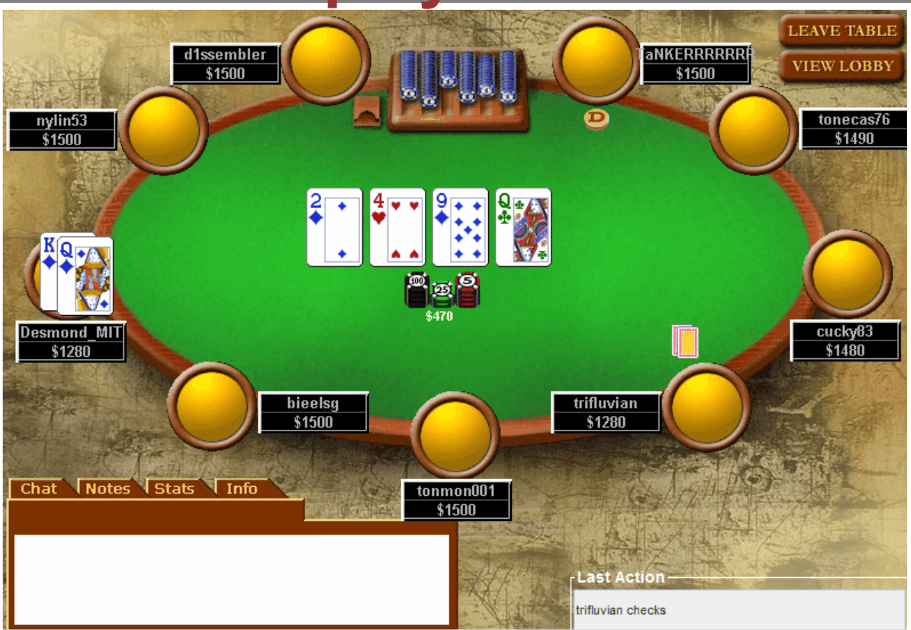
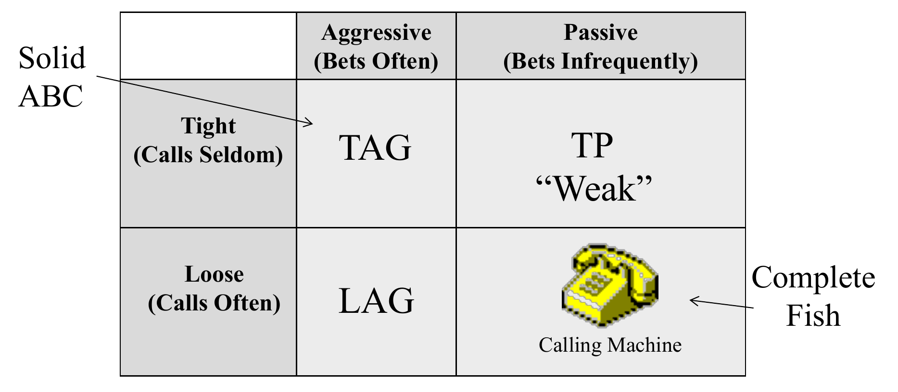

<!-- escape-math: v1 -->
# L1 Introduction to Poker Theory

This opening chapter sets up the whole course: the roadmap of topics and the "concepts–practice–advanced" learning framework, the quantitative yardsticks for what counts as a winning player, and three foundational tools and concepts that recur throughout the book. The three are hand history analysis software, the effective stack, and Harrington's M ratio.

## Course Roadmap

The course covers, in order: basic strategy, analysis techniques and their applications, preflop analysis, tournament play, poker economics, game theory, and decision making. Preflop analysis carries the most weight. Essentially all of the value a beginner loses in tournaments comes from preflop mistakes, and preflop is precisely the part that is hardest to get right by feel. The last four topics are taught by guest lecturers: Joel Fried (analytical techniques), Aaron Brown (poker economics), Bill Chen (game theory), and Matt Hawrilenko (decision making).

## How to Study: Concepts, Practice, and Advanced Techniques

Learning any complex skill can be split into three layers, and the course is organized accordingly, with slides tagged by difficulty:

- **Concepts (tagged C)**: the basic framework for decision making, aimed at un-exploitable play: solid ABC poker. The benchmark: when you sit down, every pro in the room does not turn around and want to be at your table. Become a slightly winning player long before you try to become a hugely winning one.
- **Practice (tagged P)**: applying the concepts in real time. At a real table there is no calculator, no complete information, and no time, so decision rules must be distilled into rules of thumb. You need to know how sensitive each rule is to rounding (which approximations you can ignore and which you must follow exactly) and to handle the psychological factors that affect live performance.
- **Advanced Techniques (tagged A)**: once the fundamentals are down, derive decision rules from first principles and make small deviations to squeeze out extra value (for example, grinding out an additional half big blind per hour); that is exploitive play. It also covers metagame concepts, everything unrelated to the hand-by-hand decision process: table selection, bankroll management, and "should I play this game at all."

## How to Define "Winning"

A "winner" in poker must be defined by a quantitative metric, and each format has its own:

| Format | Metric | Strong level |
| --- | --- | --- |
| Cash games (online) | Big blinds won per 100 hands, BB/100 | 5 BB/100 |
| Cash games (live) | Big blinds won per hour, BB/hour | 5 BB/hour |
| Multi-table tournaments (MTT) | Return on investment (ROI) | 30% |
| Sit-and-Go's (SnG) | Return on investment (ROI) | 15% |
| General | Hourly rate | \\$50–\\$200/hour |

The lecture video's worked example of ROI (from the blackboard, not the slides): ROI = total returned ÷ amount invested − 1. Invest \\$100k, get back \\$150k in total, and ROI = 150k/100k − 1 = 50%.

## Perspective of the Course

The value judgments in this course come mainly from the instructor's perspective as an online MTT grinder, in four specific ways:

- **ROI as the core efficiency metric**, with the hourly rate kept in view. There is a trade-off between ROI and hourly: you should generally maximize ROI until it falls to the hourly floor you set for yourself. The standard way to supplement ROI is to move down in stakes: lower-stakes games are easier and your win rate is higher, but that win rate is multiplied by a much smaller number. Players move around in stakes until they find the balance of "good ROI, hourly above the personal floor."
- **Focus on live tournaments**. The policy outlook for online poker is uncertain, whereas live tournaments are social and public; everyone knows who wins them.
- **Preference for conservative, low-variance play**. The course rejects the "a real pro plays every game" attitude in favor of identifying value and monetizing it.
- **Online training feeds back into live play**. Online you can accumulate hands and review them with software at a speed no live player can match, which is exactly why the live tournament scene is dominated by players with online backgrounds. Even if you intend to play only live for the rest of your life, online analysis training lets you learn, much faster, things you would never see live.

## Basic Tools: Hand Histories and Analysis Software

The analysis in this course is built on the **hand history**: a text file the poker platform generates for every hand, recording each action line by line. The format is essentially universal across analysis software. One caveat: real-money players can request their complete hand histories from the platform at any time, but play-money players' histories are stored only locally, never archived by the site. You must enable local saving from day one, because lost histories cannot be recovered.

Two core pieces of software:

- **PokerTracker**: poker analytical software that imports hand histories by the thousand and computes statistics automatically; it also bundles tools such as an equity calculator and an independent chip model (ICM) calculator.
- **Universal Replayer**: a free hand-history visualizer that reads a hand history text file and animates it as if you were watching the real game, useful for review and for showing hands to others.

## Stack Size and Effective Stack Size

**Stack size** is the value of the chips in front of you. But the quantity that matters for decisions is the **effective stack size**:

$$\text{effective stack} = \min(\text{your stack},\ \text{biggest stack still in play})$$

A more intuitive definition: **the most chips you can possibly lose in this one hand**. From now on, "stack" almost always means effective stack.

Why does the effective stack shape play more than the cards themselves? Consider a heads-up example: blinds 10/20, and you hold Q♥Q♦ in the small blind.

- If both players have 1500 chips (about 50 times the blinds combined): you raise to 60, your opponent re-raises to 200, you make it 600, and he shoves 1500; your queens are probably no longer good. The deeper the stacks, the wider the gap between QQ and AA.
- If you have only 300 chips: you raise, your opponent shoves, and you cannot fold; the QQ plays identically to AA.

Likewise, even if you have 1500 while your opponent has 300, any raise from him means a shove, and there is no room for back-and-forth raising. As far as your decision is concerned, you might as well have 300 yourself. With shallow stacks you are effectively making an all-in-or-fold decision with your entire range of starting hands. Because the player with fewer chips determines when the action ends, the effective stack is the basis of decision making.

## The Four Quadrants of Player Style

Dan Harrington ("Action Dan," 1995 WSOP (World Series of Poker) Main Event champion, holder of two WSOP bracelets and one WPT title) is the archetype of the solid tight-aggressive ABC player. His **TAG (tight-aggressive)** style comes from a two-dimensional classification of basic playing temperaments: one axis is betting frequency (aggressive / passive, where betting or raising counts as aggressive), the other is calling frequency (tight / loose).

Each quadrant has a nickname:

- **TAG (tight-aggressive)**: bets with good hands, folds bad ones. Known as solid ABC play, it is the most profitable quadrant overall and the style this course recommends.
- **LAG (loose-aggressive)**: certainly bets good hands, but is willing to see a lot of cards and call a lot before giving up on a hand. Whether it wins depends on the game type, the opponents, and the ability to pick spots; there are indeed many big LAG winners.
- **TP (tight-passive, "Weak," also called a rock)**: folds without a hand and merely checks with one. These players can be run over completely; you never have to worry about a big losing night against them, and they are generally considered clearly sub-optimal.
- **LP (loose-passive, the "calling machine")**: when you have a hand, he calls every one of your bets and lets you extract full value; when he has a hand, he lets you see your draws cheaply and decide by the river whether you have made something. Over any realistic sample size, it is essentially impossible for anyone in this quadrant to be a winner: they are complete "fish," the biggest losers and donors at the table.

Recognizing which quadrant an opponent falls into directly helps you pick tables worth playing.

In the video blackboard segment the instructor also maps these two axes onto two quantitative PokerTracker statistics (this mapping is not written in the slides or the transcript): the tight–loose axis (calling and entering frequency) corresponds to **VPIP** (voluntarily put money in pot), and the aggression axis (betting and raising frequency) corresponds to **AF** (aggression factor, the ratio of bets and raises to calls). This is exactly how online analysis turns a temperament classification into data; Chapter 2 develops these metrics in detail.

## Harrington's M Ratio

The M ratio was actually invented by Paul Magriel. Magriel was a world-class backgammon theorist: holder of the most backgammon tournament wins in the world, commentator for the World Series of Backgammon (WSOB), and an eight-time WSOP final-tablist, renowned for his mathematics. The concept only caught on after Harrington popularized it in the *Harrington on Hold'em* trilogy (Vol. I *Strategic Play*, 2004; Vol. II *The Endgame*, 2005; Vol. III *The Workbook*, 2006).

The **M ratio** is defined as:

$$M = \frac{\text{effective stack}}{\text{sum of the blinds and antes}}$$

It has two equivalent readings:

1. If you folded every hand, how many rounds you could survive before being blinded out;
2. More importantly, the ratio of your stack to the value of stealing the blinds.

Why not report your stack as a number of big blinds? That measure is fundamentally flawed. First, it assumes the big blind is twice the small blind (as in 1/2 or 2/4). With a 1/3 or 3/5 structure, "how many big blinds" says nothing about how many hands you can see or how much you should care about winning the pot preflop. Second, it ignores antes entirely: at 50/100 blinds with a 25 ante, your real stack pressure nearly doubles while your "number of big blinds" does not change at all.

The M ratio is the better measure because **the blinds are the fundamental force driving preflop decisions**. The only reason anyone plays any hand of poker is that someone wants to win the blinds: even holding K♠K♥, if you could simply take the blinds 99% of the time, you would. The blinds' share of your stack directly determines how much they matter. At M = 100 the blinds are only 1% of your stack and can essentially be ignored, so postflop developments dominate the decision. At M = 2 the blinds are half your stack, and maximizing your chance of winning them at any cost is the correct play.

For tournaments, M also provides a way to normalize decisions across blind levels: 1500 chips at 50/100 blinds is essentially the same decision as ten times the chips at ten times the blinds. The conversion is one mental division, with no need to change your strategic framework as the levels rise.

### Other Harrington Ratios

Harrington proposed two further ratios that never caught on:

- **Q ratio** $Q = \dfrac{\text{your stack}}{\text{average player's stack}}$, measuring your relative position in the tournament: at Q = 5 there is no need to be aggressive, while Q = 0.2 means you are far from the money with a lot of catching up to do.
- **Effective M ratio** $M\_{\text{eff}} = M \times \dfrac{\text{players at the table}}{10}$. Its motivation is the "how many rounds can you survive" reading. At a 10-handed table, M = 10 means surviving 10 more rounds of blinds. But with only 3 players you pay a blind every other hand and your real survival time shrinks sharply, so M is discounted proportionally to how shorthanded the table is. This differs from the instructor's reading of M (the stack's value relative to the blinds) and is rarely used in practice.

## Key Takeaways

- Course roadmap: basic strategy → analysis techniques → preflop analysis (the centerpiece) → tournament play → poker economics → game theory → decision making.
- Learning proceeds in three layers: concepts (C, un-exploitable ABC play), practice (P, real-time rules of thumb), and advanced techniques (A, exploitive adjustments and the metagame). Become a slightly winning player before chasing big wins.
- Quantitative standards for winning: 5 BB/100 (online) or 5 BB/hour (live) in cash games; ROI around 30% (MTT) / 15% (SnG) in tournaments; hourly of \\$50–\\$200. Balance ROI against hourly by moving up or down in stakes; ROI = total returned ÷ invested − 1 (e.g. \\$100k in, \\$150k back → 50% ROI).
- Analysis infrastructure: always save your hand histories; PokerTracker for statistical analysis, Universal Replayer for visual review.
- Effective stack $= \min(\text{your stack},\ \text{biggest stack still in play})$, i.e. the most you can lose in one hand; always base decisions on the effective stack, not the nominal one.
- The four style quadrants: TAG (tight-aggressive, recommended) and LAG (loose-aggressive) can win; TP (tight-passive) is sub-optimal; LP (loose-passive, calling machine) is the guaranteed-losing fish. Both axes are quantifiable: tightness ↔ VPIP, aggression ↔ AF.
- M ratio $=$ effective stack ÷ (blinds plus antes); it captures the pressure the blinds put on decisions better than "number of big blinds" and normalizes decisions across blind levels. The Q ratio and effective M ratio are Harrington's but never caught on.
