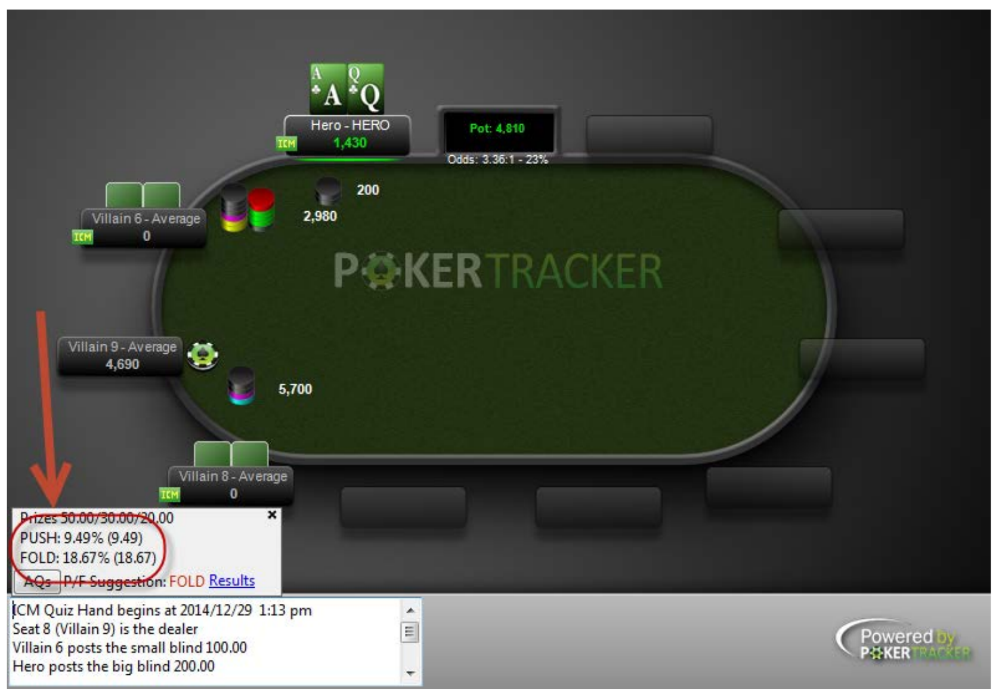
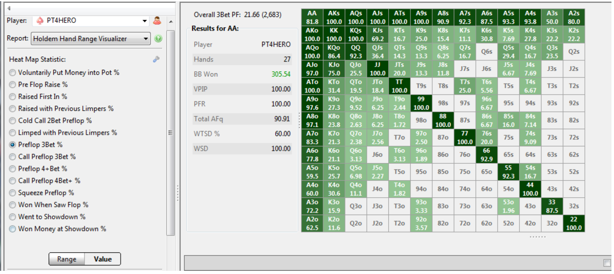
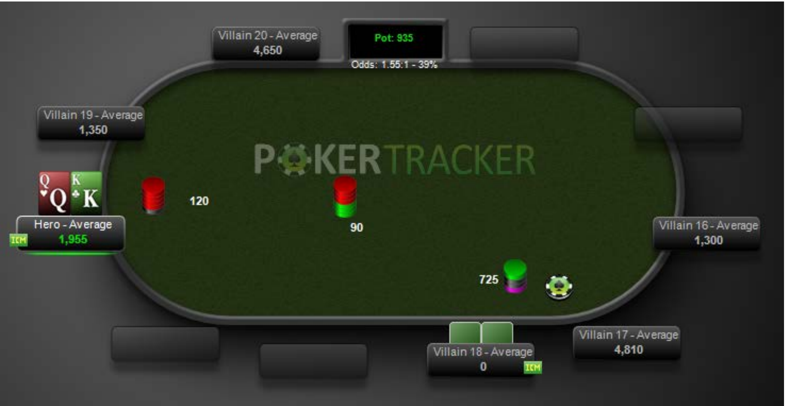
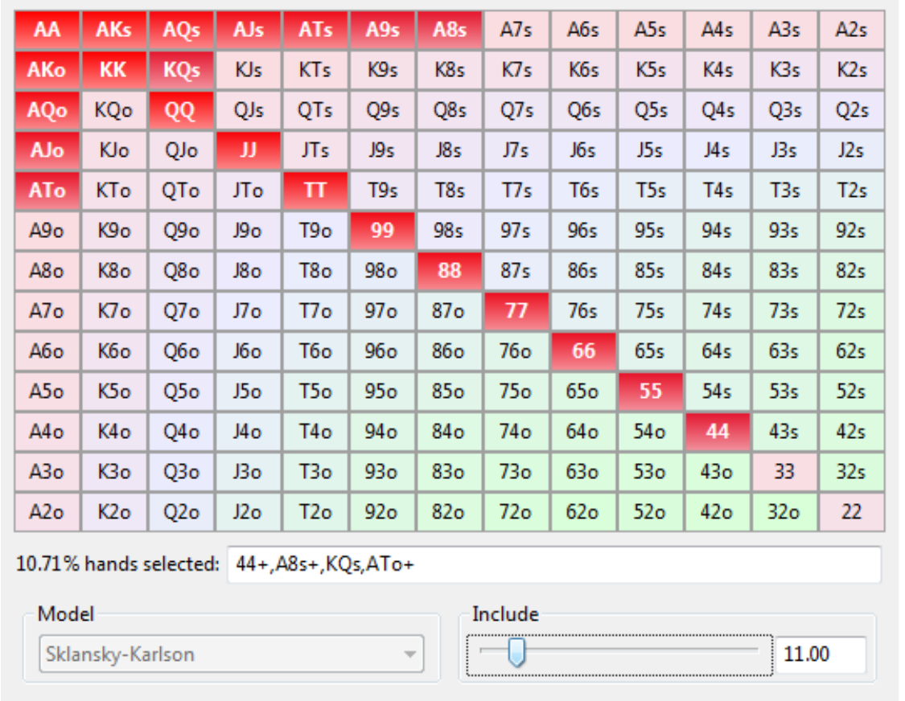

<!-- escape-math: v1 -->
# Analytical Techniques

This chapter shows how to improve your game with hand-tracking and analysis software such as PokerTracker 4 (PT4). PokerTracker has been the industry-leading analysis and tracking software for online poker since 2001, growing from limit hold'em only to Omaha, no-limit and pot-limit hold'em, and full tournament support. The core idea: poker is a sequence of discrete **decision points**. The software's value is not that it makes decisions for you, but that it helps you find the decision points where the answer is unclear, build data-driven models of your opponents, and carry the conclusions back to the table. The chapter is based on a guest lecture by Joel Freed, VIP Support Director at Max Value Software, PokerTracker's parent company; all examples use PT4.

## Decision Points: The Basic Unit of Analysis

A **decision point** is any moment in a hand where you can act: check, bet, call, raise, or fold. After you have played for a while, you naturally remember similar decision points: for example, being the short stack in a tournament with the action folded to you in the small blind. The next time you face that situation, you already have a history to build on. Analyzing these decision points with software is one of the most effective ways to improve.

What makes a decision point "interesting"? **When the expectation of the different options is not clear to you: they are close together.** Those are the spots where you see players on television agonizing for minutes. When you start out, nearly every decision point is interesting, until you develop heuristics for when to call and when to fold. Players of different levels find different decisions interesting.

### A Decision Point on the Bubble

Consider a single-table SnG with a 50/30/20 payout: the buy-in is \\$10, first place pays \\$50, second \\$30, third \\$20. The blinds are 100/200 and four players remain. You are in the big blind with A♣Q♣ and a stack of 1,430. The cutoff open-shoves 5,700, the button folds, and the small blind calls all in for 2,980; both are already all in. The action is on you; the pot is 4,810 and it costs 1,430 to call.

Start with **pot odds**: you are getting about 3.35:1, a break-even equity of roughly 23%. In a cash game, calling would be profitable with just 23% equity against the two hands combined. But this is a tournament, and that changes everything.

The figure is from PT4's ICM quiz (Tools → ICM → Quiz). The **Independent Chip Model (ICM)** converts tournament chips into real-money equity in the prize pool: your last chip is worth far more than your first, because once you are out you win nothing. Against an "average player" model:

- Calling (pushing) is worth **9.49%** of the prize pool;
- Folding is worth **18.67%**.

The reason is that the player with 2,980 chips is reasonably likely to be eliminated, at which point you are guaranteed third place. This is a clear fold, even with K♠K♥. Going further and setting both opponents' ranges to 100% (they shoved blind, with any two cards), fold equity is still about 18.89% against a push equity of only about 15.13%; even though you now win about half of all showdowns, it is still a fold. The value of tournament survival overrides pot odds.

## How **Not** to Get Better

There is a lot to look at in the software, but the following ways of spending time do nothing to improve your decisions.

- **Staring at results graphs.** A winnings curve from hand 1 to hand 265,000, ending up about €860,000, is pleasant to look at. But since poker is a series of decision points, ask: which decision would you change based on this graph? The answer is none of them. It may help you buy a house in the Boston area, but it will not help you play better.
- **Analyzing walks.** You are in the big blind, everyone folds, and you pick up the small blind for free; you never had a chance to act, so there is no play to improve.
- **Analyzing luck.** The software can plot your luck distribution: for example, one player flops a set with pocket pairs more than one standard deviation above the mean. That is great, but past luck cannot be converted into future adjustments; likewise, studying whether you were dealt aces more often than average last week is useless.
- **Relying on statistics that are irrelevant or lack a sufficient sample.**

The last point deserves expansion. PT4 has over a thousand statistics (thousands once you combine position and stack size), and many are irrelevant to the spot at hand or rest on tiny samples. Example (a real cash-game hand): the player on the button holds A♠T♥ and calls villain16's preflop raise; the flop comes 2♠4♠3♦, villain bets, he calls; the turn is the T♦, villain bets again, he calls again; the river is the A♥, giving him top two pair. Villain bets £1,550 into a pot of £1,975, so the call is priced at 2.27:1, which is profitable if he is ahead at least about 31% of the time.

The HUD (heads-up display) holds 97 hands on this opponent (roughly three hours of live play, or an hour and a half online). His VPIP is 65 and his PFR is 45: loose and aggressive. The river stats pop-up shows he had 8 chances to bet the river and bet 3 of them (38%). But that number is **completely irrelevant**: "river bet" does not care how he got to the river. Calling down and then betting when it is checked to him counts; checking flop and turn and betting the river counts. In this hand, however, he is making a **continuation bet** (cbet): last raiser preflop, betting flop, turn, and river in sequence. The pop-up's "river cbet" line reads **0/0**: not a single sample. Inferring his hand strength from his overall river-bet frequency is reasoning on the wrong data. The right approach is to work from the board texture and his preflop and flop numbers to figure out what kind of hand gets here this way.

## The Five-Step Process

1. Use reports and filters to isolate a **very specific** kind of decision point: the ones where you are unsure of the answer.
2. Build a **mental model** of the players in that situation: what you think they are doing here. Even within one kind of decision point, opponent types and board textures (draws coming in, the board pairing) differ, and each case needs its own judgment, exactly what you do at a live table trying to read what is going through an opponent's mind.
3. Adjust the model with every relevant input: the relevant statistics, notes, and even live information such as "he lost a big pot two hands ago and is steaming" or "he just finished his fifth beer and is slurring his words."
4. Evaluate the merits of each decision option: will a call win? What stack remains if you fold? How does the outcome affect everyone else's tournament standing? (Tournament preflop decisions are especially sensitive to these considerations.)
5. Go back to step 1 and repeat. Every interesting kind of decision you analyze makes you better the next time you face it.

## The Report System

In PT4, "report" means any way the software displays data. Reports live on the **View Stats** page (choose the T tab for tournaments); the sidebar selects the specific report, grouped into Results, Statistics, My Reports, and Graphs.

- The **Overview report** is grouped By Description by default (one row per tournament type) and can be switched to By Tournament; Basic and Advanced differ only in how many stat columns are shown. **Double-clicking a row drills down**: from a row summarizing 392 tournaments into the list of individual tournaments, and again into a hand-by-hand list (the most recent 100 by default, adjustable). Click any column header to sort.
- The **right-click context menu** adds or removes stat columns (Configure Report), replays hands, exports video, and adds notes and tags; Ctrl/Shift+click selects multiple rows, and "Replay All Hands in Report" replays an entire tournament.
- The **Summary report** supports several groupings, the most useful being Starting Hands Hold'em and Position. The starting-hands report has one row per hand type: for example, AA appeared 131 times with VPIP 100% (if that number is not 100%, rethink your decision process; aces is the best starting hand in Texas hold'em). Selecting a row lists the corresponding hands below, ready to replay or double-click. The position report has one row per position, letting you verify feelings like "everyone beats up on my big blind." Memory often lies; data does not.
- The **Holdem Hand Range Visualizer** displays ranges on the 13×13 starting-hand matrix. Range is a core poker concept: treat all hole cards as a domain, and your playing strategy is the function that maps hands from that domain into your range. After choosing a statistic (e.g., preflop three-bet: someone raised, and you reraised), the matrix offers two views. The **Range** view shows each hand type's actual share of the times you made the action (pocket tens 2.244%, AK 4.28%), which is what your range looks like to an opponent. The **Value** view shows how often you actually three-bet with each hand when you had the chance.

In the figure, the player three-bets suited ace-high hands like AKs/ATs/A9s every single time (100%), but their shares of his range differ; he was simply dealt some of them more often. If you believe "KJo should never be reraised" and the matrix shows you doing it 75% of the time, you immediately have an actionable fix. Any statistic expressed as a percentage can be viewed here.

- The **Facing Preflop Action report** groups hands by what happened before your first action: unopened pot (everyone folded to you), one limper (a player who just called the big blind), and so on, with hand counts, win rates, VPIP, and PFR per row. For example, one (heads-up) player has 10,434 unopened-pot hands with VPIP around 70% and PFR around 60%; with one limper, 1,945 hands and a sharply lower VPIP, because checking the big blind heads-up is not voluntarily putting money in, and VPIP counts preflop only. Late in tournaments, the range you play against an all-in differs enormously from your blind-stealing range when it is folded to you; this report is how you calibrate those spots.

### Custom Reports (My Reports)

You can build three kinds of reports: a **Player Report** (aggregate statistics over hands you played, such as VPIP); a **Hand Report** (one row per hand, ideal for lists like "all hands where I faced a river continuation bet"); and an **All Players Report** (one row per player in the database). The Player Report supports groupings found nowhere else, of which **preflop stack size** (in big blinds) is especially valuable for tournament players: you can see how your raise-first-in (RFI) frequency changes with stack depth; for instance, across the 59 hands played with less than two big blinds, RFI was 47%. Multiplying the big-blind count by 2/3 roughly converts it to M. You can save reports together with their filters and reload them from the dropdown later.

## The Filter System

**More Filters** in the sidebar is the gateway to every subset of your data, in five sections:

- **Game Details (game level)**: date, currency, speed (regular/turbo/hyper), buy-in, description, table size, blind level, and so on.
- **Hand Details (whole-hand level)**: maximum preflop raise, whether there was a three-bet, whether anyone limped, pot size, stack depth, number of players dealt in (filter bubble hands by player count), player positions (who made the first raise, where you sat), hand tags, amount won or lost, whether the hand reached showdown, and more.
- **Hand Values**: hole cards, made-hand strength, and draw strength. The hole-card selector lets you click hands on the matrix directly or use a slider for "the top N% of hands". The ranking defaults to the **Sklansky–Karlson** model (a hand-strength ordering derived for a specific mathematical problem, covered later in the course), can be switched to "hand vs three randoms" (ranked by equity against three random hands, which skews heavily toward high cards: KJo and QJo outrank low pocket pairs), or to a custom model. Group Select offers shortcuts like "any ace," "any pair," and "invert." Made-hand strength lets you specify the street the hand was made on (e.g., a straight made only on the river), how many hole cards were used, whether it was the **nuts** (a hand that cannot be beaten by a bigger hand of the same type: A♠K♥ on a Q♥J♦T♣ board is the nut straight, while 9♠8♠ on the same board is a non-nut straight), and whether it was a **backdoor** hand (no draw on the flop; the hand arrives with the turn and river). Draw strength filters for gutshots (4 outs) or open-ended straight draws (8 outs) on the flop or turn, whether the outs make the nut straight, backdoor draws, and more.
- **Board Texture**: whether the board contains an ace, whether the turn paired the board, whether the flop is monotone, board connectedness (T♠9♦8♣ is strongly connected, T♠9♦7♣ less so), and similar.
- **Actions & Opportunities**: the active player's actions (bets and their sizing, raises, raises faced and their sizing, calls, folds) and opportunities (a chance to three-bet, a chance to face an all-in, and so on), as precise as "I open-raised to 3 big blinds" or "an opponent open-raised to 2–3 big blinds into me," with the same for flop, turn, and river.

Multiple filters can be grouped with **AND / OR** (inclusive OR) and negated with **NOT**: for example, "I made a 2–3 big blind first raise" AND "I faced a 2–3 big blind open raise" can never both hold and yields no data, while OR gives their union. Complex filters take time to build, so **save them as Quick Filters**: a named Quick Filter appears in the sidebar dropdown and loads onto any report in one click; Edit Quick Filters renames, deletes, and appends multiple Quick Filters together, and import/export lets a team share them.

## Statistics: Definitions and Interpretation

The vast majority of statistics answer the same question: **given the opportunity to take an action, how often did the player take it**:

$$
\text{statistic} = \frac{\text{number of times the action was taken}}{\text{number of opportunities to take it}} \times 100\\%.
$$

Typical examples:

- **VPIP** (voluntarily put money in pot): the percentage of hands in which a player voluntarily put money in the pot preflop. It captures how involved a player is in pots, and it converges quickly (nearly every hand is an observation), so players with VPIP 40 play broadly similar styles, a fast way to categorize opponents.
- **Raise First In (RFI)**: how often a player raises on their first action when everyone has folded to them. RFI 40% signals an extreme stealing tendency. Reading it together with VPIP is more informative: a player with VPIP 70 and RFI 2 calls constantly but never raises: happy to put money in, unwilling to drive the price up.
- Highly specialized statistics, such as **Fold to Raise After Flop CBet in 3Bet+ Pot**: you made the last preflop raise of three-bet or higher, continuation-bet the flop, were raised, and folded. Stats like this become useful in cash games after thousands of hands; tournament stacks are too shallow for these spots to arise.
- The definition of every statistic can be found in the **Configure → Statistics** window: filter by tournament/cash and player/hand stats, search by name, and read a detailed description plus the exact formula. For example, "call preflop squeeze": a **squeeze** is when one player open-raises, another calls, and a third three-bets both of them, projecting great strength (a play recommended in *Harrington on Hold'em*); facing a squeeze and calling counts toward this statistic.

### Finding Your Opponents' Stats

- **Results → Player Summary**: one row per opponent in the database, with tournaments played, VPIP, PFR, three-bet frequency, and three-bet success rate (how often everyone folded to the three-bet; a high success rate means the player can three-bet with impunity to pick up blinds). Sort by column headers to find your most common opponents.
- **Hero vs Villain report**: only the hands where money changed hands between you and one opponent, broken down by pot size; selecting a row pulls up your complete history together.
- **The Player dropdown switches perspective**: load any opponent and every report, statistic, and filter in PT4 is recomputed from his point of view. The one limitation: you only see his hole cards in hands that reached showdown.

## Worked Example: K♣Q♥ in the Big Blind Facing a Shove in a Fifty50

Now we put all the tools together. A **Fifty50** tournament starts with 10 players and pays the top 5: reaching the money returns your buy-in (\\$10), and the other half of the prize pool is distributed in proportion to chip stacks. The situation we want to analyze: six-handed (exactly on the bubble: one more elimination ends the tournament), we are in the big blind holding K♣Q♥ offsuit, facing a preflop all-in.

The filter path: Game Details → Fifty50; Hand Details → players dealt in, 6 to 6; Actions & Opportunities → preflop, Posted Big Blind; Hand Values → KQo; Actions & Opportunities → preflop Opportunities → Faced All In. Only two hands in the entire database match; situations that feel like they happen "all the time" usually have smaller samples than you think. We replay the second one.

As shown: blinds 60/120, ante 15, folded to the small blind, where Villain 18 shoves 725. The pot is 935 and we must call 605: odds of 1.55:1 (about 39%). If we call and bust him, the tournament ends on the spot and we lock up a cash; if we fold, he collects 210 chips and climbs to 935, still the short stack.

**Step 1: build a baseline model.** Before touching any statistics, ask "what hands would a completely unknown player shove here?" The baseline determines what every later adjustment means ("tighter than a 100% range" and "tighter than a 10% range" are very different things). This is exactly what top pros do: establish a baseline model, then adjust for individual characteristics.

**Step 2: refine the model with data.**

Over 73 hands, Villain 18's VPIP is 11% (he plays about 1 hand in 9) and his PFR is 1%; he had raised preflop exactly **once** before this hand. Digging into his small-blind and calling numbers: small-blind VPIP 13% (1 of 8 hands), never a raise from the small blind; he tends to call across positions (4 calls in 25 hands, 2 of them cold calls); facing limpers he only called behind 1 time in 7; he does not attack weakness; and he folded both times he faced a blind steal. The sample is not large, but the picture is already fairly clear.

**Step 3: infer his shoving range.** Two forces pull in opposite directions: his tournament life is on the line (if he is called and loses, he leaves with nothing), which makes him tighter; but he is the short stack with an **M** (the ratio of his stack to the cost of one orbit of blinds and antes) of only about 2.7; pure folding cannot survive three orbits, so he must make a move soon, which makes him looser. Go through the hand classes and ask: would he risk his tournament life on a low pocket pair like 2♠2♥? On a weak ace like A♦4♣? On KQ (our hand), KT, or QJ: hands we might **dominate**, sharing one high card with the better kicker, roughly a 70/30 favorite?

Translating a percentage into a concrete range takes a tool: PT4's Equity Calculator provides a Hand Range Selector slider that expands "the top N% of hands" into a matrix under the chosen model. It also computes equity hand vs hand, hand vs range, and range vs range. Starting from his VPIP of 11% (assuming "any hand he has ever played, he would play now"), the top 11% under Sklansky–Karlson is 44+, A8s+, KQs, ATo+:

That is, no 22 or 33, no weak aces at all (even A9 counts as only a middling ace), no weak suited aces: a fairly strong range.

**Step 4: the ICM verdict.** PT4's replayer has a built-in ICM calculator: click the green ICM box to see the prize-pool equity analysis of the current spot. The default Average model (built from large-scale data analysis) says that with M ≈ 2.7, folded to in the small blind, an "average player" shoves about **33.9%** of hands (as weak as Q8s, K2s, K6o, any pair, any ace). Against that default range: push equity 15.83%, fold equity 15.28%, a **call**, but by only 0.55 percentage points (about \\$0.60 of expectation in a \\$10 tournament). The edge is small; poker advantage is precisely the accumulation of such marginal decisions.

But we have already concluded this player is far tighter than average. Drag the Include slider from 33.9% down to 11%:

The verdict flips to a **fold**. Sliding further finds the **break-even range**: if we turned our cards face up and let him play perfectly, his optimal shoving range would be about 24%: any ace, any pair, K9s+, QTs+, KTo+. If you believe he shoves narrower than that, fold; wider, call. We now have a reusable decision benchmark for "big blind facing a short-stack shove on a Fifty50 bubble."

**The outcome, and a model correction.** In the actual tournament, Hero called with K♣Q♥ (everyone gets a spot wrong the first time). The flop came 9♠K♦2♦, top pair; the turn 7♥ was safe; the river 4♦ put three diamonds on board: any two diamonds now make a flush, ace-king also beats us, as do QQ/KK/AA. The opponent showed A♥5♦: not ace-king, and only one diamond, no flush, so Hero's pair of kings took the 1,540 pot. But note that A5o was **not** in the 11% range we assigned him; the model was falsified, and that is part of the process: the next time you analyze "a very tight player's very short-stack shove," widen the range by a few percent and the model has evolved one step.

## Key Takeaways

- Poker is a series of discrete decision points; the "interesting" ones are those where the options' expectations are close and you are unsure of the answer; analyzing them is how you improve.
- In tournaments, ICM converts chips into prize-pool equity; the value of survival can make A♣Q♣ (even KK) a clear fold against an all-in on the bubble, and pot odds yield to ICM.
- Looking at winnings graphs, analyzing walks, analyzing luck, and citing irrelevant or under-sampled statistics cannot improve decisions; statistics must match the situation (overall river-bet frequency ≠ river continuation-bet frequency).
- The five-step process: filter to a decision point → build a mental model of the opponent → adjust with statistics and information → evaluate the options → repeat.
- Statistics share one form, "times / opportunities × 100%"; reading VPIP and RFI together quickly sketches an opponent's type; Configure → Statistics is the authoritative source for definitions.
- Save complex filters as Quick Filters for reuse; the range visualizer separates the Range view (actual composition) from the Value view (frequency per hand).
- The worked example: baseline model → data-driven refinement (73 hands, VPIP 11, PFR 1) → range inference (11%) → ICM verdict (call against the default 33.9% range, fold against the refined 11% range, break-even at about 24%) → correct the model when the result falsifies it.
