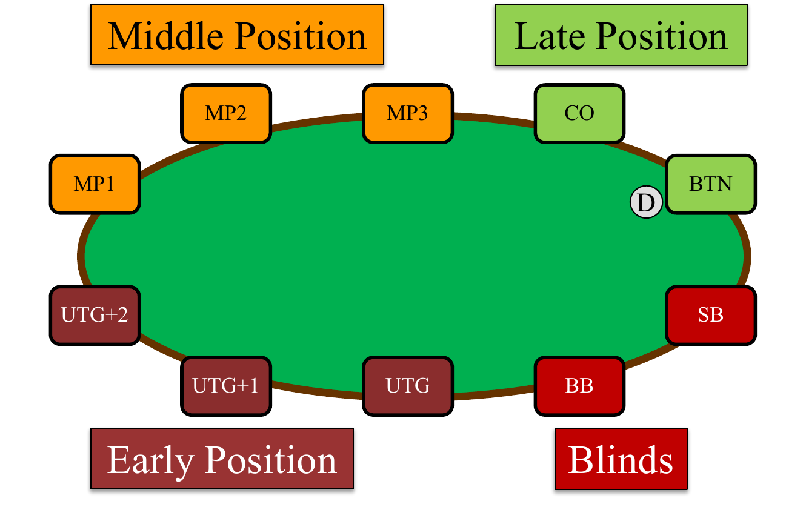
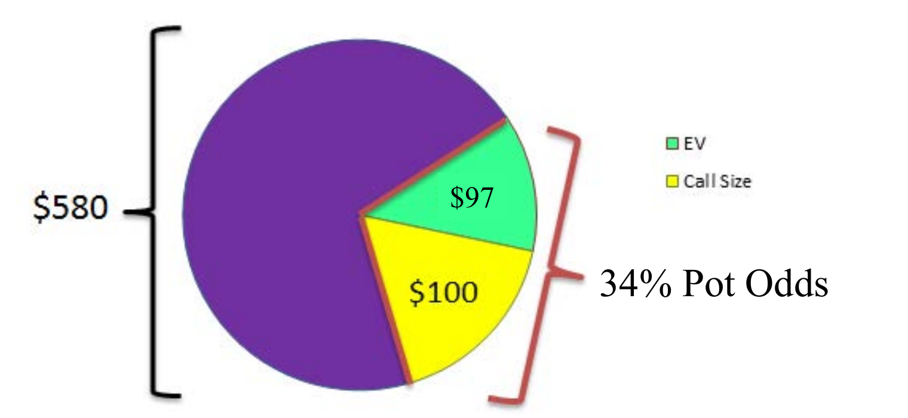
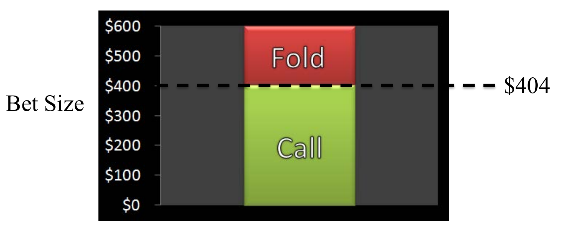
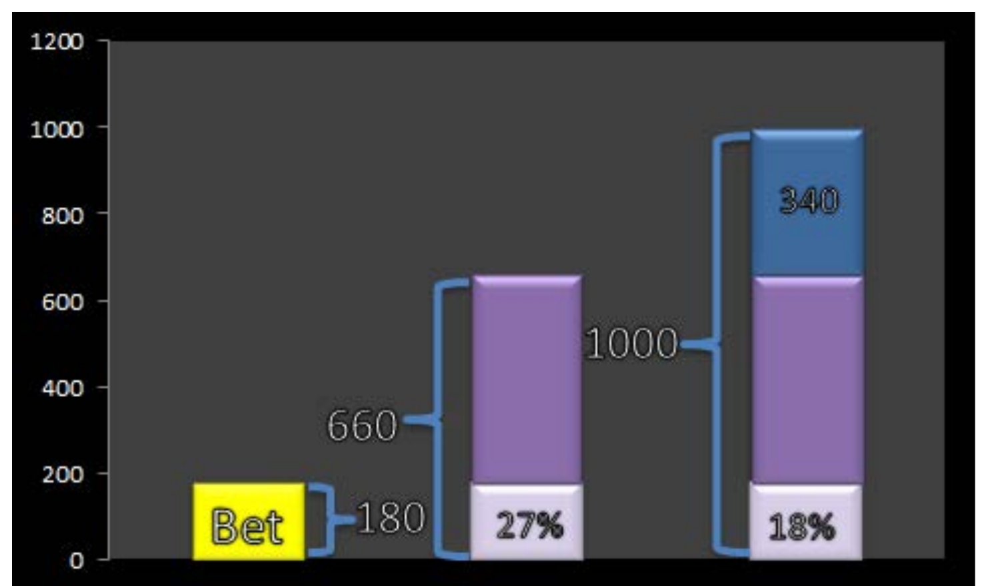
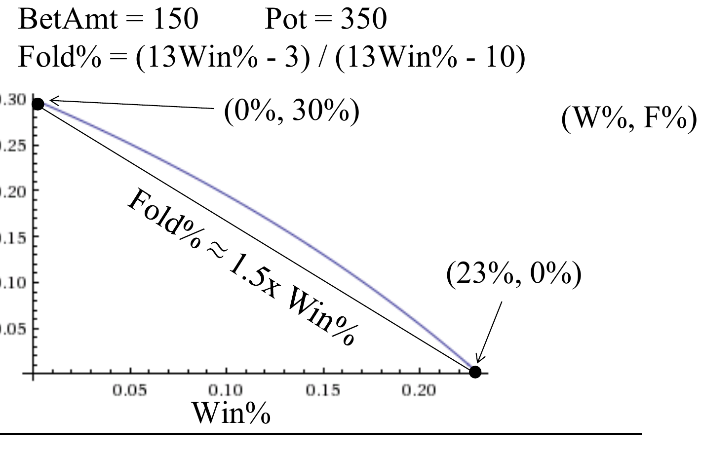

# L3 基本策略

本章是课程第一次正式进入扑克策略：先建立位置（position）术语，然后依次展开三个核心决策工具——底池赔率（pot odds）、隐含赔率（implied odds）、弃牌权益与半诈唬（fold equity and semi-bluffing）。所有工具都归结为同一个问题：如何用期望值为每个决策定出一个可计算的阈值。

## 位置术语

牌桌上的位置分为四组：盲注（blinds）、前位（early position）、中位（middle position）和后位（late position）。位置之所以重要，是因为后行动的人在行动前能看到先行动者的选择，掌握更多信息。描述一手牌时，我们通常用位置而不是人名来指代玩家。



从大盲（big blind, BB）左侧开始，前位依次称为枪口位（under the gun, UTG）、UTG+1、UTG+2；中位记为 MP1、MP2、MP3；后位围绕按钮位描述——按钮位（button, BTN，图中小圆圈 D）和关煞位（cutoff, CO，即"截断按钮"的位置）；也有人把 CO 右边的位置叫 hijack，本课程不采用。小盲（small blind, SB）和大盲构成盲注组。六人桌（6-handed）时去掉最"没意思"的位置（UTG+2、MP1、MP2、MP3），保留有正式名称的位置：UTG、UTG+1、CO、BTN、SB、BB。

关于位置的基本结论：

- 一般而言位置越靠后越好，因为行动前获得的信息更多，可玩的起手牌范围（range）也更宽。盈利总体流向后位——按钮位应该是你赚钱最多的位置，如果在按钮位亏钱，应当认真检讨打法。
- 盲注能以折扣价看到翻牌（flop），因为已经被迫投入筹码；但翻牌后每一轮他们都最先行动，处于最差的资讯劣势。折扣买到的是一手几乎必然处于信息劣势的牌局入场券。
- 但在短筹码（低 M）情形下，前位反而有优势：先行动者可以抢先全下（all-in），保住进攻带来的弃牌权益。这类似"胆小鬼博弈"（game of chicken）：两车对撞，先转向者输；最优策略是把方向盘扔出窗外，让对方知道你别无选择。锦标赛中双方都不想打摊牌（showdown）拼命时，前位玩家可以率先全下来吓退对手。

## 底池赔率

### 为什么赔率会起作用

最常见的局面是"弱成牌对听牌"（made hand vs drawing hand）：翻牌圈（flop）上一人有一对或两对，另一人只有顺子（straight）或同花（flush）听牌；翻牌前（pre-flop）则是一人拿口袋对子（pocket pair），另一人拿任意牌。听牌方（drawer）要权衡击中听牌的概率与每多看一张牌的成本；成牌方则希望下注足够大，使听牌方的跟注不是 +EV（正期望）——或者下注一个差玩家会误以为是好价格的数目，两者等效，后者甚至更好。

### 期望值

期望值（expected value, EV）是所有可能结果的概率加权平均：

$$EV = \text{Win\%} \times \text{WinAmt} - \text{Lose\%} \times \text{LoseAmt}$$

例如，若胜率为 25%，面对一个打入 ＄100 底池的 ＄60 下注：$EV = 25\% \times (100+60) - 75\% \times 30 = 17.5$。本课程的一切决策规则都建立在期望值之上。

考虑如下场景（本章反复使用的牌局格式：上方列出相关筹码量与盲注，括号内为该轮行动前底池，Hero 是我们关心的主角，Villain 是对手）：

```
John_VH925 (UTG+1): $500        盲注 20/40 + 10 ante
Hero (MP1): $500

翻牌前: ($140) Hero 持 A♥T♥
1 人弃牌, John_VH925 加注到 $120, Hero 跟注 $120, 5 人弃牌

翻牌: ($380) 8♥ 3♥ K♣ (2 人)
John_VH925 全下 $370, Hero……?
```

与其问"该不该跟注"，不如问更有韧性的问题：**Hero 最多能跟多大的注？** 设对手下注 $x$，则

$$EV = \text{W\%} \times (380 + x) - \text{L\%} \times x$$

跟注阈值在 $EV = 0$ 处。

### 底池赔率

底池赔率（pot odds）是**跟注额与跟注后底池大小**的关系。一般规则：当

$$\text{Win\%} > \frac{\text{CallAmt}}{\text{Pot} + \text{BetAmt} + \text{CallAmt}}$$

时跟注为 +EV。例如假设对手向 ＄380 的底池下注 ＄100，则底池赔率为 $100/\$580$（580 = 底池 + 下注 + 跟注），即 Hero 的跟注占新底池的约 17%；只要胜率超过 17% 就能盈利。（也有人用"1 赔 4"式的记法，本课程统一用"你贡献底池的百分比"，更直观。）

胜率由**补牌**（outs，能让你获胜的牌）决定。本例中剩余 9 张红心都能做成同花，精确胜率为转牌（turn）或河牌（river）至少击中一张的概率：

$$\text{Win\%} = 1 - \frac{40}{49} \times \frac{39}{48} \approx 34\%$$

34% 远大于 17%，这是一手很好的跟注：$EV = 34\% \times \$480 - 66\% \times \$100 = \$97.2$。



上图给出直观理解：整个饼是跟注后的 ＄580 底池，你的胜率 34% 对应 ＄197 的一块；这块由跟注成本（＄100）和期望收益（＄97）组成。跟注越小，EV 那块越大；跟注过大，EV 变成负的一块。

### Gordon 二四法则

快速估算胜率的工具是 Phil Gordon 提出的二四法则（rule of 2 and 4），出自《Phil Gordon's Little Green Book》。Gordon 是 2001 年 WSOP 主赛事第四名、一次 WPT 冠军、两次北美桥牌锦标赛冠军，还当过"石头剪刀布世界系列赛"总裁判长。法则内容：

- 每多能看一张牌，每个补牌约值 **2%** 的胜率（2% 大致来自 1/50，对剩余 47–49 张牌的粗略近似）；
- 如果能同时看到转牌和河牌（例如对手已全下），每个补牌按 **4%** 计。

例如：翻牌圈拿小对子听三条（three-of-a-kind），有 2 个补牌，每看一张牌约 4% 命中率；同花听牌 9 个补牌，$9/47 \approx 18\% = 9 \times 2\%$；卡顺听牌（inside straight draw）4 个补牌，$4/47 \approx 8\% = 4 \times 2\%$。精确计算与乘 2 的结果非常接近。

### 求解阈值与实战算法

回到场景 A：对手全下 $x$ 进 ＄380 底池，因为他已全下，我们确定能看到两张牌，胜率约 $9 \times 4\% = 36\%$（精确值 34%）。令 $EV = 0$：

$$34\% \times (380 + x) - 66\% \times x = 0 \implies x = \$404$$

验证：$404 / (404 \times 2 + 380) \approx 0.34$。于是得到解集：**任何不超过 ＄404 的下注都跟注，更大的弃牌**。



实战中不用解方程：Hero 知道自己约 36% 击中同花，因此最多可以贡献新底池的 36%。面对 ＄370 全下，新底池为 $380 + 370 + 370 = 1120$，自己贡献 $370/1120 = 33\% < 36\%$，所以跟注。这就是桌边的实时决策方式。

### 更多示例

**示例一（两头顺听牌）。** Villain (MP): ＄250，Hero (BTN): ＄1000，盲注 20/40+10。Hero 持 6♦7♦，翻牌前 Villain 加到 ＄90，Hero 跟注。翻牌（＄320）8♠5♥K♣，Villain 全下 ＄150。

1. 听什么？两头顺子（open-ended straight）。
2. 补牌？任意 9、任意 4，共 8 张。
3. 命中率？$8 \times 4\% = 32\%$（对手全下，看两张牌）。
4. 打法？跟注：$150/620 = 24\% < 32\%$。
5. EV？$32\% \times 470 - 68\% \times 150 = 48.4$。

**示例二（暗三条听葫芦，对手下注过小）。** Villain (MP): ＄3000，Hero (BTN): ＄3000，盲注 100/200。Hero 持 5♦5♥，Villain 加到 ＄400，两人跟注，Hero 跟注。翻牌（＄1900）5♣A♣6♣，Villain 下注 ＄200。牌面三张梅花，Hero 的暗三条（set）很可能落后于同花。

1. 听什么？葫芦（full house）或四条（four-of-a-kind）。
2. 补牌？3 张 A、3 张 6、1 张 5，共 7 张。
3. 命中率？只能指望看到一张牌（对手筹码还深，转牌圈大概率继续下注），$7 \times 2\% = 14\%$。
4. 打法？跟注：$200/2300 \approx 9\% < 14\%$。
5. EV？$14\% \times 2100 - 86\% \times 200 = 122$。

注意 Villain 的错误：他只下注约底池的 1/10。若他有同花，这是没有保护手牌；若没有，则白白送钱。新手常犯这种错误——怕把人打跑而下小注，其实对手弃牌反而更好；正确的下注量要让对手"要么弃牌，要么跟注即犯错"。

**示例三（小盲对大盲的"盲对盲"）。** Villain (BB): ＄200，Hero (SB): ＄1000，盲注 100/200。Hero 持 5♣7♥ 在小盲位，大盲的 ＄200 已全在池中，跟注即相当于对手全下。

1. 听什么？任何牌——对手的牌是任意两张（any two cards, ATC）。
2. 胜率？57o 对随机牌约 40%（连最差的 32o 对随机牌也有约 32%）。
3. 打法？跟注：$100/400 = 25\%$，而 40%（乃至 32%）都远大于 25%。
4. EV？$40\% \times 300 - 60\% \times 100 = 60$。弃牌等于白扔约 ＄60。

## 隐含赔率

### 手牌规则

底池赔率的解是"能不能跟"或"最多跟多少"；隐含赔率（implied odds）的解则不同：**击中听牌后还需要再赢多少筹码，才能让眼前的跟注成立**。方法是：求出底池要多大，才能使当前跟注额恰好等于底池的 x%（x% 为你的胜率），再减去跟注后实际的底池，差额就是需要补进去的"死钱"（dead money）。

例如：同花听牌，单张命中率 18%，对手向 ＄300 底池下注 ＄180。跟注后底池 ＄660，跟注占 $180/660 = 27\%$——按底池赔率太贵了，不能跟。但若底池是 $180/18\% = \$1000$，这笔跟注就恰好保本。差额 $\$1000 - \$660 = \$340$ 就是击中同花之后需要额外赢到的死钱：这 ＄340 让我们的 ＄180 跟注变成 ＄1000 底池的 18%。剩下的问题是凭经验判断这 ＄340 是否现实。



### 示例

**示例一（中对听两对/三条）。** Villain (MP): ＄3000，Hero (BTN): ＄3000，盲注 25/50。Hero 持 K♦T♥，Villain 加到 ＄150，Hero 跟注。翻牌（＄375）T♣A♥6♦，Villain 下注 ＄100。

1. 听什么？两对或三条。
2. 补牌？3 张 K、2 张 T，共 5 张。
3. 命中率？只看一张牌，$5 \times 2\% = 10\%$。
4. 底池赔率？$100/575 \approx 17\%$，太贵。
5. 保本所需后续下注？$100/10\% = \$1000$，$\$1000 - \$575 = \$425$。

这 ＄425 是现实的：对手已往 ＄400 的底池里打了 ＄100，转牌圈他大概率再下 ＄200–＄300，而我们听牌非常隐蔽，击中后加注他很难脱身。

**示例二（同花+顺子组合听牌）。** Villain (MP): ＄3000，Hero (BTN): ＄3000，盲注 25/50。Hero 持 K♣Q♣，Villain 加到 ＄100，Hero 跟注。翻牌（＄275）T♣J♣3♥，Villain 下注 ＄600。

1. 听什么？顺子或同花（K 高同花应足够大；一对不算）。
2. 补牌？同花 9 张 + 顺子 8 张 − 重叠 2 张 = 15 张（任意 A、任意 9、其余 7 张梅花）。
3. 命中率？只看一张牌，$15 \times 2\% = 30\%$。
4. 底池赔率？$600/1475 \approx 41\%$，太贵。
5. 保本所需后续下注？$600/30\% = \$2000$，$\$2000 - \$1475 = \$525$。

＄525 同样现实——对手已经打了 ＄600，即使梅花真的来了，他多半也不得不再跟注或下注至少 ＄500。

### 听牌公式汇总

- **EV（任何决策的边际价值）**：$x = \text{Win\%} \times \text{WinAmt} - \text{Lose\%} \times \text{LoseAmt}$
- **二四法则（听牌命中率）**：$x = 2\% \times \#\text{Outs} \times \#\text{FreeCards}$
- **底池赔率（跟注决策规则）**：$\text{Win\%} > \dfrac{\text{CallAmt}}{\text{Pot} + \text{BetAmt} + \text{CallAmt}}$
- **隐含赔率（击中后还需赢的筹码）**：$x = \dfrac{\text{BetAmt}}{\text{Win\%}} - (\text{Pot} + \text{BetAmt} + \text{CallAmt})$

代入前面的例子：向 ＄320 底池跟 ＄150、胜率 32%，$EV = 32\% \times 470 - 68\% \times 150 = \$48.4$；同花 9 个补牌只看转牌，$18\% = 2\% \times 9 \times 1$；＄380 底池面对 ＄370 全下持同花听牌，$36\% > 370/1120$ 成立，跟注；＄375 底池面对 ＄100 下注、听牌 10%，隐含赔率需求为 $(100/10\%) - 575 = \$425$。

### 实战案例：2014 WSOP 主赛事决赛桌泡沫

2014 年 WSOP 主赛事打到 10 人（决赛桌泡沫，再淘汰一人即进入"十一月九人组"休战三个月）。盲注 150k/300k + 50k ante：

```
Hero/Jacobson (UTG): 22,450k   Tonking (SB): 6,775k

翻牌前: (950k) Hero 持 A♣J♣
Hero 跟注 300k, 7 人弃牌, Tonking 跟注 150k, Sindelar (BB) 过牌

翻牌: (1,400k) 7♣ 8♥ T♣ (3 人)
Tonking 过牌, Sindelar 下注 500k, Hero 加注到 1,750k,
Tonking 再加注 4,525k 至 6,275k 全下, Sindelar 弃牌, Hero……?
```

分析（Tonking 实际持有 J♠9♠，已成顺子，但 Hero 不知道）：

- 听什么？同花，可能还有顺子。
- 补牌？9 张梅花全胜；3 张其他花色的 9 只有时赢（对手有 J 则平分、有 QJ 则输），保守按 50% 折算成 1.5 个补牌，合计 **10.5 个补牌**。补牌可以按击中后赢的概率折算成"部分补牌"，保守估计下若结论仍是跟注，那实际更要跟。
- 命中率？对手已全下，看两张牌，$10.5 \times 4\% = 42\%$。
- 打法？底池将为 $1400\text{k} + 500\text{k} + 2 \times 6275\text{k} = 14{,}450\text{k}$（Sindelar 弃牌的 500k 是死钱），跟注额 4,525k 约占 31% < 42%，跟注。
- EV？$42\% \times 9925\text{k} - 58\% \times 4525\text{k} = 1544\text{k}$——即使保守估计，这个跟注也价值约 150 万筹码。

Jacobson 跟注并赢下了这手牌，并最终赢得当年的 WSOP 主赛事冠军。

### 听牌的注意事项

- **不要听一手击中也未必赢的牌**：Q 高或更小的同花可能被更大的同花压制；顺子的低端（low end）极危险，常有人击中后才发现是第二好牌而输光；在对子牌面（paired board，牌面有对子，葫芦/四条成为可能）上听同花或顺子，甚至可能是在听死牌（drawing dead，胜率为 0）。
- **不要假设一次下注能看到转牌和河牌两张牌**：除非进攻方已经全下，否则这极少发生。很多玩家在翻牌圈跟注就是打着"便宜看两张"的主意，结果假设落空、白白损失 EV。
- **不要高估击中后榨取筹码的容易程度**：转牌/河牌击中同花非常明显，顺子较隐蔽，而暗三条几乎无法被读出——因此暗三条的隐含赔率极大，同花听牌的隐含赔率很小。
- **不要下注太小让对手获得 +EV 的跟注**：大多数翻牌圈、转牌圈的下注应在底池的一半到 2/3 左右，用以惩罚追牌。

## 弃牌权益与半诈唬

### 概念

弃牌权益（fold equity）是"对手弃牌的可能性"为下注方带来的价值，前提是假设被跟注会输。设对手弃牌率为 Fold%，摊牌胜率（showdown-win%, SD-Win%）为摊牌时的取胜概率：

$$\text{Fold Equity} = \text{Pot} \times \text{Fold\%} - \text{Bet} \times (1 - \text{Fold\%}) \quad (\text{SD-Win\%} = 0)$$

$$\text{Fold Equity} = \text{Pot} \times \text{Fold\%} + (1 - \text{Fold\%}) \times EV_{\text{if called}} \quad (\text{SD-Win\%} > 0)$$

其中摊牌价值（showdown value）$\text{SD Value} = (1 - \text{Fold\%}) \times EV_{\text{if called}}$。

**诈唬**（bluffing）是因为弃牌权益大于 0 而为 +EV 的下注；**半诈唬**（semi-bluffing）是弃牌权益本身为负、但被足够高的摊牌胜率补偿后仍为 +EV 的下注。半诈唬兼具偷池和反超两条获胜路径，在锦标赛中极为常用——你不会总有成牌，但总有能变成成牌的牌。

### 纯诈唬的保本弃牌率

```
Turkito694 (UTG): $2098        盲注 $5/$10
Hero (CO): $990

河牌: ($350) A♦ 5♥ 8♦ Q♠ 2♦ (2 人)
Turkito694 过牌, Hero 持 6♠7♠ 下注 $150……
这个诈唬需要多高的成功率才能盈利？
```

Hero 一路听牌未果，但前三轮的被动跟注让他在对手眼里"代表着同花"，对手河牌过牌正是担心这一点。此时摊牌胜率为 0：

$$EV = 350 \times \text{Fold\%} - 150 \times (1 - \text{Fold\%}) > 0 \iff \text{Fold\%} > \frac{150}{350 + 150} = 30\%$$

验证：$30\% \times 350 - 70\% \times 150 = 0$。注意分母是"底池 + 自己的下注"（对手若弃牌不会往池里加钱），这比底池赔率公式少一个下注额。只要对手弃牌超过 30%，这个诈唬就是 +EV——考虑到 Hero 代表着同花，这似乎不难达到。

### 半诈唬：摊牌胜率的影响

同样是 ＄150 下注进 ＄350 底池，但 Hero 改为加注且持有两头顺听牌（看一张牌，8 个补牌，摊牌胜率 16%）。令 $EV = 0$ 解出保本弃牌率：

$$\text{Fold\%} = \frac{13\,\text{Win\%} - 3}{13\,\text{Win\%} - 10}$$

代入 16% 得保本弃牌率仅约 12%，远低于纯诈唬的 30%——这就是半诈唬的价值。把该函数画成曲线可以看到更多结构：



曲线上有三个值得注意的点（坐标为 (Win%, Fold%)）：

- **(0%, 30%)**：摊牌价值为 0 时，就是纯诈唬的保本弃牌率 $150/(150+350) = 30\%$。
- **(16%, 12%)**：两头顺听牌看一张牌的情形，对手只需弃牌 12% 以上即为 +EV。
- **(23%, 0%)**：对手从不弃牌时，下注等价于"自己面对 ＄150 下注跟注"，退化为底池赔率保本点 $150/(350+150+150) \approx 23\%$。

连接两端点的割线给出快速近似：**摊牌胜率每高 1%，保本弃牌率约降低 1.5%**（略微低估，但实战足够精确）。进一步对下注额求偏导可知敏感度的界限：

$$\lim_{\text{Bet} \to \infty} \frac{\partial \text{F\%}}{\partial \text{W\%}} = 2, \qquad \lim_{\text{Bet} \to \text{Pot}} \frac{\partial \text{F\%}}{\partial \text{W\%}} = 1.5, \qquad \lim_{\text{Bet} \to 0} \frac{\partial \text{F\%}}{\partial \text{W\%}} = 1$$

即底池大小的下注对应 1.5 的系数，而无论下注多大或多小，该系数总落在区间 (1, 2) 内。

### 实战速算规则

- 摊牌价值为 0 时：保本弃牌率 = 下注 /（底池 + 下注）。底池大小的下注需要 50% 成功率；向下近似线性缩放——半池下注约需 25%（精确值为 $0.5/1.5 = 33\%$，近似偏差可接受）。
- 摊牌价值大于 0 时难以总结通用速算，但：有真实听牌时价值高得多；可用"摊牌胜率 × 1.5 抵扣弃牌率"的假设；翻牌前的下注本质上几乎总是半诈唬（总还有翻牌可翻）。很少有人做纯诈唬，因为摊牌胜率对价值的改善是实质性的。

### 示例

**示例一（纯诈唬）。** Villain (MP): ＄3000，Hero (BTN): ＄3000，盲注 25/50。Hero 持 T♦5♠ 跟注 Villain 的 ＄150 加注。河牌（＄375）4♣8♥9♦6♥6♦，Villain 过牌，Hero 下注 ＄250。Hero 只有 10 高，摊牌必输。

1. 诈唬还是半诈唬？纯诈唬。
2. 摊牌胜率？0。
3. 保本弃牌率？$250/625 = 40\%$。
4. 若 Villain 只有 25% 跟注率，是好下注吗？是：弃牌率 75% > 40%。
5. 弃牌权益？$375 \times 75\% - 250 \times 25\% = 218.75$。

**示例二（半诈唬）。** Villain (MP): ＄800，Hero (BTN): ＄1500，盲注 25/50。Hero 持 9♥T♥ 跟注 ＄150 加注。转牌（＄775）4♣8♠7♦2♥，Villain 过牌，Hero 下注 ＄450。Hero 有卡顺听牌（任意 6，4 个补牌，看一张牌）。

1. 诈唬还是半诈唬？半诈唬，摊牌胜率 16%。
2. 若 Villain 80% 跟注，摊牌价值？$80\% \times (16\% \times 1225 - 84\% \times 450) = -\$145.6$。
3. 保本弃牌率？$450/1225 = 37\%$，减去 $16\% \times 1.5 = 24\%$，得约 13%。
4. Villain 80% 跟注（即 20% 弃牌）是好下注吗？是：20% > 13%。
5. 弃牌权益？$775 \times 20\% + 80\% \times (16\% \times 1225 - 84\% \times 450) = 9.4$。

### 实战案例：持续下注

同一场 2014 WSOP 主赛事（盲注 150k/300k+50k）：Jacobson (MP2) 22,000k，Hero/Pappas (CO) 18,000k。Hero 持 A♣Q♥；Jacobson 加注到 650k，Hero 再加注到 1,425k，Newhouse 弃牌时意外亮出 A♥，Jacobson 跟注 775k。翻牌（3,800k）K♦J♥3♣，Jacobson 过牌，Hero 下注 1,800k。这是好下注吗？

- 若摊牌胜率为 0：保本弃牌率 $1800/(3800+1800) = 33\%$。
- 若只有卡顺听牌有效（任意 10，4 个补牌，看一张牌）：胜率 8%，保本弃牌率约降到 $33\% - 1.5 \times 8\% \approx 21\%$。
- 完整解：任意 10（4 张）加上任意 A 有时能赢（2 张按 50% 折算），共约 $5 \times 2\% = 10\%$ 胜率：

$$EV = 3800 \times \text{F\%} - 90\% \times 1800 \times (1-\text{F\%}) + 10\% \times (1-\text{F\%}) \times 5600 = 0 \implies \text{F\%} = 21.8\%$$

只要对手弃牌超过约 22%，这个下注就是盈利的。实际结果是 Jacobson（手持口袋 7）弃牌。这类翻牌前示强、翻牌圈对手过牌后再次下注的打法称为持续下注（continuation bet）：翻牌出现两张人头牌，翻牌前加注者很可能至少击中顶对，对手很难反抗。

### 诈唬公式汇总

- **保本弃牌率（SD-Win% = 0）**：$x = \dfrac{\text{BetAmt}}{\text{Pot} + \text{BetAmt}}$，例如向 ＄350 底池诈唬 ＄150：$150/500 = 30\%$
- **弃牌权益（纯诈唬的 EV）**：$x = \text{Fold\%} \times \text{Pot} - (1-\text{Fold\%}) \times \text{BetAmt}$，例如向 ＄375 底池诈唬 ＄250、对手跟注率 25%：$75\% \times 375 - 25\% \times 250 = \$218.75$
- **摊牌价值（被跟注的 EV 贡献）**：$x = (1-\text{Fold\%}) \times (\text{Win\%} \times \text{WinAmt} - \text{Lose\%} \times \text{LoseAmt})$，例如 ＄450 诈唬进 ＄775 底池、胜率 16%、跟注率 80%：$80\% \times (16\% \times 1225 - 84\% \times 450) = -\$145.6$
- **弃牌权益（半诈唬的 EV）**：$x = \text{Fold\%} \times \text{Pot} + (1-\text{Fold\%}) \times (\text{Win\%} \times \text{WinAmt} - \text{Lose\%} \times \text{LoseAmt})$，例如上例：$20\% \times 775 + 80\% \times (16\% \times 1225 - 84\% \times 450) = \$9.4$
- **半诈唬保本弃牌率（速算）**：$x = \dfrac{\text{BetAmt}}{\text{Pot} + \text{BetAmt}} - 1.5 \times \text{Win\%}$，例如 $450/1225 - 1.5 \times 16\% = 37\% - 24\% = 13\%$

### 诈唬的注意事项

- **诈唬下注不要太小**：拿真牌你不会（至少不应该）只下 1/3 底池，小注等于宣告自己与牌面无关。要像拿真牌一样下注，下到让听牌方没有合适赔率。
- **诈唬下注不要太大**：超过底池的下注（overbet）基本不是好主意（除非常规下注量已让你底池承诺 pot-committed），超池下注本身也是诈唬的马脚——说明下注者没算过数，只想把人打跑。短筹码时不要诈唬一个"对手加注后你按赔率又不得不跟"的数目，那种情况应该直接全下。
- **不要害怕诈唬被抓或亮出烂牌**：这在现场牌局尤其常见。好玩家的标志之一就是被抓诈唬后坦然亮牌。诈唬时你拿什么牌完全无关紧要——烂透的牌和边缘牌没有区别。
- **有免费牌可拿时不要半诈唬**：有位置、对手示弱过牌时，拿着两头顺听牌免费看下一张牌可能更好；要比较过牌与诈唬两者的 EV。
- **不要诈唬跟注站**（calling station）：对付他们的价值来自价值下注（value bet），诈唬是唯一可能输钱给他们的方式。

## 要点小结

- 位置越靠后信息越多、可玩范围越宽、盈利越高；盲注以折扣入场但翻牌后永远最先行动；短筹码时前位的率先全下能保住进攻权益（胆小鬼博弈）。
- 一切决策归结为 EV：$EV = \text{Win\%} \times \text{WinAmt} - \text{Lose\%} \times \text{LoseAmt}$，保本点在 $EV = 0$。
- 底池赔率：$\text{Win\%} > \text{CallAmt}/(\text{Pot} + \text{Bet} + \text{Call})$ 就跟注；胜率用二四法则估算（每个补牌每张牌约 2%，能看两张牌则约 4%）。
- 隐含赔率回答"击中后还需赢多少"：$\text{BetAmt}/\text{Win\%} - (\text{Pot} + \text{Bet} + \text{Call})$；死钱需求是否现实靠对牌局隐蔽性的判断（暗三条最隐蔽，同花最明显）。
- 弃牌权益：纯诈唬保本弃牌率 $= \text{Bet}/(\text{Pot} + \text{Bet})$；半诈唬可用"摊牌胜率 × 1.5 抵扣弃牌率"速算，系数必在 (1, 2) 内。
- 听牌别听死牌、别假设能免费看两张牌；成牌下注 1/2–2/3 底池，让追牌者无利可图；诈唬下注要像真牌，不畏被抓，不诈唬跟注站。
