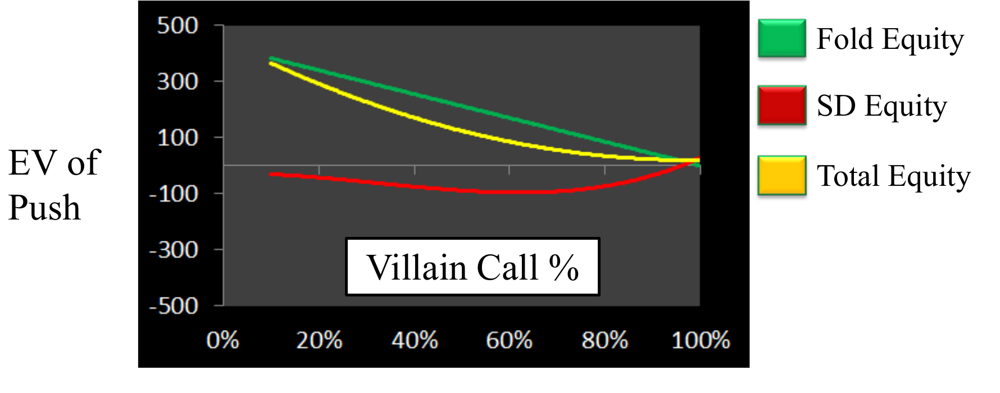
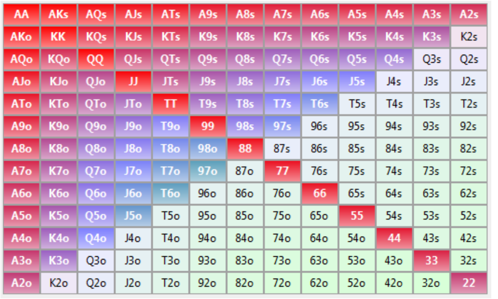
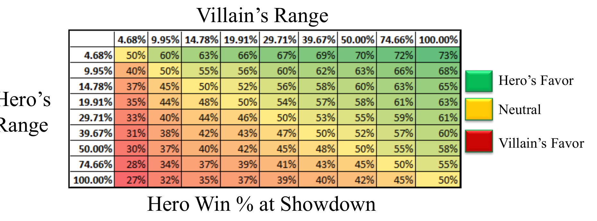

# L4 Preflop Analysis

Preflop is the most precisely solvable decision point in tournament poker: the variables are few, the math is clean, and most live players get it spectacularly wrong. This chapter starts from a seemingly foldable trash hand, builds the language of ranges, and then systematically derives push/fold rules for heads-up and multi-way play at M ≤ 10.

## Motivator: Why Spend a Whole Lecture on Preflop?

- In tournaments, most of your value comes from playing preflop close to optimally;
- Most live players are way off in their preflop decision-making — they fear getting knocked out on a bad hand or showing down a bad hand, and preflop play is deeply counterintuitive;
- Preflop is easy to solve: few variables, few assumptions, so we can get close to a Nash equilibrium. Postflop has a million variables and reduces to pattern matching.

## Scenario A: Should We Push 9♠6♥?

No-limit hold'em tournament, blinds 125/250 with a 25 ante. The big blind, trifluvian, has 1100 left (M = 2.59); we are on the button/small blind (BTN/SB) with 3400 (M = 8). Note the small heads-up rule variation: the button is also the small blind, acting first preflop and last on every later street. The pot is already 425, we hold 9♠6♥ — what do we do?

A preflop all-in is essentially a semi-bluff: even when called, we are virtually never worse than 30% to win. Using the semi-bluff EV formula:

$$EV = Pot \times Fold\% + (1-Fold\%) \times (Win\% \times WinAmt - Lose\% \times LoseAmt)$$

Assume the opponent calls with 22+, A2+, JT+ (27.60% of all starting hands — a fairly wide calling range). Plugging 96o versus that range into PokerTracker's equity calculator: we never need to know his exact hand, only that "if he calls, he is equally likely to hold any hand in the range." Against {22+, A2+, JT+}, 96o wins **34.26%** of the time — when called, we are roughly a 35–65 underdog.

Win and loss amounts (note that the blinds and antes the BB has already posted are not counted):

$$WinAmt = 4500 - (3400 - (125+25)) = 1250$$
$$LoseAmt = 1100 - (125+25) = 950$$

Plugging in: the EV of folding is 0, while the EV of pushing is

$$EV_{push} = (1-27.6\%) \times 425 + 27.6\% \times [34.26\% \times 1250 - 65.74\% \times 950] = 307.7 - 54.2 = \mathbf{253.5}$$

In this seemingly marginal spot, pushing earns 253.5 chips on average — and it only takes 1000 chips to win the whole tournament. Put the other way around, folding hands the opponent about 250 chips for free.

### Generalizing: The Conclusion Does Not Depend on the Call-Range Assumption

The calculation above assumed a specific calling range. Make the call frequency $F\%$ a variable (the win rate $W\%$ moves with $F\%$: the tighter he calls, the more crushed we are when called):

$$EV_{push} = (1-F\%) \times 425 + F\% \times [W\% \times 1250 - (1-W\%) \times 950]$$

As shown above, Total Equity = Fold Equity (declining linearly in the call frequency) + Showdown Equity (negative over nearly the whole range, creeping just above zero only when the opponent calls extremely wide). The key observation: **EV is positive along the entire curve** — no matter what calling strategy the opponent adopts, pushing is correct here. When he folds 100% of the time, EV approaches the pot of 425; as he calls more, EV drops but stays positive, averaging about 175 chips across the curve.

How bad is folding? Open-folding this hand costs about 175 chips of EV — worse than calling an all-in with 3♣4♦ against A♠K♠:

$$1250 \times 35.42\% - 950 \times 64.58\% = -171$$

### Counterintuitiveness and Chapter Goals

Push/fold decisions are not intuitive: fold equity and showdown equity move simultaneously in strange directions as every variable changes, so intuition cannot be trusted. The variables that drive the decision are: our cards, our position, our stack, and the opponent's calling range. Our goal is quick rules that hold "for all call ranges" or "for any two cards," ultimately producing a decision chart of the form "push in the green region, fold in the yellow region."

## Range Definition

**A range is a set of hands.** Suitedness is marked by an o (offsuit) or s (suited) next to the hand.

Ranges are denoted by the lowest (or highest) hand in a series:

- AA KK QQ is written **QQ+**;
- AA KK AK AQ KQ is written **KK+, AQ+, KQ+**;
- Less commonly, "-" marks the best hand in a series: 55 44 33 22 54 53 52 43 42 can be written 55-, 54-, 43-.

Ranges serve two purposes:

- **Analyzing opponents**: estimate an opponent's hand distribution and compute our equity — e.g., holding AT, we are 63% against ATC (any two cards);
- **Determining our plays**: build range-based rules — e.g., "push with AT+, 88+, and fold everything else."

### Sklansky-Karlson Rankings

The most common percentile ranking of starting hands is the Sklansky-Karlson ranking, based on the likelihood of being ahead preflop in a two-player hand. The top 10 hands in order: AA, KK, AKs, QQ, AKo, JJ, AQs, TT, AQo, 99.

David Sklansky is a renowned poker theorist: three WSOP bracelets, one WPT title, studied at Wharton, and author of 13 books published by TwoPlusTwo Publishing. His **Fundamental Theorem of Poker** states:

> Every time you play a hand differently from the way you would have played it if you could see all your opponents' cards, they gain; and every time you play your hand the same way you would have played it if you could see all their cards, they lose.

The Sklansky-Karlson ranking comes from Sklansky's October 4, 2003 post "Important No Limit Math Problem": blinds 1/2, you are in the small blind with A8o, and your only options are to fold or to **push all-in with your cards face up** (the opponent sees your A8o before deciding). For what stack size x is the face-up shove still +EV? Sklansky's answer was roughly x ~ 70.

Derivation: assume the big blind calls only when his win probability is ≥ 50% (ignoring the subtle effect of pot odds — it shifts x only slightly and does not change the hand ordering). Then the BB's calling range is A8+, 22+ (13.12% of hands), and A8o wins 33% against it. Setting EV to zero for the break-even point:

$$EV = 87\% \times 3 + 13\% \times [33\% \times x - 67\% \times (x-1)] = 0 \Rightarrow x \approx 62$$

So with 62 chips or fewer, shoving A8o face-up is +EV. Each hand's x value depends on two factors: **how many hands you are marginally better than** (which drives fold equity) and **your chance of winning when behind** (which drives showdown equity when called). Victor Chubukov (Karlson) solved for every hand on October 24 of the same year: AA has x = ∞ (face-up shoving aces never loses chips on average, no matter the stack), KK has x = 1290 (verifiable via $0 = 0.9955 \times 3 + 0.0045 \times (0.1805x - 0.8195(x-1))$, which crosses zero near x ≈ 1040); all the way down to 32o with x ≈ 1.8. An alternative ranking — equity versus three random hands — may be more relevant for multi-way pots, but this course generally assumes a single caller, so we use Sklansky-Karlson.

Mapping percentiles to ranges: the top 1% is AA; the top 5% is TT+, AQs+, AQo+; the top 30% is 22+, A2s+, K4s+, Q9s+, JTs, A2o+, K8o+, QJo.

Simplified ranges worth memorizing:

| Percentile | Range | Mnemonic |
|---|---|---|
| 5% | TT+, AQ+ | Premium hands |
| 10% | 55+, AT+ | Starts at AT |
| 20% | 22+, A2+, KQ | A2 or a pocket pair |
| 30% | 22+, A2+, Broadway | Any two broadway cards (T and up) |
| 50% | Pairs plus hands whose ranks add to 16 | The grid diagonal |
| 100% | Any two cards | The whole grid |

### +EV Ranges and Optimal Ranges

For a given decision, a **+EV range** is one that is profitable on average; an **optimal range** is the set of hands that is most profitable in chip terms. Example: against AQ, calling with 55+, AT+ wins 53% of the time — profitable, but not optimal, because the AT and AJ in it lose to AQ. The optimal range is 22+, AQ+, winning 60%. If a range is optimal, every single hand in it is individually +EV. This is exactly why solving for a range proves the rule works for any hand inside it.

## Basic Assumptions

- Our effective M < 10 (M is the stack divided by the cost of one full round of blinds);
- The opponent's calling range is some "top x%" of hands, and everyone roughly agrees on the hand ordering;
- Ignore ICM (Independent Chip Model); maximize chip expected value (cEV) only;
- At M < 10 there are basically two options: push or fold. **Why not raise?** Raising to 3BB (about 2M) still lets you fold to a re-raise up to 6M, where your pot odds are 8/20 = 40% — you can get away from marginal hands like 99-, A5-, K9- cheaply. But if a raise leaves you with less than 4M behind, the pot odds become 4/12 = 30%, which is basically always a call — the fold equity is gone. So at M < 10, maximizing fold equity matters most: just shove.

## Heads Up

**Goal**: derive the optimal push/call ranges for blind-versus-blind play at M ≤ 10. The methodology has five steps:

1. Build a table of range-versus-range equities;
2. Derive a two-factor model to estimate range-versus-range equities;
3. Build an EV model for semi-bluffs;
4. For each M, find the Nash equilibrium if one exists;
5. For unstable equilibria, find reasonable ranges.

### Step 1: Range-versus-Range Equity

In PokerTracker, fix our range and compute equity against each of the opponent's calling ranges. Say we push the top 50%: if he calls 50%, our equity is 50% (symmetric); if he calls 100%, we have about 60%; if he calls only AA, we have about 17%. Fit each "we push X% vs. he calls Y%" curve with a function: for Y ≥ 10% the relationship is logarithmic ($r^2$ of 0.99, 0.98); but as his range tightens, $r^2$ falls to 0.95 at 5% and 0.89 at 3%, and fails completely at 1% — because the top 1% contains only three hands (AA, KK, AK), so whether or not he calls AK makes equity jump discontinuously. The same pattern holds in reverse (fixing his range and varying our pushing range): if he calls the top 50%, pushing the top 30% wins 55%. Typical values from the full table: push top 50% vs. call top 20% → win 40%; push 100% vs. call 30% → win 39%; push 5% vs. call anything → win 73%.

### Step 2: A Two-Factor Logarithmic Model

Running a multiple regression on the whole table with logarithmic variables gives:

$$HeroWin\% = 50\% + 0.085 \times \ln(VillainRange) - 0.085 \times \ln(HeroRange) + \varepsilon$$

$R^2 = 0.98$ (81 observations, standard error 0.01). The 50% intercept and the two identical-magnitude coefficients (symmetry) are intriguing, and intuitive: the wider he calls, the more weak hands he holds, the higher our equity; the wider we push, the more weak hands we hold ourselves, the lower our equity. The error concentrates in extremely tight ranges below 5% and is tolerable elsewhere — and at M < 10 nobody plays a sub-5% range, so we can ignore it.

### Step 3: Semi-Bluff EV Model (in Units of M)

Let the small blind plus big blind equal 1 (all EV measured in M):

$$EV = FoldEquity + ShowdownValue$$
$$FoldEquity = 1 \times (1 - VillainCall\%)$$
$$ShowdownValue = VillainCall\% \times [SDWinAmt \times HeroWin\% - SDLoseAmt \times HeroLose\%]$$
$$SDWinAmt = Stack + \tfrac{2}{3}, \quad SDLoseAmt = Stack$$

(The +2/3 comes from winning one big blind; whether the stack is recorded before or after posting the blind introduces a ±1/3 nuance that makes little difference.) Substituting the Step 2 equity model yields one big equation in only three variables — his call frequency, our push frequency, and stack size:

$$EV = (1 - VillainCall\%) + VillainCall\% \times \left[\left(Stack + \tfrac{2}{3}\right) \times HeroWin\% - Stack \times HeroLose\%\right]$$

### Step 4: Nash Equilibria

For the M = 20 EV grid, the small blind (SB) wants to maximize EV while the big blind (BB) wants to minimize it; the SB loses 0.49M per hand on average. Plotting the EV grid for each M (green favors SB, yellow neutral, red favors BB):

- **M = 1**: SB pushes 100% and BB calls 100% is a Nash equilibrium — neither side can move, exactly as intuition suggests;
- **M = 2**: push 100%/call 100% is still an equilibrium (deviating costs only about 0.01M);
- **M = 3**: an **unstable Nash equilibrium** appears — if SB pushes 80%, BB should call 100%; if BB calls 100%, SB should push 65%... it cycles like rock-paper-scissors.

So the "preflop Nash equilibrium charts" found online are mostly unreliable: stable equilibria exist only at M ≤ 2, where you should be pushing extremely wide anyway. For M > 2 we need a different approach.

### Rules of Thumb for SB Pushing

For each M and each candidate pushing range, take the max-EV column under four scenarios: average case (no information about the opponent's calling range), worst case (opponent plays the best response), tight villain (assumed 15% calling range, e.g., 33+, A4+, KT+), and loose villain (assumed 80% calling range, e.g., 22+, T2+, 93+, etc.).

- If you read the opponent as tight, **pushing 100% is always optimal** — he folds 85% of the time, and fold equity crushes everything;
- In the other scenarios, pushing 100% is optimal at M = 1, then the optimum drifts slowly down to about 50% at M = 10;
- The biggest mistake is pushing less often than 50% of hands.

Heads-up pushing cheat sheet (when the opponent is not tight):

| Stack | Pushing Range |
|---|---|
| 1M | Top 100% |
| 5M | Top 75% |
| 10M | Top 50% |

### Rules of Thumb for BB Calling

At M < 10 the SB always has an edge thanks to fold equity; the BB's goal is a practical calling rule with as few assumptions as possible. For each M, mark the region most favorable to the BB on the "his pushing range × our calling range" EV grid, and the **optimal calling range turns out to be a fixed proportion of the SB's pushing range**.

| Stack (M) | Call Multiple | Optimal BB Call% = SB Push% × Multiple |
|---|---|---|
| 1 | 10× | He pushes 5%, you call 50%; he pushes ≥ 20%, call everything |
| 2 | 2× | He pushes ≥ 50%, call everything; he pushes 20%, you call 40% |
| 4 | 1× | Match him exactly |
| 6 | 2/3× | |
| 9 | 1/2× | He pushes 90%, you call 50% |

Heads up (including the de facto heads-up that arises when a full table folds to the small blind), just remember: call nearly everything at M = 1–2, match him one-for-one at M = 4, and call half to two-thirds of his pushing frequency at M = 6–9 — and you will keep exploiting whatever pushing frequency you read him for.

## Other Positions

### Calling an All-In

The complication at a full table is the players left to act behind us, so we make conservative assumptions (better to fold away a small positive edge than to call a small negative one):

- Showdown win amount = stack (no discount for being in the SB/BB);
- A second caller's range is TT+, AQ+ (top 5%);
- If called twice, our win probability is treated as 0% (we are almost certainly dominated).

Therefore the minimum required win rate = 50% + 5% × players remaining behind, and our calling range should be a multiple (HRM) of the opponent's pushing range:

| Players Remaining | Minimum Win% | Range Multiple HRM |
|---|---|---|
| 5 | 75% | 5% |
| 4 | 70% | 10% |
| 3 | 65% | 20% |
| 2 | 60% | 30% |
| 1 | 55% | 55% |
| 0 | 50% | 100% |

Example: the opponent pushes the top 50% from the cutoff (CO), we are on the button (BTN) with 2 players behind; we need 60% equity. We should call 50% × 30% = top 15%. Verifying with the two-factor model: $Win\% = 50\% + 0.085\ln(50\%) - 0.085\ln(15\%) = 60.2\%$ ✓

Calling rules of thumb by position (conservative estimates, so a threshold call is usually very +EV; they also rely heavily on reading the opponent's pushing range):

| Position | Our Calling Range |
|---|---|
| MP | 5% × opponent's range |
| LP | 10% × opponent's range |
| CO | 30% × opponent's range |
| SB | 50% × opponent's range |

In practice, facing a shove in the CO, just ask "is his pushing range 3× wider than my cards?": holding AQ (top 5%), would he push A5 (top 15%)? Holding AT (top 10%), would he push KJ (top 30%)? Holding KQ (top 20%), would he push 85 (top 60%)?

### Pushing All-In

The exact analytical solution is complex; the goal is a decision table built on conservative assumptions:

- Showdown win amount = stack;
- First caller's range: 55+, AT+ (top 10%);
- Second caller's range: TT+, AQ+ (top 5%);
- Win probability when called twice: 20%;
- Third caller probability: 0% (we are never called three times).

Answering two questions: when can we profitably push Broadway (top 30%)? When can we profitably push any two cards (top 100%)? Conclusions (conservative, not optimal, but good enough):

- **AT+, 55+ (top 10%)**: profitable shove from any position with stacks up to 10M;
- **Broadway (top 30%)**: from any position at 1M, from late position at 6M, from the CO at 10M;
- **Any two cards (top 100%)**: from late position at 1M, from the button at 4M, from the small blind at 10M.

Simplified decision table:

| Stack | Push ATC From | Push Broadway From | Push AT+, 55+ From |
|---|---|---|---|
| 1M | Late position | Any position | Any position |
| 5M | Button | Late position | Any position |
| 10M | Small blind | CO | Any position |

In short: at M < 10 you can always push the top 10%; at M < 1 push very wide from any position; at M < 5 push Broadway from late position.

## Key Takeaways

- A preflop all-in is a semi-bluff: EV = fold equity + showdown equity. In short-stack heads-up play this value is nearly always positive, and folding a "trash hand" can cost more than calling an all-in with 3♣4♦ against A♠K♠.
- A range is a set of hands; use Sklansky-Karlson rankings to map ranges to percentiles, and memorize the five simplified ranges (5% / 10% / 20% / 30% / 50%). Every hand in an optimal range is individually +EV.
- At M < 10, assume opponents call with a "top x%" range, ignore ICM, and restrict yourself to push/fold; raising forfeits fold equity, so just shove.
- Range-versus-range equity is estimated by the two-factor logarithmic model $Win\% = 50\% + 0.085\ln(V\%) - 0.085\ln(H\%)$, $R^2 = 0.98$, which fails only for sub-5% ultra-tight ranges.
- Heads-up pushing: against a tight opponent push 100%; otherwise push 100% at M = 1, drifting to 50% at M = 10; pushing less than 50% of hands is the biggest mistake.
- Heads-up calling: the BB's optimal call% = SB push% × multiple (10× at M=1, 2× at M=2, 1× at M=4, 2/3× at M=6, 1/2× at M=9).
- Full-table calling: minimum win rate = 50% + 5% × players remaining, calling range = opponent's pushing range × position multiple (MP 5%, LP 10%, CO 30%, SB 50%) — the core question: "is his pushing range 3× wider than my cards?"
- Full-table pushing: top 10% (AT+, 55+) shoves profitably from any position up to 10M; Broadway from any position at 1M / late position at 6M / CO at 10M; any two cards from late position at 1M / button at 4M / SB at 10M.
