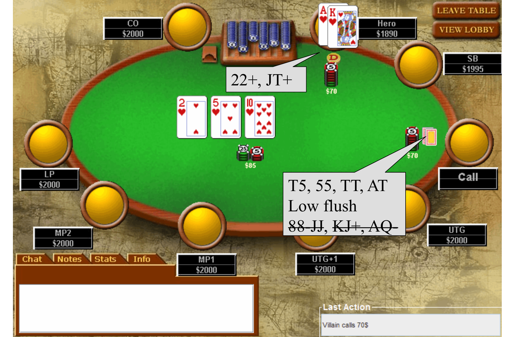

# L5 Tournament Play

This chapter treats poker as an investment: assuming you are already a winning player, how do you cash in your edge in a tournament — a structure fundamentally different from a cash game — and how do you manage your bankroll?

## Cash Games vs Tournaments

A tournament is a structure in which you exchange a buy-in for tournament chips and earn money only by outlasting your opponents — the player who ends up with all the chips wins a fixed share of a prize pool, not cash equivalent to the chips. In a cash game, every chip has a definite monetary value, and you can enter or leave whenever you like. The comparison:

| Cash Games | Tournaments |
| --- | --- |
| Chips = Winnings | Finish Position = Winnings |
| Chip EV (cEV) = \$EV | cEV ≈ \$EV (same direction, not strictly equal) |
| Come-and-go at will | Locked into tournament structure |
| Unlimited buy-ins | One fixed buy-in |
| Fixed blinds | Increasing blind levels |
| Table selection | Player pool selection |
| Higher liquidity | Higher overhead |
| Lower variance | Higher variance |
| Well-documented | Limited literature |

A few rows deserve elaboration. cEV and \$EV largely move together in tournaments, but in some spots a decision that is positive cEV can be negative \$EV (see ICM below). In a cash game, if you get knocked out you can buy back in immediately, "like it never happened"; busting on the first hand of a tournament offers no redo. In a cash game you can watch the eight or nine players at a table before deciding to sit; in a tournament you can only select a "player pool" — you might register for an event with 90 fish and 10 pros and be seated at a table full of pros. Cash games are liquid and let you realize your hourly rate at will, making them the best professional choice; but mid-to-high-stakes cash games are hard to beat — losers notice quickly and drop out, whereas in tournaments some big-name pros may already be losers without knowing it, because the "long run" of major events can take years to reveal itself.

**Why tournaments?** They are harder to master and sparsely documented, so there is more room for an edge; they are more publicized; results are permanent (a track record); they let you play high stakes against opponents used to lower stakes; and ROI is generally higher.

**Why not tournaments?** They are harder to master; it is less obvious when you are playing badly, and the long run takes forever; variance is higher; each event takes a long time; high stakes are generally required for a worthwhile hourly; there are incidental costs such as dealer tipping, travel, and hotels; and they demand more planning and research.

## Tournament Life Cycle

The most important tournament concept is **tempo**. The life cycle has three phases: the early game, the bubble and early cashes, and the late game / final table. The early game eliminates roughly 90% of the field and occupies about half the total playing time.

### Early Game

Early play closely resembles a cash game: here cEV ≈ \$EV — when you hold 1,000 chips and winning requires 100,000, a swing of 50 chips barely affects your payout expectation. Your playing style is dictated entirely by your stack size, and the early game carries extra value: establishing reads on your opponents and building your own table image.

Stack zones are defined by M (the ratio of your stack to the cost of one orbit of blinds and antes — Harrington's M):

| Stack Size | Zone |
| --- | --- |
| $M < 2$ | Dead Zone |
| $2 < M < 8$ | Steal Period |
| $8 < M < 12$ | Steal/Re-steal Period |
| $12 < M < 30$ | Value Betting Zone |
| $M > 30$ | Set Mining Zone |

**A note on tempo:** the biggest difference between tournaments and cash games is calibrating your aggression. Doyle Brunson said to "never get caught speeding in a tournament" — do not be overly aggressive when your stack is deep. To win a tournament you will eventually have to win some coin flips (confrontations near 50/50); that is inevitable. Your goal is to grow your stack slowly without showdowns, avoid voluntarily entering flips, and arrive at the unavoidable ones with more chips. These small differences compound over the whole event, raising your probability of winning from 1% to 3%–4% — that is where your edge materializes.

### M < 2 – Dead Zone

You should reach this zone only because you just lost a hand in which you had slightly more chips than your opponent. Here you have virtually no fold equity (the portion of your expectation that comes from opponents folding) — the big blind has the odds to call any push and may call without even looking. Your entire goal is to accumulate enough chips to regain fold equity. **Never fall under M = 1 under any circumstance**: even if you double up afterward, you are still in the dead zone, effectively at least one must-win confrontation behind. Go all in with any two cards before letting your M drop below 1.

### 2 < M < 8 – Steal Period

Your only move here is all-in or fold (push or fold). Every time you steal the blinds, your stack grows by roughly 10%–40% — unless you literally hold AA, that is worth more than the edge you would have playing good cards to a showdown. Concretely:

- Identify players who do not protect their blinds and steal from them — you should have been reading people during the early game; these pushovers are your best friends;
- Project the image of someone who defends their blinds (e.g., verbally announce that you will fight back), but do not actually do it — if everyone folds to your big blind, you collect nearly 1 M for free;
- Avoid showdowns at all costs: do not call an all-in unless you believe you are about a 70% favorite.

Behind this is Sklansky's **Gap Theory**: calling an all-in requires a much stronger hand than pushing all in yourself. When you bet, you own the full equity conferred by fold equity; when you call, you do not — there are many spots where you can push with any two cards (ATC) but can call only with a good hand. The goal in this zone is to keep $M \geq 2$ and to reach the next zone by doubling up or chaining steals (three steals in a row take you from about 8M to 11M).

### 8 < M < 12 – Steal/Re-steal Period

At this depth you regain the option to fold to a raise, which was unavailable deeper. Why? Your standard steal raise is 3BB (about 2M); when an opponent re-raises all in, you must call about 6M more, and the pot odds demand $\frac{6}{6+11} \approx \frac{6}{17} = 35\%$ equity — not enough to justify calling with any two cards. The re-raise is no longer a forced call, and folding is back on the menu. Stealing is the initial attempt to take the blinds; re-stealing is identifying that someone is stealing and re-raising them — including raising a stealer when you are not in the blinds yourself.

### 12 < M < 30 – Value Betting Zone

In this zone you will actually see flops (the slide section title reads $15 < M < 30$). Your hand's preflop value now depends on its ability to connect with the flop, and play approaches that of a cash game. Guidelines:

- Do not flat call preflop — come in for a raise yourself, and continuation bet (c-bet) the flop when heads-up;
- Going broke with a set on an uncorrelated board is acceptable;
- Do not go broke with a low two pair or top pair top kicker (TPTK), nor with a set on a board where a flush or straight is obvious.

### M > 30 – Set Mining Zone

**Set mining** means flat calling cheaply preflop with a pocket pair, hoping to flop a hidden set. General rules:

- Wait patiently for monster hands and value bet them aggressively once made;
- In a hand that has been raised and re-raised, count how many hands can beat you — if yours is not the absolute best possible hand, do not go broke for 50M;
- See flops cheaply, use pot odds to evaluate draws to the nuts, and estimate implied odds conservatively;
- If you cannot keep it together, fold JJ and worse pairs until you have 30M.

## Flop, Turn, River Play

The advice below applies to medium stacks ($M > 10$). The basic idea is to state the value of each class of hand at every stage and to recommend aggressive betting: the standard preflop raise is 3BB plus 1BB for each prior caller; postflop bets on each street are about 2/3 of the pot to discourage draws. $M < 10$ is preflop play (covered in a later lecture), and $M > 30$ calls for very conservative play.

### Levels of Thinking

- **L0** — Not reading / indifference to hand value;
- **L1** — "What cards do I have?" (hand reading);
- **L2** — "What cards does he have?" (opponent reading);
- **L3** — "What cards does he think I have?" (representation);
- **L4** — "What cards does he think he is representing?";
- **L5** — and so on …

**Your goal is to be exactly one level above your opponents** — not as high as possible.

The slides demonstrate this reasoning with an online hand (bets in dollars): Hero (Desmond_MIT) holds T♠T♥. Level-one thinking says "we have a good hand versus any two cards"; adding opponent reading, the UTG opener is put on 77+, ATo+, TJs+.

MP1 then re-raises and is read as TT+, AQo+, AJs+; UTG comes back with a fourth raise — compressing his range to QQ+, AK, and TT turns from a good hand into a bad one.

This is Phil Gordon's maxim from *Phil Gordon's Little Green Book*: **"The Fourth Raise Means Aces."**

**Mismatched levels** are a common way to lose money: thinking at L3 ("what am I representing?") is wasted when your opponent is not trying to read you at all (below L2) — against an L1 player, even Phil Ivey has no edge, because every act of "representation" falls on deaf ears. Example: blinds 25/50, Villain (late position) and Hero (button) each have \$2000.

- Preflop (pot \$75): Hero holds K♣J♣, Villain calls \$50, Hero raises to \$250, Villain calls;
- Flop 7♣T♣3♣ (pot \$575, two players): Villain bets \$200, Hero raises to \$600, Villain goes all in for \$2000.

The same action means entirely different ranges to a weak player and to a strong player:

| Weak Player's Range | Strong Player's Range |
| --- | --- |
| JJ+ | A♣X♣ (nut flush draw) |
| AT | Maybe TT |
| TT, 77, 33 | |
| T7, T3, 73 | |
| Any two ♣ | |

One of your first "reads" is simply whether someone is a good or bad player. The same person may jump ±1 level between spots — for instance, someone good at preflop opponent reading who stares only at his own cards on the flop (between L1 and L2); or someone who thinks a low flush is big but does not think a low pair is big (between L0 and L1). A reasonable default assumption: **new players are L1, average tournament players are L2, and cash game players are L3**.

Players who know each other well enter an arms race, each climbing one level higher to dominate the other — more common in cash games, but tournaments have examples too: Shaun Deeb's AA versus Max Heinzelmann's A6 in the 2011 WSOP Main Event is an instance of L5 thinking. Norwegian star Annette Obrestad (youngest WSOP bracelet winner at 18, playing online as Annette_15 since age 15) once won an entire tournament without looking at her hole cards — an extreme demonstration of reading opponents while ignoring one's own hand.

The **Strong vs Weak Treadmill** summarizes this cycle of levels:

| Level | Actual Hand | Represented Hand |
| --- | --- | --- |
| L1 (reading) | Strong | Strong |
| L3 (representation) | Strong | Weak |
| L5 | Strong | Strong |
| L7 | Strong | Weak |

Why learn levels of thinking? The postflop recommendations that follow assume opponents are average players capable of basic opponent reading: the strategy is not optimal against brand-new players, it probably loses to pros, but it is at least enough to beat low-stakes games.

### Preflop Play

Hands are ranked by the likelihood of flopping a hand that wins; position affects hand strength materially — many hands are winners in late position but losers in early position. The tiers roughly track the Sklansky-Karlson rankings, and the specific ranges come from Harrington's *Harrington on Hold'em*.

Playing this way, you enter few pots but are generally ahead when you do; your flop decisions are easy because you either hit completely or miss completely; and you win medium-size pots rather than huge ones. Every hand you play, you raise yourself to 3BB + 1BB per caller (about 15% of all starting hands), hoping to be heads-up by the flop.

**Opening ranges:**

| Position | Range |
| --- | --- |
| Blinds and UTG/UTG+1 | TT+, AQs+, AKo+ |
| MP1, MP2, MP3 | 88+, AJ+, KQ+ |
| LP, CO, BTN | 77+, suited aces (Axs), high suited connectors |

The early-position range is extremely tight (roughly the top 5%) because you have the least information and will hold the worst position on every later street; the middle-position range widens to about 15%.

**Ranges when facing a raise:** shift everything up one tier —

| Position | Range |
| --- | --- |
| Early or middle position | TT+, AQs+, AKo+ |
| LP, CO, BTN | 88+, AJ+, KQ+ |

### Flop Play

Having been the preflop aggressor, you should continuation bet the flop for 2/3 of the pot. The break-even success rate is only

$$\frac{2/3}{1 + 2/3} = \frac{2}{5} = 40\%,$$

so the bet is profitable if it works about 40% of the time; keep the sizing constant to avoid exploitation. Any made hand worse than top pair good kicker (TPGK) is treated as a drawing hand — you may semi-bluff with it, or call when the pot odds are right.

Flop hand-strength tiers:

| Tier | Hands |
| --- | --- |
| Tier 1 | K-high flush, top straight (unpaired board); top two sets, full house |
| Tier 2 | A-high flush, top straight (paired board); T-high flush, second-best straight (unpaired board); bottom set, any two pair |
| Tier 3 | Overpair, top pair good kicker |
| Drawing | Top pair bad kicker, middle/bottom pair, pocket pair that is not an overpair, four-flush, straight draw |

A paired board means a full house is possible, so flushes and straights are demoted on paired boards. Tier 1 is worth going broke with (even for 30M); Tier 2 is worth about two bets — for example, do not fold a T-high flush, but if your bet is raised, only call and do not raise again; Tier 3 is treated as a drawing hand once raised.

### Turn/River Play

By the turn the pot is usually already about 10M, and the decision is often just all-in or fold — there is no need to squeeze out one more bet. Evaluate your hand strength against hand ranges: which hands both fit his action so far and beat you.

### Reading Hand Ranges

After the flop you should have a reasonable estimate of your opponent's range; each subsequent decision lets you eliminate part of it, clarifying where you stand. A story that "doesn't make sense" could be a bluff, but the probability of a complete bluff is usually negligible.

The slides walk through two online hands to show this elimination process. In the first, Hero holds K♣T♠ on the button: preflop Hero raises and the UTG Villain calls — Hero is read as 22+, JT+, Villain as 88-JJ, 78+, AQ-; the flop comes 2♦5♠9♥, Villain check-raises, and the ranges narrow to Hero 99-JJ, 79, T9 and Villain 88-JJ, KJ+, AQ-. In the second, Hero holds A♥K♥, the flop is 2♥5♥T♥, Hero bets and Villain calls: Villain's range is revised to T5, 55, TT, AT, and low flushes, with 88-JJ, KJ+, AQ- crossed out.

**Zeebo's Theorem**: "No player is capable of folding a full house on any betting round, regardless of the size of the bet." So when your opponent can have a full house, do not bluff with a worse hand; conversely, when you hold the full house, collect value on the assumption that you will be paid off.

## Psychological Concepts

Mike Caro was one of the first poker theorists, author of *Caro's Book of Poker Tells*, an advocate of 4-color decks, and the developer of the early poker AI "Orac." His system's fundamental concept: the goal is to make +EV decisions; the results of any single session or hand do not matter. The remaining core psychological concepts:

**Image**:

- The organization and tidiness of a chip stack suggests a playing style;
- Advertisement — opponents remember the hands you show;
- Prefer loose-aggressive (LAG) play when the blinds are small, tight-aggressive (TAG) when the blinds are high.

**Manipulation**: different opponents naturally "want to call" or "want to fold" — tailor your play to the person; do not be afraid to loosen up the whole table.

**Long-run concepts**:

- What you have already invested does not matter (sunk costs are not yours);
- Cards will not "break even" in the long run — luck has no memory;
- **Threshold of Misery**: players often lose the most money immediately after losing more than they planned;
- Do not try to prove you are the best — this is not basketball.

Typical signs of **fear and tilt**: being forced to show down bad hands; losing money; playing short sessions while ahead and long sessions while behind.

**Techniques for stabilizing**:

- Mark your bankroll to market;
- Remember poker's most important secret: "Play your best game all the time";
- Do not think in terms of winning or losing streaks — think in terms of breakeven periods;
- Keep a short memory for hands — this is easier online.

## Bubble Play

The bubble begins roughly when the field is about 10% of the remaining players away from the money (if 10% of the field cashes, the atmosphere starts changing at about 20% left). The average amateur plays noticeably too tight — for example, with 250 players left at the WSOP and 240 places paid, they would rather forfeit a sliver of added chance at first place than risk busting. Arguably, your bubble performance determines how deep you finish: this is when amateurs make their biggest mistakes, and a good player who exploits them is much better than 50% to double up during this phase. Use ICM (next section) in marginal spots.

The bubble metagame comes in two forms: traditionally very passive; more recently, after everyone learned to "be aggressive on the bubble," the average player has become overly aggressive. Watch whether the weak players at your table are making bad calls or bad folds, and you will quickly know which metagame you are in. Bully people when you can; when others bully you, you need not push back at everything.

## Independent Chip Model (ICM)

The **Independent Chip Model (ICM)** converts tournament cEV into \$EV. It is built on your probability of finishing in each paid position:

$$\$EV_i = \sum_j P(\text{finishing } j\text{-th}) \times \text{payout}_j,$$

where the finishing probabilities are derived recursively from all players' stacks and, as of now, can only be solved algorithmically. Intuitively:

- When the winner takes all, cEV is close to \$EV;
- When payouts are flat, cEV and \$EV diverge substantially;
- For large swings, \$EV moves are asymmetric — losing hurts more than winning helps (there is curvature: chips you win are devalued, chips you lose are expensive). Factoring in the utility of money itself raises the threshold for taking big risks even further.

**Example**: a \$20 buy-in, 100-player tournament is down to 4 players, each holding 2,500 chips; payouts are 1st \$1000, 2nd \$600, 3rd \$400, 4th \$0. Assuming equal skill, each player's equity is 25% of the \$2000 prize pool, i.e., \$500.

Now Adam and David get all in, and Adam eliminates David:

| Player | Chips | Equity (ICM) | Payout |
| --- | --- | --- | --- |
| Adam | 5000 | \$766 | \$1000 |
| Bob | 2500 | \$616 | \$600 |
| Charlie | 2500 | \$616 | \$400 |
| David | 0 | \$0 | \$0 |

You might expect Adam to simply inherit David's \$500 and reach \$1000, but under ICM Adam gains only \$266, while Bob and Charlie each gain \$116 for doing nothing. The reason is the marginal payout structure: 2nd pays \$200 more than 3rd, and 1st pays \$400 more than 2nd. Once David is out, Bob and Charlie have locked up at least \$400, and only the two marginal jumps of \$200 and \$400 remain to be allocated. The eventual winner never holds \$2000 of equity proportional to all the chips — he effectively "gives up" equity to the players knocked out before him, making first place the position with the lowest equity per chip. If the event were winner-take-all (1st pays \$2000), the equities would be Adam \$1000, Bob \$500, Charlie \$500, David \$0, and cEV and \$EV would coincide exactly.

**WSOP satellite example**: a satellite is a tournament in which the top finishers win entry to a larger event, and it is especially prone to enormous mistakes. Suppose 10 players remain, places 1–9 each win a \$10000 seat, 10th gets \$0; everyone has 2,500 chips, so each player's equity is \$9000. With blinds 200/400, Irene in the small blind raises to 2,500 (all in), and Jessica in the big blind looks down at K♦K♥. Her M is about 3, her opponent is correctly shoving any two cards from that spot, and KK versus ATC wins 82% of the time.

- Chip expectation: $cEV = 0.82 \times 5000 + 0.18 \times 0 = 4100$, so $\Delta cEV = +1600$ — a huge gain;
- Dollar expectation: $\$EV = 0.82 \times \$10000 + 0.18 \times 0 = \$8200$, so $\Delta \$EV = \$8200 - \$9000 = -\$800$ — a loss.

So KK should be folded here; in fact, even AA should be folded unless you are more than about a 90% favorite (say you know you hold a pocket pair dominating theirs) — pretend to look at your cards and then fold. In practice Jessica calls here almost 100% of the time, a mistake the rest of the table is delighted to see. If everyone played rationally, every player's calling range would be 0%, so on every hand the player to act should simply shove any two cards until the blinds finally force someone all in. This is why satellites are where ICM has the most leverage — and the tournaments most worth seeking out.

## Late Game

- Do not be overwhelmed by the stakes — treat the final table like a single-table tournament. That is essentially what it is: a 10-handed SNG with slightly flatter payouts, except everyone is playing over their heads — bankrolled for a \$100 buy-in, 1,000-player event, the last 10 players are effectively contesting a \$10000 tournament;
- Continue to steal and re-steal according to your stack zone;
- Stay conscious of ICM — know the marginal payout of each position; this is not the time to flip for your whole stack (for example, do not call an all-in with AK for a 2% edge);
- Exploit players who are under-bankrolled.

## Bankroll Management

**What is a bankroll?** Generally, "the amount of money you devote to poker investments"; more precisely, the amount whose loss you would deem "irrecoverable" and that would force you to stop playing — not out of shame, but because the stakes your remaining money could support are so low you could never grind it back. For example, if you could conceivably put \$20000 into poker and lose \$19900, you would not grind one-cent/two-cent games to recover it — you would get a normal job and rebuild. The concept only matters for winning players: a negative-expectation player goes broke eventually no matter what, and his job is to learn to win or move down to stakes he can actually beat. Some examples:

- New players: "a large amount of money" — a new player who loses \$10000 probably quits poker forever;
- Amateurs: expendable cash not committed to long-term investments (the portion whose loss would not leave you homeless);
- Pros: expendable cash plus full borrowing capacity — Phil Hellmuth could lose his entire net worth and still raise more money to keep playing; with a good enough track record, you can be broke and still command a six-figure "bankroll" through staking.

**Rules of thumb**: the following numbers are based on a 2% risk of ruin, computed off average buy-ins, and assume you do not move up or down in stakes with your results — in practice you should: moving down after losses drives the ruin probability asymptotically toward zero (you bleed toward "hourly not worth it" rather than actual ruin), while moving up after wins replaces the old 2% with a new 2%, compounding your risk. The rules also assume solid winning play and typical variance:

| Game Type | Recommended Bankroll |
| --- | --- |
| Cash games — No-Limit (NL) | 20 max buy-ins |
| Cash games — Limit | 300 big bets |
| Single-Table Tournaments (STT) | 30 entries |
| Multi-Table Tournaments (MTT) | 50–100 entries |

These numbers use the average buy-in: if the whole table has doubled up, you are effectively playing a game twice as big. So whether to stay after doubling in a cash game depends on the table — stay if the opponents are clearly weak, change tables if they are strong; either way, you should not want more at risk than your usual risk metrics dictate. If your win rate is well above average, the required number of buy-ins drops. If you constantly agonize over losses while playing, it is usually not a psychological weakness — your bankroll is simply inadequate.

**Theoretical basis: the Kelly Criterion**. If your utility function is logarithmic, maximizing long-run utility growth requires betting in proportion to your edge. For example, in an even-money biased-coin game where you win 60% of the time, the optimal fraction is $f^* = 0.6 - 0.4 = 0.2$, i.e., 20% of your bankroll. This is the theoretical foundation of bet sizing in blackjack card counting — bet big when the count favors you — and the same idea governs allocating more capital to higher-alpha positions in investment management.

**The WSOP as an example**: the WSOP Main Event is one of the biggest tournaments, with 6000+ entries and a \$10000 buy-in, so the appropriate bankroll by the rules above exceeds \$1000000 — compared with other investments of that size, playing one hundred WSOP Main Events offers terrible risk-adjusted returns. On the other hand, the WSOP has the softest field of any \$10000 event, and a deep run carries publicity value beyond the prize money (Chris Moneymaker earned far more from sponsorships after winning than from the prize itself).

**Risk management tools**:

- **Staking**: a winning player at the WSOP level might have +\$5000 of \$EV (+50% ROI) with enormous variance, and an investor with suitable risk preferences can absorb that variance in exchange for a share of the profit. A common deal gives the investor 50% of the upside while covering 100% of losses — the player first repays the buy-in, then splits half of the remainder, and long-term staking carries a "makeup" clause. This is an equity investment: losses are not owed back.
- **Selling shares and trading percentages**: it is nearly universal for pros to trade small percentages of their results in big events with one another; players also split a single event into 10 shares sold to individual investors at a 10% markup (e.g., cutting 10 tournaments into \$1500 pieces to raise \$15000), letting small investors diversify across many players — retaining the expectation while materially reducing variance.

**Other considerations**:

- **Counterparty risk**: a staked player might skip the tournament or refuse to share winnings; an underground club might get raided; an online site might abscond. If you estimate the club you play in has a 1-in-10 chance of being raided on any given night, you should mark down your expected gross winnings by 10%;
- **Lifestyle**;
- **The current poker environment**: the 2003 WSOP promoted itself with hole-card cameras, and Moneymaker's win — followed the next year by Greg Raymer, who also qualified via satellite — ignited a five-year golden age of online poker; then the player pool collectively improved, and Black Friday (Full Tilt exposed as a Ponzi scheme, online sites exiting the US) contracted the market noticeably — a table once seated six amateurs per pro, while today's \$10000 events are roughly fifty-fifty;
- **Game selection**: soft games still exist (WSOP side events, low-stakes games), and with proper game selection and bankroll management, poker can be an excellent source of diversified income alongside your other pursuits.

## Key Takeaways

- In tournaments, finish position determines winnings, and cEV only approximately equals \$EV; rising blinds and the single buy-in make tournaments higher-variance and more demanding of tempo.
- The most important concept is tempo: grow your stack slowly without showdowns, avoid voluntarily entering coin flips, and save the must-win flips for when you are deeper.
- Play by M: $M<2$ is the Dead Zone (never fall below 1); $2<M<8$ is push-or-fold, living off steals (Gap Theory: calling requires a much stronger hand than betting); $8<M<12$ allows re-stealing and folding to re-raises; $12<M<30$ is the Value Betting Zone; $M>30$ means cheap set mining and going broke only with monsters.
- Think exactly one level above your opponents: by default new players are L1, average tournament players L2, cash game players L3; leveling against someone who is not reading you is a mismatch. "The Fourth Raise Means Aces."
- Medium-stack postflop play: enter with your own raise (3BB + 1BB per caller), c-bet 2/3 pot on the flop (break-even at 40%), and classify your hand into Tiers 1–3 and draws.
- The bubble is where average players make their biggest mistakes and where you build your finishing depth; the traditional metagame is too tight, the modern one too aggressive — diagnose your table first, then pick the direction of exploitation.
- ICM: losing hurts more than winning helps. In extreme cases (like satellites) a hugely +cEV call can be hugely −\$EV — with 10 players fighting for 9 seats, even KK and AA should be folded to a shove.
- Bankroll management is based on a 2% risk of ruin: 20 buy-ins for NL cash, 300 big bets for limit, 30 entries for STTs, 50–100 buy-ins for MTTs; the theoretical basis is the Kelly Criterion; staking and selling shares spread the risk of high-variance events.
