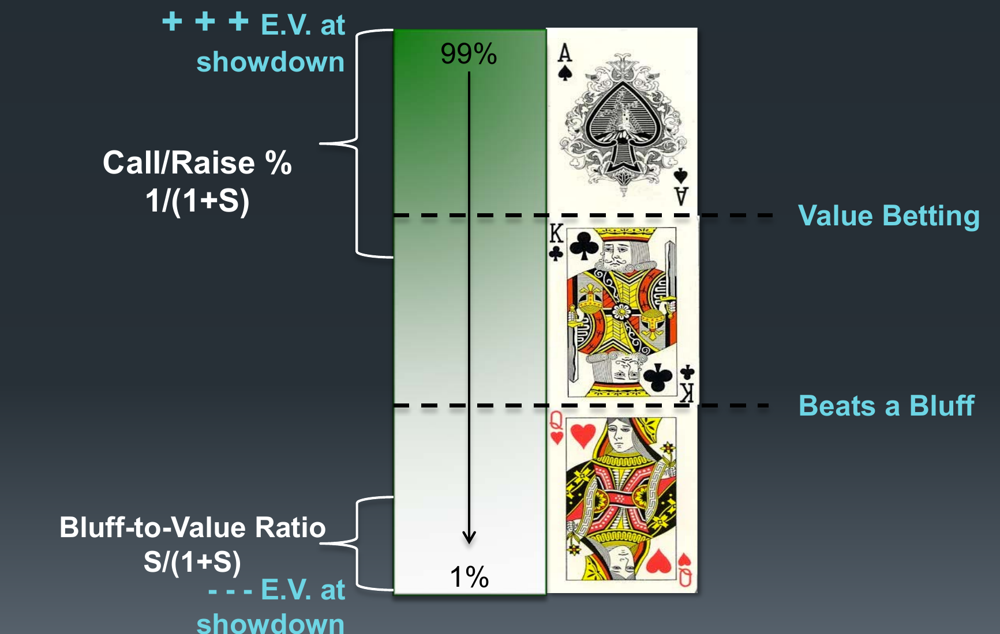

<!-- escape-math: v1 -->
# L8 Decision Making

This chapter is a guest lecture by Matt Hawrilenko (WSOP bracelet winner, once regarded as one of the best limit hold'em players in the world). In the previous lecture Bill Chen presented Cepheus, the computer program that solved heads-up limit hold'em; this lecture approaches the problem from the other side: how can a human actually apply game theory at the table? The method is to solve two extremely simple toy games, map the principles onto one real high-stakes tournament hand, and distill training principles that can guide your development long after the course ends.

## The Read-Based Approach vs. the Game-Theoretic Approach

Faced with the enormous game space of "playing good poker," people generally take one of two approaches. The **read-based approach** tries to figure out what the opponent has, or might have, and acts accordingly; this is what almost everybody does. The **game theoretic approach** asks whether your own overall strategy is balanced and whether it can be exploited.

Why is game theory worth learning? An analogy from jujitsu: when you train against white belts, almost anything works. But as your opponents progress to blue, purple, and black belts, those same moves not only stop working but get you into serious trouble. Poker is the same. In a home game, "play tight, bet your good hands, and almost never bluff" can be very profitable, because your opponents overvalue their hands. Take that same strategy to a mid-limit game at the Bellagio and you will get eaten alive. The right attitude is to train to black-belt standards from day one: learn the moves that hold up against the best competition.

The theorist can solve games and dynamical systems; the practitioner cares about what game theory says about how to think through a specific situation. These are not either-or: toy games are the bridge between theory and practice.

## A Real Hand

Here is the hand that runs through the entire lecture. A WSOP tournament a few years ago, in the money, six-handed, blinds \\$12,000/\\$24,000 with a \\$3,000 ante. The narrator (hero) raises two off the button with A♣A♥, and an opponent who is clearly the better player calls.

- **Flop** K♥J♦8♠: the opponent checks, hero bets, the opponent calls (pot \\$160,000).
- **Turn** 5♣: the opponent checks, hero bets about 2/3 of the pot, the opponent calls (pot \\$310,000).
- **River** K♣: the opponent leads out for about \\$1,080,000 into a \\$720,000 pot.

Hero has no idea what is going on. What does a bet of 1.5 times the pot mean? Why isn't he putting hero all in? Is he trying to entice a call, or trying to save \\$300,000 in case hero folds? Most people's instinct at this moment is to gather more "information" to narrow the opponent's range: has he shown down big bluffs before? Should we stare him down for tells?

## "The Other Side Can Do Magic Too"

On tells, some cold water first. Tells at the poker table may be worth something against weak players, but they are a very small signal in a very noisy environment: nothing to build a career on. A series of studies tested FBI interrogators: interrogators and random people off the street watched interview footage and judged whether the subject was lying. Both groups scored essentially at chance (about 53%); the only difference was that the interrogators were far more confident: ordinary people were about 50% sure of their judgments, while the interrogators were 90% sure they were right.

Behind this lies **self-assessment bias**. A classic survey of GE engineers asked each one to estimate their own percentile rank among all the engineers. The average answer landed at the 80th percentile, and of roughly a hundred respondents only two rated themselves below average. The film *Rounders* opens with a quote that states the poker version of the same thing: "Few players remember the big pots they have won, but every player can remember with remarkable accuracy the outstanding tough beats of their career." Memory bias feeds self-assessment bias.

The narrator paid tuition for this himself. On the exact money bubble of a big WSOP event (the next player out gets nothing, everyone else is guaranteed money), the player to his immediate left was playing his first WSOP and was so excited that he left the table 40 minutes early rather than risk busting. When the bubble actually arrived, the narrator looked down at 42o in the small blind, it folded to him, and trusting his "iron-clad read" he shoved all in. The opponent said "I knew you were going to do that" and **called without looking at his cards**, turning over 92o, dominating the narrator with a terrible hand and busting him on the bubble by one or two chips. How wrong does the read have to be? The opponent not only has to be unconcerned about busting on the bubble; he has to care so little that he does not even look at his cards, because one look at 92o forces a fold.

The lesson is more than "be humble." **Any time you try to divine your opponent's strategy, she can do the same thing back to you.** You are estimating her distribution and responding to it; she is estimating what you think her distribution is and shaping her actions around that: both sides are "doing magic." Players without a repertoire instinctively resort to magic when dragged into unfamiliar territory, and strong players will take you down exactly those strange side roads they have walked many times.

Hence the first rule of the lecture: **forget her hand; better yet, forget her range.** Jerrod Ankenman (co-author of *The Mathematics of Poker*) states the goal: "If I truly played optimally, I could write down my entire strategy on a piece of paper, what I would do in every single situation, and give it to you — and you couldn't beat me."

The problem is that a complete strategy cannot be memorized: heads-up limit hold'em, the smallest poker game played for real money, has about a quintillion ($10^{18}$) game states. Solvers are black boxes; for a human brain to understand the structure behind a strategy, we need toy games.

## Toy Game 1: Coin Flip Clairvoyance

A **clairvoyance game** is one in which one or both players have complete information about the game state: if you always knew your opponent's hand, and he knew that you knew, how would you play? The rules of **Coin Flip Clairvoyance**:

1. Each player antes \\$1 (pot \\$2).
2. Flip a coin: heads you win, tails your opponent wins. But only you see the result.
3. You may bet \\$1 or check; your opponent can only check/call or fold.

Scenario one: heads, so you obviously bet. Scenario two: tails, so what now? The core is two questions: how often should your opponent call, and how often should you bluff?

**Calling frequency.** The caller wants to make the opponent indifferent between bluffing and giving up, i.e., set the two expectations equal:

$$E(\text{bluffing}) = E(\text{giving up}) \\;\Longrightarrow\\; P(1-C) = 1 \cdot C \\;\Longrightarrow\\; C = \frac{P}{P+1},$$

where $P$ is the pot size, $C$ the calling frequency, and $1$ the bluff bet. The left side is what a bluff wins (the pot times the opponent's folding rate); the right side is what a bluff loses when caught. Here $P = 2$, so the opponent should call $2/3$ of the time. Note that the bigger the pot, the higher the calling frequency; $C$ asymptotes to $1$. The money is already in the pot, so you must defend more against being bluffed out of it.

**Bluffing frequency.** The bluffer wants to make the opponent indifferent between calling and folding. Writing the ratio of bluffs to value bets as $b$ (rather than a percentage) keeps the algebra clean:

$$E(\text{calling}) = E(\text{folding}) \\;\Longrightarrow\\; b\\,(P+1) - 1 = 0 \\;\Longrightarrow\\; b = \frac{1}{P+1}.$$

That is, when the opponent calls, she wins $P+1$ against a bluff with probability $b$ and loses her call with probability $1$. Here $b = 1/3$: one bluff for every two value bets. The bigger the pot, the *lower* the bluffing proportion: the value is already in the pot and the opponent calls more, so you need few bluffs to collect your value.

**Generalizing to arbitrary bet sizes.** Let the pot be $1$ and $S$ the bet as a proportion of the pot:

$$\text{calling frequency} = \frac{1}{1+S}, \qquad \text{bluff-to-value ratio} = \frac{S}{1+S}.$$

The more your opponent bets, the less frequently you need to call; the more she bluffs, the more value bets she must pair them with: as the bluffing region expands, the value-betting region must expand with it.

**"What if you only play it once?"** A common objection: against an opponent you will never see again, why balance? The answer: it is still a repeated game. Imagine playing the coin-flip game once each against a thousand different opponents, and deciding "they can't learn from my history, so I'll bluff 100% of the time." Each opponent is really a random draw from the distribution of all possible strategies: some will over-fold and you will own them; others will over-call and they will own you. Even your very first hand against a stranger is played against this distribution of strategies, and that is a repeated game.

**Two observations.** First, what matters is not value betting or bluffing in isolation but the combination of the two: if you "bet heads, check tails," your opponent folds to every bet and your good hands are worth nothing. Second, we are maximizing the value of our **entire set of hands**, not the value of the hand we currently hold.

## Toy Game 2: The Ace-King-Queen Game

The **Ace-King-Queen game** is the most classic toy game of incomplete information:

1. Each player antes \\$1 and is dealt one card from {A, K, Q} (if you hold the ace, your opponent holds only the king or the queen).
2. Player 1 may check or bet.
3. Player 2 can only check/call or fold.

Case by case:

- **You hold the ace**: bet (if the opponent calls you win; if she folds you also win).
- **Opponent bets, you hold the ace**: call.
- **Opponent bets, you hold the queen**: fold.

These three cases involve **dominant and dominated strategies**: a dominated strategy is one whose value is strictly no greater than that of another choice. Calling with the queen can never win and only loses money; it is strictly dominated by folding.

- **You hold the king: check or bet?** This is also a dominated strategy! The opponent always calls with the ace and always folds the queen, so betting the king wins no extra money and only loses to the ace; it is strictly dominated by checking.
- **You hold the queen**: bet some of the time (bluff).
- **Opponent bets, you hold the king**: a mixed strategy, calling some of the time (bluff catch).

How often should you call? Applying the formula from the previous section, you should continue at frequency $\frac{1}{1+S}$ with the hands that beat a bluff. Here $S = 0.5$ (betting \\$1 into a \\$2 pot), so the calling frequency is $2/3$. The hands that beat a bluff are aces and kings (the queen cannot beat even a bluff). Aces are half of those hands, and calling all of them only reaches $1/2$; you need another $1/6$: **call with all your aces and with $1/3$ of your kings** ($1/2 + 1/3 \times 1/2 = 2/3$).

Note how this differs from pot-odds thinking. Holding the king against a bet, pot-odds thinking asks "am I ahead at least $1/3$ of the time?", which requires divining the opponent's hand. Game-theoretic thinking asks "what must I do to make my opponent indifferent to bluffing?"; you only need to manage your own entire range.

**One new observation**: it is useful to map hands into three categories: value hands, bluff catchers, and bluffs. **Your strategy for one hand determines your strategy for other hands.** Since aces certainly call, some kings must call with them; since aces certainly bet, the worst part of the distribution (queens) should supply the bluffs. That part gains the most from the opponent's folds. More subtly: if you play one hand differently from me, your optimal play with your other hands differs from mine too. If you bet only half your aces but still bet a third of your kings, the proportions are out of whack, and out of balance in this game means losing money.

The three inscriptions at the Temple of Apollo at Delphi summarize everything so far. **Know thyself**: know your hand and know your distribution. **Nothing in excess**: stay balanced. The third inscription, "make a pledge and mischief is nigh," is too much of a stretch, so just remember **mischief**, saved for the exploitation section. The narrator's emphasis: until knowing where you are in your own distribution (and shaping that distribution to be balanced) has bought you a house, do not worry about anything else in poker. By comparison, everything else is window dressing.

## Three Levels of Thinking About the Same Hand

Back to the opening hand. Facing the \\$1,080,000 river bet, there are three levels on which people think:

1. **My hand vs. your hand**: I have aces; what does he have? KQ? KT? QT? Q9? Pinning an opponent to one specific hand is both hard and not very useful.
2. **My hand vs. your distribution**: how are my aces doing against "all the hands you might hold given the action so far"? Here a **distribution** is the frequency distribution of hands a player might hold, given all the action that has occurred.
3. **My distribution vs. your distribution**: shape your own actions so that they maximally exploit the opponent's actions. The question is no longer "what do I do with these aces?" but "what do I do with every hand that would have arrived here the same way; I just happen to be holding aces." This is the level most complementary to game theory.

Using pot odds to ask "am I ahead at least $1/3$ of the time?" is doing magic again. The game-theoretic question is: how often do I need to call to make my opponent indifferent to bluffing?

## Mapping the AKQ Game to Real Poker

The next figure is the single most important one in the lecture: mapping the structure of the AKQ game onto the full range of real poker.

Take every hand you might hold in the current spot and line them up from highest to lowest E.V. at showdown: at the top, the 99th-percentile hand (quad kings or so on this board); at the bottom, the 1st-percentile hand (something like 42o). The structure:

- **Call/raise region**: continue with the top $\frac{1}{1+S}$ of hands (real poker allows raising, hence "call or raise"). The goal is to make the opponent's bluffs zero-EV.
- **Bluff-to-value ratio**: the bottom $\frac{S}{1+S}$ of hands become bluffs. The hands with the least showdown value gain the most when the opponent folds.
- **The middle** is the bluff catchers that beat a bluff.

The value-betting and bluffing regions are linked: the wider your value-betting range, the more bluffs it must be paired with. This is exactly the principle behind the seemingly insane thin value bets and bluff catches of the best no-limit players: they value bet a lot, so they bluff a lot, so their opponents must call more. The most common imbalance among beginners is a bluffing region disconnected from the value region.

## Reading Your Own Hand

**Reading Your Own Hand (RYOH)** is the most important skill in poker: what you do with one part of your distribution determines what you do with the rest of it. Concretely, on each street you update your distribution twice:

1. **Card removal**: revise combo counts for the newly dealt board cards. When an 8 flops, your combinations of 88 drop from 6 to 3.
2. **Account for your action**: delete the hands that would not have taken the action you took.

Now walk through the opening hand in full. The narrator raised two off the button; a reasonable preflop distribution is roughly:

| Category | Hands | Combos | Category | Hands | Combos |
|---|---|---|---|---|---|
| Pairs | 22–AA | 6 each (78 total) | No gap | AK, KQ, QJ, JT | 16 each |
| Suited connectors | T9s–65s | 4 each (20 total) | One gap | 86s, 97s, T8s, J9s 4 each; QT 16 | 32 total |
| | | | Two gaps | KJ, AQ, KT, AJ | 16 each |
| | | | Three gaps | K9s 4; AT 16; A2s–A9s 32 | 52 total |

**310 combinations** (combos) in total.

- **Flop K♥J♦8♠, card-removal update**: combos containing a K, J, or 8 shrink (88, JJ, KK 6→3 each; AK 16→12; KJ 16→9; 86s, T8s, J9s 4→3 each; A2s–A9s 32→31; etc.), total 310→**263**.
- **Flop action update** (opponent checks, hero bets \\$75,000): delete the hands that would not bet — 66, 77, 99, TT, 86s, 97s, T8s, 98s, 87s, AQ, AT, A2s–A9s go to zero, total→**160**. Exactly which hands should check behind is debatable; the point is that the distribution is narrowing.
- **Turn 5♣, card-removal update**: 55 6→3, 65s 4→3, total→**156**.
- **Turn action update** (opponent checks, hero bets \\$205,000, opponent calls): delete 22, 33, 44, JT, J9s, 65s, etc., total→**120**.

Now run a balance check: on the turn hero is value betting about 96 combos, leaving 24 combos as bluffs. By the formula, bluffs should be $\frac{S}{1+S}$ of value bets, i.e., about $96 \times \frac{0.4}{1.4} \approx 27$ combos. The actual number, 24, is pretty good. There is no need to agonize over individual hands on each street; the point is to ask yourself regularly, "am I roughly balanced on this street?"

- **River K♣, card-removal update**: KK 3→1, AK 12→8, KQ 12→8, KJ 9→6, KT 12→8, K9s 3→2, total→**102**.

## The River Decision

The opponent bets \\$1,080,000 into a \\$720,000 pot, so $S = 1.5$, and hero should call with the hands that beat a bluff at frequency

$$\frac{1}{1+S} = \frac{1}{2.5} = 40\\%.$$

Rank the 102 combos from strongest to weakest and accumulate the frequencies (QJ is roughly the worst hand that still beats a bluff), giving:

| Hand | Cumulative percentile | Hand | Cumulative percentile |
|---|---|---|---|
| KK | 1% | KT | 51% |
| KJ | 9% | K9s | 54% |
| JJ | 13% | AA | 62% |
| 88 | 17% | QQ | 69% |
| 55 | 21% | AJ | 85% |
| AK | 31% | QJ | 100% |
| KQ | 41% | QT, T9s, 76s | (don't beat a bluff) |

The answer is surprising: this street *feels* like a tough decision, but AA sits at the 62nd percentile of the distribution, well outside the 40% calling line: **fold**. Even KT (51%) is a fold. The calling range is roughly KQ and better.

Note one corollary: if the opponent thinks "he'll fold good hands like aces" and therefore bluffs here 90% of the time, is he exploiting us? No. Our distribution is extremely strong here: about half of the hands that beat a bluff have trip kings. What he loses running bluffs into that brick wall far outweighs what he wins by occasionally stealing the pot. When your distribution is strong, the opponent cannot exploit you by bluffing more.

**Gut check**: do we really want a distribution in which we *have* to fold trips? This board has no flush and no straight possibilities, so folding trips feels wrong; either the feeling is wrong, or something went wrong on an earlier street. A practical rule of thumb: **if you would bet a hand for value, you want a distribution where you do not have to fold it.**

How to fix it? Add hands in from earlier streets: play more hands preflop, value bet wider on the flop and turn, and the river distribution widens. For example, if JT and J9s are played all the way through (they slot into the "beats a bluff" region at 97% and 100%), the calling line sinks to cover most kings; go further still (adding J9o, J8o, J7s) and AA gets pushed to about the 41st percentile, just inside the calling region: the same aces on the same river, but because the path to get here was different, the correct play changes from fold to call. Conversely, **if you find your river distribution full of medium-strength hands, you must call with more medium-strength hands, or you can be exploited.**

A word on raising: pure bluffs should come from the very bottom of the distribution (least showdown value, most to gain from folds); but a **bluff raise should use the strongest hands among those you were going to fold anyway**: since you were folding them regardless, bluff-raising with the best of them costs nothing, and using weaker hands instead is a dominated strategy.

**RYOH in practice:**

- Check for balance on every street, but do not overthink it; fix the glaring errors. This work belongs mostly off the table.
- Do not drill only the K♥J♦8♠5♣K♣ board, or you will overfit your strategy to one specific runout.
- **Do not needlessly bifurcate your distribution**: if you use different preflop raise sizes for different hand types, your 310 combos split in half from the start, the game tree shrinks dramatically, and your range becomes easy to read. It is not absolutely forbidden, but it demands a very good reason and extreme care. The narrator himself adjusts bet sizes only for board texture (how draw-heavy it is), never for hand type: the potential gain is too small and the potential loss too big.
- Record the spots where you tend to become imbalanced; when you are ready to move on to exploitive play, look for the same tendencies in your opponents: where you get imbalanced, others probably do too.

**Keep the model's assumptions in mind.** Mapping the AKQ game onto a real hand implicitly assumes the two distributions are roughly symmetric (your aces, kings, and queens look like mine). That is not always true in poker: at a full table you raise under the gun and the big blind calls. Your distribution is far stronger and the situation is not symmetric, so the play should differ. As the hand progresses and both players' actions narrow their ranges, however, the distributions tend toward symmetry. Overall the mapping is fairly robust, but watch for the exceptions.

Finally, one thing this lecture deliberately does not cover: **how to choose which hands to value bet**. The formulas give the calling and bluffing proportions, but do not answer "which hands should I bet?"; that requires other toy games (see *The Mathematics of Poker*). RYOH was chosen as the core method precisely because it is flexible: whatever hands you currently value bet, tight or loose, it integrates into your game. And as you add more hands, the marginal $n$th hand affects your expectation far less than the fifth: everyone plays TT; adding 9♠6♥ to your range is just one step toward the zero-EV threshold hands.

## Exploitive Play: Working the Margins

Balance is the foundation; exploitive play is the adjustment built on top of it, based on opponent tendencies. Game-theoretic exploitation is not "I knew he was bluffing — I call blind." It is **exploiting at the margins**: moving only the marginal, near-zero-EV hands, and never touching the core regions:

- Opponent bluffs too much → **expand the marginal calls**;
- Opponent does not value bet enough → **contract the marginal calls** (but never make the big fold);
- Opponent folds too much → **expand the marginal bluffs, contract the marginal value bets**;
- Opponent calls too much → **expand the marginal value bets, contract the marginal bluffs**.

The confidence of your read determines how far the margin moves: a small read moves it a little, a big read moves it more. But even when it moves, you move the entire marginal band ("this person seems bluffy, so I'll shade my whole distribution a bit"), not just the one hand you happen to be holding.

The counterexample is that 42o hand on the bubble. It was a "shove the top, fold the bottom" situation, and sensible exploitation would have moved the margin from 86s to 85s, then maybe to K2o, one small step at a time; the narrator instead jumped straight to the very bottom of the distribution (42o has only 33% equity against a random hand) and was suitably punished. **However confident you are in your read, you are probably overestimating it.**

**Advanced exploitation: do not forget that the pot is also a variable.** The $S$ in the bluff-to-value ratio $\frac{S}{1+S}$ reminds you that exploitation need not happen at the time and place of the opponent's mistake. Suppose an opponent folds too much on the river; if you hammer every river, she will get that feedback soon enough. The alternative is to make the pot a little bigger on earlier streets: raise a bit more preflop, bet a bit more on the flop, then take all your normal actions on the river. She still folds too much, you still win those extra pots, but every pot you steal is proportionally larger. This is **exploiting downstream**: anticipate where the opponent is weak, do not change your play in that spot and tip her off; change the pot geometry upstream instead.

## Equilibrium vs. Exploitation

One last common question: playing Nash equilibrium only guarantees you cannot be exploited; must you actively exploit to win tournaments? This long-circulating claim underestimates how strong equilibrium strategies are. An equilibrium strategy means letting your opponents **impale themselves on their own mistakes** while making as few mistakes as possible yourself. Most people are far too optimistic about the "few mistakes" part: while you think you are exploiting, you are often being exploited. The empirical evidence supports this: Cepheus beats strong professionals for about 4 bets per hundred hands, while the best human players win less than half that from other humans. Maybe one day humans will be good enough that exploitation is needed to pull ahead, but we are nowhere close to that day.

The lecture's four principles — the Delphi maxims, poker edition:

1. **Know thyself**: know where you are in your own distribution;
2. **Nothing in excess**: keep the distribution balanced;
3. **Mischief**: exploit;
4. **Exploit at the margins**.

Even as more poker games are solved by computers, the strategies that come out of the black box will still need the intuition toy games provide as scaffolding before humans can grasp, remember, and execute them.

**Reference**: Chen, B. & J. Ankenman. *The Mathematics of Poker*. ConJelCo, 2006.

## Key Takeaways

- Reads and tells are weak signals in a sea of noise; any time you try to divine your opponent's strategy, she can divine yours right back. Rule #1: forget her hand, forget her range; manage your own distribution instead.
- The clairvoyance game yields the two core formulas: calling frequency $\frac{1}{1+S}$ and bluff-to-value ratio $\frac{S}{1+S}$ (where $S$ is the bet as a proportion of the pot). Bigger pot → call more, bluff proportionally less.
- A "one-time" game is still a repeated game: an unknown opponent is a random draw from the distribution of strategies.
- The AKQ game shows that betting the king is a dominated strategy; the optimum calls with all aces plus $1/3$ of kings as bluff catchers. Map hands into value hands, bluff catchers, and bluffs; your strategy for one hand determines your strategy for the others.
- Reading Your Own Hand (RYOH) is the most important skill in poker: on every street, update once for card removal and once for your action, then check whether your value-to-bluff proportions are balanced.
- In the case-study hand, the river bet $S = 1.5$ requires calling with the top 40% of hands that beat a bluff; AA sits at the 62nd percentile of the distribution and is a fold. When your distribution is strong, the opponent cannot exploit you by bluffing more. Rule of thumb: if you would bet a hand for value, build a distribution where you do not have to fold it.
- Exploitation happens at the margins: expand or contract the marginal calls, bluffs, and value bets according to opponent tendencies. The stronger the read, the bigger the move, but never touch the core; you can also build bigger pots upstream and exploit downstream.
- Equilibrium strategies are stronger than most people think: Cepheus beats strong professionals for about 4 bets per hundred hands, more than twice what the best humans win from other humans.
